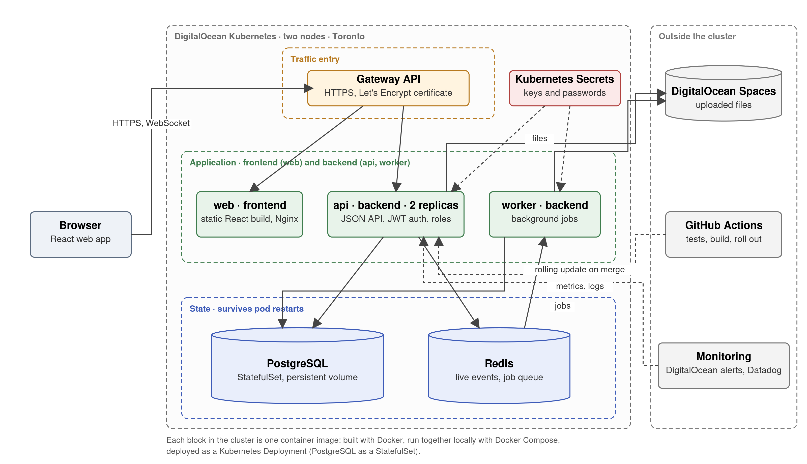

# ContentCollab

Upload a document, share it with the right people, and review it together: comments, annotations and mentions that show up live for everyone looking at the same version.

Team project for ECE1779 Introduction to Cloud Computing, University of Toronto, Fall 2026.

**Status, 31 October:** proposal sections 2, 3 and 4 open as pull requests ([#31](https://github.com/nabeegh-khan/contentcollab/pull/31), [#34](https://github.com/nabeegh-khan/contentcollab/pull/34), [#33](https://github.com/nabeegh-khan/contentcollab/pull/33)), due 7 November; API contract on main ([docs/API.md](docs/API.md)); Kubernetes manifests with minikube and DigitalOcean overlays run on minikube with the restart test passed ([#35](https://github.com/nabeegh-khan/contentcollab/pull/35), [#52](https://github.com/nabeegh-khan/contentcollab/issues/52)); `/metrics` ([#57](https://github.com/nabeegh-khan/contentcollab/pull/57)) and the worker skeleton ([#58](https://github.com/nabeegh-khan/contentcollab/pull/58)) in review; one Issue per piece of work in every slice (#37 to #55). Minutes in [docs/meetings/](docs/meetings/).

## Architecture



Solid lines carry application traffic; dashed lines are configuration, deployment and monitoring. Source: [docs/img/architecture.svg](docs/img/architecture.svg).

Decisions and trade-offs: [docs/ARCHITECTURE.md](docs/ARCHITECTURE.md).

## Team

| Name | Student number | Email | GitHub |
|------|----------------|-------|--------|
| Milton Wang | 1009114192 | milt.wang@mail.utoronto.ca | [@MWang-max](https://github.com/MWang-max) |
| Jyotiraditya Kale | 1013397370 | jyotiraditya.kale@mail.utoronto.ca | [@Jyotiraditya7](https://github.com/Jyotiraditya7) |
| Yiqing Liu | 1008052580 | eyrika.liu@mail.utoronto.ca | [@Oct31yrika](https://github.com/Oct31yrika) |
| Nabeegh Khan | 1001388152 | nabeegh.khan@mail.utoronto.ca | [@nabeegh-khan](https://github.com/nabeegh-khan) |

## What it does

A review workspace for any file a team has to sign off on. Members are invited by email as Owner, Reviewer or Viewer, and outside reviewers get an expiring link. PDFs and images render in the browser; Word, Excel and PowerPoint files are converted to PDF by the worker for read-only review, with the original kept for download; text, Markdown and code render with line numbers. Collaborators leave threaded comments and pins on a page position or a line, @-mention each other, and mark a version Approved or Changes requested. Each upload becomes a new version, the changes from the previous one are highlighted, and any version can be restored. Everyone viewing the same version sees new comments without refreshing.

This is a review tool, not an editor. Live text editing and track changes are out of scope; the reasons are in [docs/ARCHITECTURE.md](docs/ARCHITECTURE.md), decision D3.

## Stack

| Layer | Choice |
|-------|--------|
| API | Node.js, Express, Socket.IO, in Docker |
| Data | PostgreSQL on a DigitalOcean Volume (persistent storage); Redis for Socket.IO across replicas |
| Files | DigitalOcean Spaces (S3-compatible object storage) |
| Orchestration | DigitalOcean Kubernetes: Deployments, Services, a StatefulSet for PostgreSQL, HorizontalPodAutoscaler; one Kustomize base with minikube and DigitalOcean overlays ([k8s/](k8s/)) |
| Frontend | small React app served as static files by its own container |
| Background jobs | worker container on a Redis queue (BullMQ): Office-to-PDF conversion, bulk imports, thumbnails, version comparison |
| Local development | Docker Compose |
| Monitoring | DigitalOcean metrics and alerts; `/metrics` on the API (Prometheus format), collected with container logs by Datadog |
| CI/CD | GitHub Actions: lint and test on every pull request, build and deploy on merge to `main` |

Advanced features promised in the proposal: security (sign-in, roles, HTTPS, secrets) and CI/CD. Planned extension: auto-scaling and high availability. Everything else on the board is for the final report, not the proposal.

## Timeline

Course deadlines are 11:59pm Toronto with no late submissions. The windows are what we work in.

| Window | What happens | Course deadline |
|--------|--------------|-----------------|
| 17 Oct to 24 Oct | architecture and plan agreed; API contract; team formation on Quercus | team formation, Sat 24 Oct |
| 19 Oct to 1 Nov | skeleton: Compose stack, schema and first migration, health endpoint, CI on pull requests, manifests on minikube | Assignment 3, Sat 31 Oct |
| 26 Oct to 7 Nov | proposal written from the architecture docs; core features under way | **proposal, Sat 7 Nov (15%)** |
| 2 Nov to 14 Nov | cloud: DOKS cluster, TLS, PostgreSQL on a volume with the restart test, autoscaling, alerts, deploy on merge | |
| 9 Nov to 20 Nov | real-time, additive features, integration checkpoints Sat 14 and Fri 20 Nov; new features stop Sat 21 Nov | health check, Mon 16 Nov; Assignment 4, Sat 21 Nov |
| 23 Nov to 24 Nov | project introduction, slides, two demo rehearsals | introduction Mon 23 Nov; slides Tue 24 Nov |
| 25 Nov and 2 Dec | presentations, 6 minutes plus Q&A, live demo required | **presentation (10%)** |
| 25 Nov to 5 Dec | README report, `ai-session.md`, video, deployment left running | **final deliverable, Sat 5 Dec (35%)** |

## Repository layout

```
api/                 the JSON API (Express, Socket.IO); routes, middleware, services, db, tests
web/                 the small React frontend, served as static files by its own container
worker/              background jobs on a Redis queue: imports, thumbnails, backup trigger
k8s/                 Kubernetes manifests, with minikube and DigitalOcean overlays
scripts/             cluster, volume, migration, backup and smoke-test scripts
tests/               cross-service checks: restart, scale, end-to-end smoke
.github/workflows/   CI on pull requests, deploy on merge to main
docs/
  ARCHITECTURE.md    decisions with the options weighed; the source for proposal section 2
  PLAN.md            stages, owners, integration, risks; the source for proposal section 3
  PRACTICES.md       the engineering practices we hold to, with their course sources
  PROPOSAL.md        the proposal, one section per owner, due 7 Nov
  API.md             the endpoint contract (written before feature work starts)
  meetings/          one file per team meeting, YYYY-MM-DD.md
.env.example         environment variable template; copy to .env, which is never committed
```

Each folder has a README saying what goes in it, its planned layout, and the practices that apply there. `compose.yaml` lands with the skeleton.

## How we work

- One Issue per task, assigned to whoever takes it. Issues live on the [project board](https://github.com/users/nabeegh-khan/projects/2) (Backlog, Ready, In progress, In review, Done); new issues land in Backlog on their own, assigned ones move to Ready, a pull request that says `Closes #n` moves #n to In progress, and closed ones move to Done.
- Reviews: the reviewer is the teammate whose area the change touches, so reviews spread across the team instead of landing on one person. Every request carries a review-by date three to four calendar days out, the same rule for everyone. Anything tied to a course deadline is reviewed at least a week before it.
- Code: one branch per Issue (`feature/`, `fix/`, `ci/`), one pull request per branch with `Closes #<n>`, one review from a teammate, squash and merge. Keep them small.
- Documentation goes straight to `main`; it does not need a pull request.
- Commits: `<type>(<scope>): <summary>` in the imperative, under 50 characters. Types: `feat`, `fix`, `docs`, `refactor`, `chore`, `ci`.
- Every member commits their own work. Individual contribution is 15% of the grade, read from the Git history, pull requests, Issues and reviews, so each of us writes, reviews and discusses on GitHub under our own account.
- Meeting notes go in `docs/meetings/` the same day.
- AI use is logged in `ai-session.md`, as the course requires.

## Local setup

Clone, copy `.env.example` to `.env`, then `docker compose up --build`; the API answers at `http://localhost:3000/health`. The Kubernetes manifests run on minikube with `kubectl apply -k k8s/minikube` ([k8s/README.md](k8s/README.md), on #35 until it merges).
