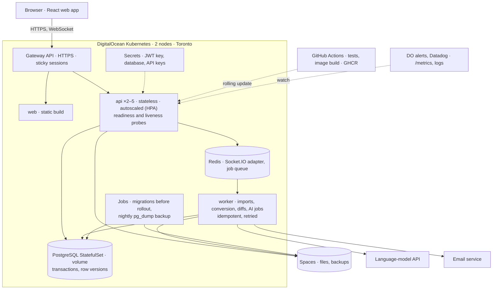

# Architecture

Working draft for the 7 November proposal, section 2 (objectives, architecture and key features). Each decision records the options weighed and the reason for the choice. Items marked **proposed** are confirmed or changed at the team meeting; to change anything here, edit the file on `main` or open an Issue with the alternative and its trade-off.

## Objective

A stateful, cloud-native content review platform. A user uploads a document, PDF or image, shares it with named collaborators or by a scoped link, and the collaborators comment and annotate on it, with updates appearing live for everyone viewing the same version. Every required course technology is used by a real part of the system.

## System diagram

## Decisions

### D11. Traffic entry: Gateway API, not ingress-nginx (proposed)

ingress-nginx was retired in March 2026 and gets no security fixes, so we do not use it. The Gateway API is its supported replacement: a Gateway terminates TLS (cert-manager, Let's Encrypt) and HTTPRoutes send `/api` and `/socket.io` to the API and everything else to `web`. Cost: new objects to learn. Fallback: a DigitalOcean load balancer with its own certificate, which is simpler but needs a second load balancer or a proxy for path routing. Details in [RESEARCH.md](RESEARCH.md).

### D12. Socket.IO across replicas (decided 24 October, #17)

Sticky sessions at the Gateway keep each client on one API pod, so Socket.IO keeps its HTTP long-polling fallback when a WebSocket connection fails; the Redis adapter carries broadcasts between pods. WebSocket-only transport is the fallback if the Gateway controller cannot provide session affinity. Affinity comes from NGINX Gateway Fabric 2.8's cookie session persistence (open source since 2.8, an experimental Gateway API field, per the [NGF 2.8 release blog](https://blog.nginx.org/blog/nginx-gateway-fabric-2-8-ip-allow-and-deny-lists-passive-health-checks-and-cookie-based-session-persistence), checked 6 November 2026) or from `ip_hash` in an UpstreamSettingsPolicy, which needs the DigitalOcean load balancer to pass the client IP: the default network load balancer (DOKS 1.33.1 and later) preserves it, while an HTTP load balancer needs PROXY protocol ([DigitalOcean load balancer docs](https://docs.digitalocean.com/products/kubernetes/how-to/configure-load-balancers/), checked 6 November 2026); if neither works, WebSocket-only. The Gateway's idle timeout is set above Socket.IO's 45 seconds.

### D13. Cluster bring-up and the CI credential (decided 11 November, #54)

`scripts/cluster-up.sh` builds the cluster from nothing and repairs or upgrades a running one; every step can be re-run. Before it changes anything it checks its tools, that doctl is signed in, and that each variable is present and well formed; `DRY_RUN=1` runs those checks and prints each change instead of making it. A dry run changes nothing in DigitalOcean or the cluster, but against an existing cluster it still saves the cluster's credentials to the local kubeconfig (and selects that context) so it can read what is installed, and it runs `git fetch` when `IMAGE_TAG` is not set. It creates the cluster only when `doctl kubernetes cluster list` does not show it, so a failed sign-in can never be read as "no cluster".

Versions, checked 11 November 2026 against each project's own pages:

| Component | Pinned | Why this one |
|---|---|---|
| Kubernetes, new clusters | newest `1.36.x` DOKS offers | cert-manager 1.21 supports Kubernetes 1.33 to 1.36; DOKS offers 1.34 to 1.37, and `doctl kubernetes cluster create` defaults to `latest` (doctl 2.1.0 help), so an unpinned create lands outside that range |
| NGINX Gateway Fabric | 2.8.1 (3 November) | latest release; its Helm chart needs Kubernetes 1.32 or later |
| Gateway API CRDs | 1.6.3, standard channel | the bundle NGINX Gateway Fabric 2.8.1 ships, installed from its own `config/crd` path |
| cert-manager | v1.21.3 (23 October) | 1.19, installed on 4 November, reached end of life on 8 July 2026; 1.21 and 1.20 are the supported releases |

cert-manager is upgraded one minor version at a time, as its upgrade guide recommends, so the running cluster moves 1.19.2, then 1.20.5, then 1.21.3. Gateway API support is switched on with `enableGatewayAPI` up to 1.20 and `gatewayAPI.enabled` from 1.21, where the old field is deprecated but still read. The running cluster was created on 4 November at 1.37.0, one minor version above cert-manager 1.21's supported range. It is kept: rebuilding it at 1.36 means a new load balancer address, a DNS change and a new certificate, and that is a decision for the cluster owner, not the script.

CI credential: the deploy workflow holds a `DIGITALOCEAN_ACCESS_TOKEN` repository secret and asks doctl for a kubeconfig that expires after 600 seconds, DigitalOcean's documented push-to-deploy pattern. This beat storing the kubeconfig itself as a `KUBECONFIG` secret, which #54 first described: a saved kubeconfig carries a revocable token, and DigitalOcean's documentation states no expiry for it, and it would have to be replaced every time the cluster is rebuilt. The cost is that the access token reaches more of the account than the cluster, so it is the one secret to revoke first if it leaks. The script checks that the secret exists and prints the `gh secret set` command when it does not; the token is typed by the cluster owner and never written to a file.

Certificate: Let's Encrypt can issue the certificate only once `contentcollab.app` resolves to the Gateway's load balancer. The script checks this by connecting to the domain and comparing the address it reached with the Gateway's. When they differ, it prints the A record to set and stops without an error, because there is nothing to wait for yet. When they match, it waits for the certificate (`CERT_TIMEOUT`, 5 minutes by default) and on failure prints the certificate, order and challenge status and exits 1.

Sources, checked 11 November 2026: [NGINX Gateway Fabric Helm install](https://docs.nginx.com/nginx-gateway-fabric/install/helm/) and [releases](https://github.com/nginx/nginx-gateway-fabric/releases); [cert-manager supported releases](https://cert-manager.io/docs/releases/), [upgrading](https://cert-manager.io/docs/installation/upgrade/), [Gateway API usage](https://cert-manager.io/docs/usage/gateway/), [releases](https://github.com/cert-manager/cert-manager/releases) and `pkg/apis/config/controller/v1alpha1/types.go` at v1.20.5 and v1.21.3; [DigitalOcean: connect to a cluster](https://docs.digitalocean.com/products/kubernetes/how-to/connect-to-cluster/) and [push-to-deploy with GitHub Actions](https://docs.digitalocean.com/products/kubernetes/how-to/deploy-using-github-actions/); `doctl kubernetes options versions` (doctl 2.1.0); [kubectl wait](https://kubernetes.io/docs/reference/kubectl/generated/kubectl_wait/).

### D14. Scaling and rolling updates that drop no requests (decided 11 November, #69)

What the API already has, in `k8s/base/api.yaml`: an `autoscaling/v2` HorizontalPodAutoscaler (2 to 5 pods, 70% average CPU); a PodDisruptionBudget (`minAvailable: 1`); a rolling update with `maxUnavailable: 0` and `maxSurge: 1`; a readiness probe on `/health`; and a 30-second grace period. What each piece does, from the Kubernetes docs:

- **HPA.** Utilization is measured against the container's CPU request (100m here), so the API scales out when its pods average 70m. The desired count is `ceil(current replicas × current / target)`. The controller checks every 15 seconds and does nothing within 10% of the target. It scales down only to the highest recommendation of the last 5 minutes. On DOKS it needs metrics-server, which `scripts/metrics-server.sh` installs (D5).
- **Rolling update.** `maxUnavailable: 0` keeps every old pod until a new one is ready, and `maxSurge: 1` adds one pod at a time. Both default to 25%, which with two replicas would let a rollout run on one.
- **PDB.** It limits voluntary disruptions that go through the Eviction API, such as `kubectl drain` and node upgrades. Deployments "are not limited by PDBs when doing rolling upgrades", so the rollout's guarantee comes from `maxUnavailable`, not from the PDB.

The gap is shutdown. When a pod is deleted, the kubelet starts stopping it "at the same time as" the control plane removes it from the Service's EndpointSlices. On SIGTERM the API calls `server.close()` and refuses new connections, while kube-proxy and the Gateway may still send it traffic for a moment, so requests can fail even with `maxUnavailable: 0`.

**Decision:** a `preStop` hook that sleeps 10 seconds before SIGTERM. The pod stops being an endpoint while it still serves; the API then finishes its in-flight requests and exits. The hook uses the kubelet's built-in `sleep` handler, stable since Kubernetes 1.34 (on DOKS 1.37 and on new 1.36 clusters, D13), so the image needs no shell. The hook counts against `terminationGracePeriodSeconds`, which stays at 30 s: 10 s of sleep plus the API's shutdown.

Options it beat:
- An `exec` hook running `sleep`: it needs a shell binary in the image and its CPU counts against the container.
- A delay inside the API's SIGTERM handler: that is API code, outside this slice, and it does the same job.

**Where the change lives:** the hook lives in a kustomize component, `k8s/components/graceful-drain`, which both overlays include. `k8s/base/api.yaml` is not edited while #83 changes it; the patch moves into that file after #83 merges.

The web front end gets the same HPA, PDB and hook when its Deployment exists (#47); today there is no `web` Deployment to scale.

**Proof:** shown on a local single-node k3s cluster in Docker before DOKS.
- Under a steady k6 load through the Service, `scripts/rollout-no-drop.sh` runs `kubectl rollout restart` and fails on any non-2xx response or connection error.
- It runs first against the old settings (`maxUnavailable: 1`, no hook), which drop requests, then against the new ones.
- `scripts/hpa-scale.sh` ramps the load and records `kubectl get hpa -w` as the API scales out.
- Results are in BUILD_LOG.md; the DOKS demo steps are in `docs/DEMO_SCALING.md`.

Sources, checked 11 November 2026: [Horizontal Pod Autoscaling](https://kubernetes.io/docs/concepts/workloads/autoscaling/horizontal-pod-autoscale/); [Deployments: max unavailable, max surge](https://kubernetes.io/docs/concepts/workloads/controllers/deployment/); [Disruptions](https://kubernetes.io/docs/concepts/workloads/pods/disruptions/); [Pod lifecycle: termination](https://kubernetes.io/docs/concepts/workloads/pods/pod-lifecycle/); [Container lifecycle hooks](https://kubernetes.io/docs/concepts/containers/container-lifecycle-hooks/); [feature gates](https://kubernetes.io/docs/reference/command-line-tools-reference/feature-gates/) (PodLifecycleSleepAction stable from 1.34). DOKS metrics-server: the DigitalOcean HPA guide as cited in `scripts/metrics-server.sh` (checked 6 November), and read-only `helm list` on the cluster (11 November: metrics-server chart 3.14.0, app 0.9.0, installed).

### D15. What the restart test proves about PostgreSQL's volume, and what it does not (decided 11 November, #68)

The StatefulSet with a `volumeClaimTemplates` claim on `do-block-storage` stays (D2). Persistence is shown by one script, `scripts/restart-test.sh`, that writes a marker row and reads it back after each of four events: the postgres pod is deleted; the `api` Deployment is restarted and the API reads the row through its own connection; PostgreSQL is scaled to 0 and back to 1; and, on DOKS only, the node it runs on is drained. A test that cannot fail proves nothing, so the same script is run first against an `emptyDir` in place of the claim, where it must fail, and then against the real manifest, where it must pass (local cluster in Docker; output in `docs/DEMO_PERSISTENCE.md`).

What the documentation says, checked 11 November 2026: deleting or scaling down a StatefulSet does not delete its volumes, and the `persistentVolumeClaimRetentionPolicy` fields `whenDeleted` and `whenScaled` default to Retain ([StatefulSets](https://kubernetes.io/docs/concepts/workloads/controllers/statefulset/)); a dynamically provisioned volume inherits its StorageClass's reclaim policy, which defaults to Delete, and deleting the claim then deletes the PersistentVolume and the storage behind it ([Persistent Volumes](https://kubernetes.io/docs/concepts/storage/persistent-volumes/)); DigitalOcean's `do-block-storage` is `ReadWriteOnce`, 1 to 10,000 GB, can grow but never shrink, and billing stops only when the volume itself is deleted ([add volumes](https://docs.digitalocean.com/products/kubernetes/how-to/add-volumes/), last verified 12 August 2026); snapshots are `VolumeSnapshot` objects ([create snapshots](https://docs.digitalocean.com/products/kubernetes/how-to/create-snapshots/), last verified 12 August 2026). Read-only on the running cluster (Kubernetes v1.37.0): the storage classes are `do-block-storage` and `do-block-storage-xfs` (reclaim Delete) and `do-block-storage-retain` and `do-block-storage-xfs-retain` (reclaim Retain); there is a `VolumeSnapshotClass` named `do-block-storage`; the claim `data-postgres-0` is 5 GiB on `do-block-storage`; its volume's reclaim policy is Delete; the StatefulSet's retention policy is Retain and Retain.

Consequence: the data survives the pod, the node, the StatefulSet and the API, and does not survive deleting the claim, the namespace or the cluster, because the volume is then deleted with it. This is the gap the test cannot close. Options: (a) put the claim on `do-block-storage-retain` in the `doks` overlay (a claim's class cannot be changed in place, so it applies at the next rebuild); (b) patch the existing volume to Retain, which needs no rebuild and can be undone ([change the reclaim policy](https://kubernetes.io/docs/tasks/administer-cluster/change-pv-reclaim-policy/)); (c) a backup. Recommended: (b) now, a one-line change made by the cluster owner (it writes to the live cluster, so it is not done here), and (a) at the next rebuild. Neither is a backup: a volume is not a backup (DB-3), and a deleted database, a bad migration or a dropped table is on the volume too. The backup is the nightly `pg_dump` to Spaces (D5, Milton, a stretch goal) or a `VolumeSnapshot` of the claim; neither exists yet and the demo says so.

Not claimed: that a drain brings the pod back on the other node with its data (that is what the DOKS run shows), that a snapshot is consistent while PostgreSQL is writing, or anything about zone or region failure.

### D16. Request logs and the error rate per endpoint (decided 11 November, #55)

**Decision.** The API writes one JSON line per request to standard output, and the request counters carry a bounded label set, so Datadog can search one request by its ID and show the share of 5xx responses per route.

Log line: `timestamp` (ISO 8601 UTC), `level` (`debug`, `info`, `warn` or `error`), `msg`, `http.request_id`, `http.method`, `http.route`, `http.status_code` and `duration_ms`; a failed request adds `error.kind` and, for a server error, `error.message` and `error.stack` (a 4xx error logs its kind only, because a JSON parse error quotes the rejected body). The level follows the status: `error` for 5xx, `warn` for 4xx, `info` otherwise; a successful `/health` or `/metrics` request is `debug`, so the readiness probe (one request every 5 seconds per pod) stays out of the logs at the default `LOG_LEVEL=info`. The route is the matched template (`/documents/:documentId`), never the raw path, and nothing from headers, cookies, query strings or bodies is logged, because the planned share-link route carries a token in its path or query. The request ID is the incoming `X-Request-Id` when it matches `[A-Za-z0-9._-]{1,128}`, otherwise a new UUID, and it is returned in the `X-Request-Id` response header, so a request seen in the browser is found in the log by that value.

Key names follow Datadog, checked 11 November 2026: a JSON log's date comes from `timestamp` (not `time`), its message from `message` or `msg`, and its status from `level`; `status` is a reserved attribute for the log severity, so an HTTP status code under that name would be read as a severity, and the standard attributes are `http.request_id`, `http.method`, `http.route` and `http.status_code` ([Attributes and aliasing](https://docs.datadoghq.com/logs/log_configuration/attributes_naming_convention/), [Pipelines, JSON preprocessing](https://docs.datadoghq.com/logs/log_configuration/pipelines/), [Standard attributes](https://docs.datadoghq.com/standard-attributes/)). The standard `duration` is in nanoseconds; the log keeps `duration_ms`, which is mapped with a remapper in the Datadog log pipeline (not in the repository).

Metrics: `http_requests_total` and `http_errors_total` have the labels `method`, `route` and `status_class` (`2xx` to `5xx`), and `http_request_duration_seconds` keeps `method` and `route`. The route label is the template, or `unmatched` when no route matched, so the number of series is the number of routes times a handful of methods and five classes, whatever clients send. The OpenMetrics check turns the counter into `contentcollab.http_requests.count` (counter names are given without `_total`, and the check appends `.count`; [OpenMetrics integration](https://docs.datadoghq.com/integrations/openmetrics/), checked 11 November 2026), and the labels become tags.

Datadog files, committed to be imported by hand, never applied with an API key from a script: `k8s/doks/datadog/dashboard.json` (request rate, 5xx share, average latency and the request log per route) and `k8s/doks/datadog/monitor-error-rate.json` (the 5xx share per route over five minutes above 2%, the threshold in the failure table below, with a warning at 1%). The dashboard import overwrites the dashboard it is pasted into ([Configure dashboards](https://docs.datadoghq.com/dashboards/configure/)); the monitor uses the `query alert` type with the ratio of two `as_count()` queries, the form of Datadog's own error-rate example ([non-static thresholds guide](https://docs.datadoghq.com/monitors/guide/non_static_thresholds/)).

**Option it beat: pino and pino-http.** They provide request-ID generation (`genReqId`), per-request levels (`customLogLevel`), serializers and redaction ([pino-http README](https://github.com/pinojs/pino-http), checked 11 November 2026), and they would be the choice for a larger service. Here they add two dependencies, and so changes to `api/package.json` and the lockfile, which the open schema and storage pull requests also change; the log has a fixed set of fields and never touches headers or bodies, so there is nothing to redact; and pino's defaults (numeric levels, `time` in milliseconds) would still need formatters to fit Datadog. The cost of the choice is about sixty lines of our own code and no transports; the key names are fixed, so replacing the writer with pino later changes no dashboard or monitor.

**Limits.** Latency is shown as an average (`.sum` divided by `.count`): a p95 needs the histogram buckets submitted as distributions, which is a change to the check's annotation in `k8s/base/api.yaml`, not part of this change. The route label has two more limits: a router mounted on a path with a parameter would put the parameter's value in the label, so routers are mounted on literal paths and parameters stay in the route; and a route that calls `next()` and falls through to the 404 handler keeps its own label. A request the client abandons before the response is complete is written as one `request aborted` line (level `warn`) and is not counted in the metrics. The agent is not installed on the cluster yet (#27), so the metric names, the tags and the log parsing are checked against the documentation and by tests on the API, not against a running Datadog.

### D18. Monitoring that fits two 2 GB nodes: provider metrics and alerts, `/metrics`, JSON logs; no agent in the cluster (decided 11 November, #55)

Supersedes the agent part of D17 and D6. D17's reasoning (one stack, no extra cost, Datadog over Prometheus and Grafana) stands; what changes is that the Datadog agent is not installed, because it does not fit.

**What the course requires.** The handout lists monitoring as required for all projects, not as an advanced feature: "Integrate monitoring using provider tools (e.g., DigitalOcean metrics/alerts for CPU, memory, disk ...)" and "Set up basic alerts or dashboards for key metrics" ([project handout](https://www.eecg.utoronto.ca/~cying/courses/ece1779-cloud/project/handout/), read 11 November 2026). The provider tools alone meet it.

**What the cluster has left.** Measured on the running cluster on 11 November 2026 at 18:37 UTC (two s-2vcpu-2gb nodes, 1,464.6 MiB allocatable each, 2,929 MiB in all; `kubectl describe nodes`, `kubectl top`). The rebuild without the high-availability control plane (COST_PLAN) keeps the same node size and the same pods, so these numbers are expected to carry over; they are re-measured with `scripts/memory-headroom.mjs` once the rebuilt cluster is up.

| | Node A | Node B | Both |
|---|---|---|---|
| Memory requested by pods | 974 MiB (66%) | 1,166 MiB (79%) | 2,140 MiB |
| Unrequested | 490.6 MiB | 298.6 MiB | 789 MiB |
| In use now | 1,217 MiB (83%) | 1,126 MiB (76%) | 2,343 MiB |
| Not in use now | 247.6 MiB | 338.6 MiB | 586 MiB |

The autoscaler is allowed five API pods (128 MiB requested each, about 138 MiB in use each). Three more pods take 384 MiB of requests and about 414 MiB of real memory, so with the API at its maximum **405 MiB are unrequested and about 172 MiB are not in use**. On 6 November a node reached 93% memory with five pods and the load test stops at 95% (LOG), so that margin is real. Cilium alone uses about 410 MiB on each node and cannot be reduced here.

**Options.**

| | Requests | Fits with the API at five pods? |
|---|---|---|
| (c) Datadog agent and cluster agent (D6) | 768 MiB | No: 405 MiB unrequested. A third node (about US$0.73 a day with tax, COST_PLAN) would be needed. Halving the requests to 384 MiB leaves 21 MiB of requests and none of the real memory. Datadog's own Kubernetes example gives the Agent container a 256 MiB request, and it warns that a 100 MiB limit may lead it to be killed for memory ([Kubernetes distributions](https://docs.datadoghq.com/containers/kubernetes/distributions/), read 11 November 2026), so going lower is outside what the vendor shows. |
| (b) One Prometheus pod with short retention, and Grafana | about 192 to 384 MiB (an estimate: Prometheus 128 to 256 MiB, Grafana 64 to 128 MiB; the official pages give no memory figure per series, only the retention flags `--storage.tsdb.retention.time` and `--storage.tsdb.retention.size`, [Storage](https://prometheus.io/docs/prometheus/latest/storage/), read 11 November 2026) | Not with room to spare. The requests fit 405 MiB only at the low end, and the 172 MiB of real memory left at five API pods is less than either pod would use. `/metrics` has 153 series, so the data is small; the baseline of the two processes is the cost. |
| (a) DigitalOcean metrics and alerts, `/metrics` shown live, JSON logs through `kubectl logs`, no agent | 0 | Yes |

**Decision: (a).** It meets the handout, costs nothing, and leaves the memory to the HPA.

- **Provider dashboards:** the cluster's Insights tab shows CPU usage, load average, memory, disk and disk I/O for the cluster, the node pool and each node, from the DigitalOcean metrics agent that every DOKS cluster runs ([basic metrics](https://docs.digitalocean.com/products/kubernetes/how-to/monitor-basic/), read 11 November 2026). Its memory graph leaves out reclaimable memory, so it reads lower than `kubectl top` ([autoscaling guide](https://docs.digitalocean.com/products/kubernetes/how-to/set-up-autoscaling/), read 11 November 2026).
- **Provider alerts:** policies for CPU, memory and disk above 80% for five minutes, assigned by the cluster's tag (worker nodes are recycled, so the docs recommend tags), created by `scripts/alerts.sh` (#62). Resource alerts are free ([manage resource alerts](https://docs.digitalocean.com/products/monitoring/how-to/manage-resource-alerts/), [features](https://docs.digitalocean.com/products/monitoring/details/features/), read 11 November 2026).
- **Application metrics:** `/metrics` (D16: `method`, `route` and `status_class` labels, 153 series) read live through a port-forward; the Gateway never routes it.
- **Logs:** the JSON request log (D16) through `kubectl logs`, with the request ID followed from the browser's `X-Request-Id` header to its line.
- **Error rate per endpoint:** `scripts/error-rate.mjs` reads the request log and prints the 5xx share per route over the window, exiting 1 above 2% (the threshold in the failure table), with a minimum request count so one failure on a quiet route does not alert. Stopping Redis makes it fail within the window. This is the "monitor firing" of the demo; it is run by hand, not by an agent.
- **Kept, not installed:** the Datadog dashboard and monitor files (`k8s/doks/datadog/`, validated against Datadog's schemas), the agent values (`k8s/doks/datadog-values.yaml`) and the optional install step in `scripts/cluster-up.sh` (skipped without `DATADOG_API_KEY`). They are used only if a third node is ever added; nothing in the demo depends on them.

**What is given up.** No history beyond the provider's retention and the pods' own logs (a pod's log is gone with the pod); no alert on the application's error rate that sends a message; no p95 latency graph. The first is accepted for a project that runs for weeks, the second is covered by running the error-rate check by hand in the demo, and the third was already out of reach (D16). If the rubric credits an alert on an application metric, the next step is not an agent: `scripts/error-rate.mjs` can run in a CronJob that mails or posts to a webhook, a small pod that exists only while it runs; that is not built and its memory is not measured.

**Not claimed.** That the rebuilt cluster has the same headroom (re-measured after the rebuild); that Insights shows what `kubectl top` shows; any Datadog result, since the agent was never installed.

### D0. Service model

Lecture 1 splits cloud services into IaaS (you manage the OS), PaaS (the provider manages the hosts, you ship containers or code) and FaaS (functions run on events). Assignment 1 was IaaS: a droplet, Nginx, PostgreSQL installed by hand. The project is not that. We use managed Kubernetes, where DigitalOcean runs the control plane and the worker nodes' OS and we run containers (PaaS-style on top of the provider's IaaS), object storage as a service for files, and the provider's metrics and alerts. A DigitalOcean Function is an option for one small event-driven job (a thumbnail when a file lands in Spaces) if we want the serverless advanced feature; it is not in the core path. The point for the proposal: we manage containers and data, not machines.

### D1. Orchestration: DigitalOcean Kubernetes (proposed)

The course accepts Docker Swarm (service replication and routing-mesh load balancing, lecture 6) or Kubernetes (Deployments, Services, PersistentVolumeClaims, minikube locally then a managed cluster).

| | Kubernetes (DOKS) | Docker Swarm |
|---|---|---|
| Replication and load balancing | Deployment replicas behind a Service; a Gateway terminates TLS and routes by path | service replicas behind the routing mesh; TLS needs a separate proxy service |
| Scaling | HorizontalPodAutoscaler scales replicas on CPU or memory; two worker nodes give node-level redundancy | manual `docker service scale`; no autoscaler |
| Rolling updates and recovery | rolling update with readiness probes, `rollout undo`, failed pods replaced by the controller | rolling update per service, `--rollback`, failed tasks replaced by the manager |
| Persistent storage | PersistentVolumeClaim bound to a DigitalOcean block-storage volume; the volume follows the pod if it is rescheduled within the zone | a named volume lives on one node; the service must be pinned to that node |
| Secrets and config | Secret and ConfigMap objects mounted as files or env | Docker secrets mounted as files (lecture 5) |
| Operations cost | manifests for every object, kubectl, a managed control plane; more to learn and more to misconfigure (a wrong storage class loses data) | one Compose file with a `deploy:` section; fewer concepts |
| Cost (DigitalOcean pricing pages, checked 4 Nov 2026) | about US$54 a month: two s-2vcpu-2gb nodes at $18, a $12 load balancer, a 5 GiB volume at $0.50, Spaces at $5; control plane free | two $6 droplets |

Proposed: **DOKS**. The deciding points are the autoscaler and the volume handling: auto-scaling and high availability is one of our committed advanced features, and on Swarm the database volume ties the service to one node by hand. The cost is the learning curve and more objects to get right, which is why the manifests are tested on minikube first and Swarm remains the fallback: the same Compose file with a `deploy:` section would carry the stack if the cluster is not stable by 15 November.

**Why not Fly.io.** The course allows DigitalOcean or Fly.io. Fly.io gives edge regions and machines without managing hosts (lecture 6, Assignment 3), but its Kubernetes service is a paid beta the course does not recommend, and one system across two providers is two sets of operations for no gain. Assignment 3 covers Fly.io; the project stays on one provider.

### D2. Persistence: PostgreSQL on a DigitalOcean Volume, files in Spaces

A managed database alone does not count as persistent storage in this course, so PostgreSQL runs in the cluster as a StatefulSet with a PersistentVolumeClaim backed by DigitalOcean block storage. Uploaded files do not go on that volume: with several API replicas, a file written to one pod's disk is invisible to the others. Spaces is S3-compatible object storage reachable from every replica; the API streams the upload to Spaces and keeps the metadata row (owner, version, size, checksum, object key) in PostgreSQL. The restart test for the presentation: delete the postgres pod, the PVC re-attaches, the data is still there.

Schema, first cut: `users`, `documents`, `document_versions` (one row per upload, object key in Spaces), `shares` (document, user or link token, role, expiry), `comments` (document version, anchor, author, body, parent for threads), `tags`, `document_tags`. Roles are Owner, Editor, Commenter and Viewer (28 October, proposal section 2), enforced by one middleware that loads the share row for the current user and document before any handler runs.

### D3. What "collaboration" means here

Content is the uploaded file (manual upload, or a bulk import from a bucket the team already has: D9). PDFs and images render in the browser; other types (docx, spreadsheets) are stored, versioned and downloadable but not rendered. Collaboration is review: threaded comments, annotation pins anchored to a page and position, @-mentions, and a new version uploaded when the content changes, with the version history and revert.

Live co-editing of document text, or a track-changes mode, is a different product. It needs a CRDT or operational-transform engine (Yjs is the usual library) and an editor, and track changes is harder still because every change becomes a reviewable object. A collaborator in another time zone is served by versions, comment threads and notifications. If the team wants live text editing later, it is one more feature on top of this architecture, not a change to it; it is not promised.

### D4. Real-time: Socket.IO with a Redis adapter

New comments, replies, annotation pins and mentions appear for everyone viewing the same document version without a refresh. With replicated API pods, an event received by pod A must reach a user connected to pod B; the Socket.IO Redis adapter does that through Redis pub/sub, which is why Redis is in the stack. See D12 for routing across replicas.

### D5. Advanced features: four committed, two stretch (revised 6 November)

The proposal commits to four features, each with an owner: security (Eyrika, Nabeegh), CI/CD (Nabeegh, running), real-time (Jyotiraditya) and auto-scaling with high availability (Nabeegh, load test #69). On 6 November real-time and auto-scaling moved from planned to committed: the HPA is already in `k8s/base`, the cluster has run since 4 November, and #69 holds the test. Backup and external email stay stretch goals because they are additive and off the demo path.

1. **Security**: email and password sign-in with bcrypt-hashed passwords, JWT sessions, role checks per route, share links with a token and an expiry, HTTPS from cert-manager and Let's Encrypt at the Gateway on `contentcollab.app` (registered 17 October through the GitHub Student Developer Pack, name.com, first year free), credentials in Kubernetes Secrets (the Docker secrets pattern from lecture 5), never in the image or the repo.
2. **CI/CD**: GitHub Actions. On every pull request: lint, typecheck, Jest and Supertest against a PostgreSQL service container. On merge to `main`: build the image, push to the GitHub Container Registry, `kubectl set image` and wait for the rollout. The pipeline is what makes the deployment reproducible for the grader.

3. **Real-time** (D4).
4. **Auto-scaling and high availability**: HorizontalPodAutoscaler on CPU, two worker nodes, readiness and liveness probes, a PodDisruptionBudget, a rolling update shown live. The API pods spread across nodes by a topology spread constraint on `kubernetes.io/hostname` with `maxSkew: 1` and `whenUnsatisfiable: ScheduleAnyway`, counting each rollout revision on its own (`matchLabelKeys: [pod-template-hash]`); without it nothing spreads them, because the scheduler's default spread (hostname and zone) does not score nodes missing either label, and DOKS nodes carry no `topology.kubernetes.io/zone` label (`kubectl get nodes`, 6 November 2026). It beat required pod anti-affinity, which allows one API pod per node and would leave the autoscaler's third to fifth replicas, and the surge pod of a rolling update, Pending on two nodes. ScheduleAnyway rather than DoNotSchedule because a drained or lost node still counts as a domain with no API pods, so a hard rule would leave replacement pods Pending; spreading is not rebalanced after a scale-down ([Pod Topology Spread Constraints](https://kubernetes.io/docs/concepts/scheduling-eviction/topology-spread-constraints/), checked 6 November 2026; #69). The HPA reads CPU from the resource metrics API, which DOKS does not provide until metrics-server is installed ([DigitalOcean HPA guide](https://docs.digitalocean.com/products/kubernetes/how-to/set-up-autoscaling/), checked 6 November 2026); on 6 November the HPA showed `cpu: <unknown>/70%` and could not scale. `scripts/metrics-server.sh` installs the upstream chart pinned at 3.14.0 (metrics-server 0.9.0) with two replicas and kubelet TLS verified, as DigitalOcean's own Marketplace stack does, rather than the Marketplace 1-Click, which is a dashboard click and unpinned. The load test refuses to start while the HPA cannot read CPU, so a result without scaling cannot be mistaken for a scaling limit.

Stretch goals, presented as completed only if they are:

5. **Backup and recovery** (Milton): a Kubernetes CronJob runs `pg_dump` nightly to Spaces; a restore is rehearsed once and documented.
6. **External services** (Eyrika): email on share and on @-mention through a transactional email API.

### D6. Monitoring

**The Datadog agent described here is not installed: see D18.**

DigitalOcean droplet and cluster metrics with alert policies (CPU, memory, disk at 80%) are mandatory and free. The API exposes `/metrics` with `prom-client` (request count, latency histogram, error count, and the Node.js process defaults; upload bytes and connected sockets are not exported yet). Datadog collects those metrics, the container logs of the `contentcollab` namespace (not cert-manager, the gateway or kube-system, decided 10 November) and the Kubernetes state (restarts, pending pods, autoscaler replicas) through its agent, and holds the dashboard (#27, decided 8 November; the proposal's monitoring row already named it). It beat Prometheus and Grafana in the cluster, the handout's optional route: the account came with the GitHub Student Developer Pack (24 October minutes), logs outlive the pod that wrote them, and the two small nodes carry one agent each plus one cluster agent, instead of a metrics store and a dashboard server. The chart's operator, service discovery and APM containers are switched off. The cost is a vendor account, an API key kept outside the repository, and 400m CPU and 768 MiB of memory requested (agent 100m and 256 MiB on each node, cluster agent 200m and 256 MiB), against 2 GiB allocatable to pods on the two nodes (BUILD_LOG.md, 8 November). `scripts/cluster-up.sh` installs the agent last, from the chart pinned there, after checking the key against the account's Datadog site. The API pods are scraped by an autodiscovery annotation in `k8s/base/api.yaml`. The presentation shows one alert firing and one dashboard.

### D7. Local development

One `compose.yaml` runs api, web, worker, postgres and redis locally with healthchecks and `depends_on`, as in Assignment 2. Kubernetes manifests live in `k8s/` and are tested on minikube before DOKS. `.env.example` lists every variable; `.env` is ignored.

### D8. Frontend (proposed: yes, small)

The course does not require a frontend and grades the cloud work, not the interface. We build one anyway because the demo is a user opening a document, leaving a comment and a second browser seeing it appear, and that is hard to show with curl. It stays small: sign-in, document list, upload, document view with comments and pins, share dialog. A React build served as static files by its own `web` container behind the same Gateway, so it scales and deploys like everything else and the API stays a pure JSON service. No server-side rendering, no design system work.

### D9. How content gets in

Two paths, one pipeline.

**Manual upload** is the core: the browser sends the file to the API, the API streams it straight to Spaces (never buffering the whole file in memory), then writes the version row. Size and type limits are enforced before a byte is stored.

**Bulk import** is the answer to "a team already has its documents somewhere": an Owner points ContentCollab at an existing S3-compatible bucket, or at a folder the API can reach, and a `worker` service copies the files in as versions under a chosen collection. The import runs as a background job on a Redis-backed queue (BullMQ), in its own container, so a thousand files cannot stall the API. Each file is identified by a checksum, so running the same import twice adds nothing. Connectors to Google Drive or SharePoint follow the same job shape and are not promised.

This split is what keeps the system standing: the request path does small, bounded work; everything slow or unbounded goes to the worker. The worker has the same database and Spaces access as the API and nothing else.

### D10. What keeps it from falling over

The practices in `docs/PRACTICES.md` that shape the design:

- Every list endpoint paginates with a maximum page size; every input is validated in middleware before a handler sees it; errors have one shape.
- Request bodies and uploads are capped; uploads stream; a rate limit per user applies to writes.
- The API handles `SIGTERM`: it stops accepting connections, finishes in-flight requests and closes the pool, so rolling updates and autoscaling drop nothing.
- Readiness is separate from liveness: a pod gets traffic only once Postgres and Redis answer.
- Every container has CPU and memory requests and limits, so a runaway process cannot starve the node.
- Secrets are mounted, never baked into images; the `web` container holds none.
- The load-bearing pieces are the schema, the API contract in `docs/API.md` and the role middleware. They change only with tests in place and the team told.

## Failure handling and reproducibility (28 October)

The API pods hold no state: every request is answered from PostgreSQL, Redis or Spaces, so any pod can be killed or added without losing data.

| Risk | How we handle it |
|---|---|
| Race conditions (two users save, resolve or restore at once) | Each document row carries a version number; a write that read an older number is rejected with 409 and the client reloads. Unique constraints and transactions keep partial writes out of the database. |
| Duplicate work after a retry | Uploads and worker jobs carry an idempotency key, so a retried request or a job run twice changes nothing. |
| Network partition or a dependency down | Every call has a timeout and retries with backoff. If Redis is unreachable, the API keeps serving and live updates fall back to polling; if PostgreSQL is unreachable, the readiness probe fails and the Gateway stops routing to that pod. On reconnect, clients fetch events newer than the last sequence number they saw. |
| Memory exhaustion | Uploads stream to Spaces and are never held in memory; every container has CPU and memory requests and limits, with Node's heap capped below its container limit. |
| Errors reaching users | One error middleware returns a single JSON shape with a request ID; logs are structured and carry the same ID into Socket.IO events and worker jobs. On shutdown the API finishes in-flight requests before exiting. |
| Silent failure | Alerts by email when the 5xx rate exceeds 2% for five minutes, p95 latency exceeds one second, a pod restarts three times in ten minutes, the job queue keeps growing, disk passes 80%, or the nightly backup fails. |
| A build that runs differently in the cluster | Base images pinned by digest, `npm ci` from the lockfile, multi-stage builds running as a non-root user, and the image tested in CI is the one deployed. Database migrations run as a Kubernetes Job before each rollout. |

## Scope and feasibility

In: upload, versions, revert, share by user or link, roles, comments, annotations, tags, search by tag or title, JSON or CSV export of metadata, live updates. Out: rich-text editing, track changes, formatting, mobile. The 10 October notes listed a Google Docs style editor; this is where the thinking changed, and proposal section 4 says so.

## Open questions for the team

- Confirm D1 (Kubernetes) and D3 (review, not editing).
- DigitalOcean billing: nobody has credit left from Assignment 1; one account hosts the cluster and the cost is split. The GitHub Student Developer Pack no longer includes DigitalOcean credit: the offer ended 31 July 2026 and redeemed credit expired 1 August 2026 ([Capital & Compute, checked 16 September 2026](https://capitalandcompute.net/blog/github-student-developer-pack-2026/)), so the budget in [RESEARCH.md](RESEARCH.md) assumes paid usage from the start.
- PDF annotation in the browser: pdf.js with our own overlay, or pins anchored to page number and coordinates only.

### D17. Monitoring stack reconsidered: Datadog stays, Prometheus and Grafana not added (decided 11 November, #100)

**Superseded in part by D18 (11 November):** the Datadog agent is not installed because it does not fit on the two nodes; the reasoning below for keeping one stack and for Datadog over Prometheus and Grafana stands.

**Question.** At the 11 November design review we asked whether to replace Datadog (D6) with Prometheus and Grafana in the cluster, to have one metrics stack, zero extra cost and Prometheus visible in the demo.

**Decision.** Keep D6. The API stays instrumented in the Prometheus format (`/metrics`, prom-client), Datadog's OpenMetrics check scrapes it, and Datadog holds the dashboard, the error-rate monitor and the container logs. The demo shows the Prometheus endpoint itself (`curl` from inside the cluster) and the same series on the Datadog dashboard. No Prometheus server or Grafana is installed.

**Why, checked 11 November 2026.**
- Cost: Datadog is free for us. The GitHub Student Developer Pack gives a Datadog Pro account for up to 10 hosts for two years ([GitHub Education pack](https://education.github.com/pack), [Datadog student offer](https://www.datadoghq.com/blog/datadog-github-student-developer-pack/)); our two nodes are two hosts. Neither option costs money; replacing Datadog saves nothing.
- Memory: the cluster runs at 74% and 82% memory used on its two s-2vcpu-2gb nodes (`kubectl top nodes`, 11 November). Our Datadog values request 768 MiB in total (D6). The community Prometheus chart sets no requests by default; a sized Prometheus server is typically given 512 MiB and Grafana 128 MiB ([prometheus-community values](https://github.com/prometheus-community/helm-charts/blob/main/charts/prometheus/values.yaml)), plus a volume for the time-series data. The footprints are about the same, so the switch does not relieve the memory limit either.
- Coverage: Datadog gives metrics, Kubernetes state (restarts, pending pods, HPA replicas) and container logs from one agent. Prometheus and Grafana give metrics and dashboards only; logs would need a third component (Loki and an agent), which is more memory, not less. The JSON request logs and per-route error rate in D16 were designed for Datadog's log pipeline on the same day.
- Scope: the handout requires provider metrics and alerts (done with DigitalOcean alert policies, #62) and does not name Prometheus or Grafana; monitoring is a core requirement, not one of the advanced features, so a second stack earns no rubric credit that the first does not.
- Consistency: the submitted proposal names Datadog for dashboards and logs (monitoring row, section 2). Keeping it means no change to explain.

**Option it beat.** Prometheus and Grafana in the cluster (kube-prometheus-stack or the separate charts). It would be fully open source, keep data inside the cluster and avoid a vendor account, and it is the common choice when a team cannot use a SaaS. It would win if the Datadog account were lost or the team needed metrics without internet egress.

**What would change this.** The student account ending or failing to ingest during the 14 November checkpoint; then Prometheus and Grafana replace Datadog using the same `/metrics` endpoint, with no change to the API.
