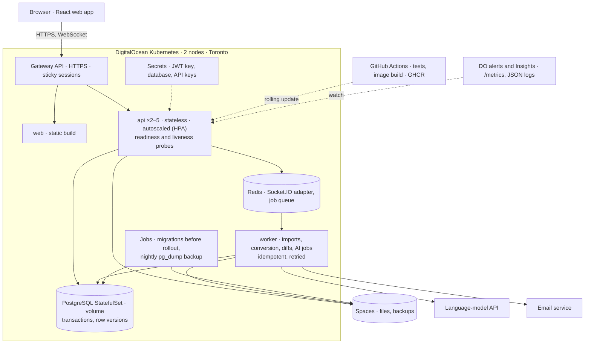

# Architecture

Working draft for the 7 November proposal, section 2 (objectives, architecture and key features). Each decision records the options weighed and the reason for the choice. Items marked **proposed** are confirmed or changed at the team meeting; to change anything here, edit the file on `main` or open an Issue with the alternative and its trade-off.

## Objective

A stateful, cloud-native content review platform. A user uploads a document, PDF or image, shares it with named collaborators or by a scoped link, and the collaborators comment and annotate on it, with updates appearing live for everyone viewing the same version. Every required course technology is used by a real part of the system.

## System diagram



## Decisions

### D11. Traffic entry: Gateway API, not ingress-nginx (proposed)

ingress-nginx was retired in March 2026 and gets no security fixes, so we do not use it. The Gateway API is its supported replacement: a Gateway terminates TLS (cert-manager, Let's Encrypt) and HTTPRoutes send `/api` and `/socket.io` to the API and everything else to `web`. Cost: new objects to learn. Fallback: a DigitalOcean load balancer with its own certificate, which is simpler but needs a second load balancer or a proxy for path routing. Details in [RESEARCH.md](RESEARCH.md).

### D12. Socket.IO across replicas (decided 24 October, #17)

Sticky sessions at the Gateway keep each client on one API pod, so Socket.IO keeps its HTTP long-polling fallback when a WebSocket connection fails; the Redis adapter carries broadcasts between pods. WebSocket-only transport is the fallback if the Gateway controller cannot provide session affinity. Affinity comes from NGINX Gateway Fabric 2.8's cookie session persistence (open source since 2.8, an experimental Gateway API field, per the [NGF 2.8 release blog](https://blog.nginx.org/blog/nginx-gateway-fabric-2-8-ip-allow-and-deny-lists-passive-health-checks-and-cookie-based-session-persistence), checked 6 November 2026) or from `ip_hash` in an UpstreamSettingsPolicy, which needs the DigitalOcean load balancer to pass the client IP: the default network load balancer (DOKS 1.33.1 and later) preserves it, while an HTTP load balancer needs PROXY protocol ([DigitalOcean load balancer docs](https://docs.digitalocean.com/products/kubernetes/how-to/configure-load-balancers/), checked 6 November 2026); if neither works, WebSocket-only. The Gateway's idle timeout is set above Socket.IO's 45 seconds.

### D13. Cluster bring-up and the CI credential (decided 11 November, #54)

`scripts/cluster-up.sh` builds the cluster from nothing and repairs or upgrades a running one; every step can be re-run. Before it changes anything it checks its tools, that doctl is signed in, and that each variable is present and well formed; `DRY_RUN=1` runs those checks and prints each change instead of making it. A dry run changes nothing in DigitalOcean or the cluster, but against an existing cluster it still saves the cluster's credentials to the local kubeconfig (and selects that context) so it can read what is installed, and it runs `git fetch` when `IMAGE_TAG` is not set. It creates the cluster only when `doctl kubernetes cluster list` does not show it, so a failed sign-in can never be read as "no cluster".

Versions, checked 11 November 2026 against each project's own pages:

| Component | Pinned | Why this one |
|---|---|---|
| Kubernetes, new clusters | newest `1.36.x` DOKS offers | cert-manager 1.21 supports Kubernetes 1.33 to 1.36; DOKS offers 1.34 to 1.37, and `doctl kubernetes cluster create` defaults to `latest` (doctl 2.1.0 help), so an unpinned create lands outside that range |
| NGINX Gateway Fabric | 2.9.0 (18 November) | ships nginx 1.31.9, which fixes the HTTP/2 CVEs CVE-2026-123007 and CVE-2026-123633; 2.8.0 and 2.8.1 ship nginx 1.31.7. Live on the cluster since 20 November |
| Gateway API CRDs | 1.7.0, standard channel | the bundle NGINX Gateway Fabric 2.9.0 ships, installed from its own `config/crd` path (`cluster-up.sh` reads the same ref) |
| cert-manager | v1.21.3 (23 October) | 1.19, installed on 4 November, reached end of life on 8 July 2026; 1.21 and 1.20 are the supported releases |

cert-manager is upgraded one minor version at a time, as its upgrade guide recommends, so the running cluster moves 1.19.2, then 1.20.5, then 1.21.3. Gateway API support is switched on with `enableGatewayAPI` up to 1.20 and `gatewayAPI.enabled` from 1.21, where the old field is deprecated but still read. The running cluster was created on 4 November at 1.37.0, one minor version above cert-manager 1.21's supported range. It is kept: rebuilding it at 1.36 means a new load balancer address, a DNS change and a new certificate, and that is a decision for the cluster owner, not the script.

CI credential: the deploy workflow holds a `DIGITALOCEAN_ACCESS_TOKEN` repository secret and asks doctl for a kubeconfig that expires after 600 seconds, DigitalOcean's documented push-to-deploy pattern. This beat storing the kubeconfig itself as a `KUBECONFIG` secret, which #54 first described: a saved kubeconfig carries a revocable token, and DigitalOcean's documentation states no expiry for it, and it would have to be replaced every time the cluster is rebuilt. The cost is that the access token reaches more of the account than the cluster, so it is the one secret to revoke first if it leaks. The script checks that the secret exists and prints the `gh secret set` command when it does not; the token is typed by the cluster owner and never written to a file.

Certificate: Let's Encrypt can issue the certificate only once `contentcollab.app` resolves to the Gateway's load balancer. The script checks this by connecting to the domain and comparing the address it reached with the Gateway's. When they differ, it prints the A record to set and stops without an error, because there is nothing to wait for yet. When they match, it waits for the certificate (`CERT_TIMEOUT`, 5 minutes by default) and on failure prints the certificate, order and challenge status and exits 1.

Sources, checked 11 November 2026: [NGINX Gateway Fabric Helm install](https://docs.nginx.com/nginx-gateway-fabric/install/helm/) and [releases](https://github.com/nginx/nginx-gateway-fabric/releases); [cert-manager supported releases](https://cert-manager.io/docs/releases/), [upgrading](https://cert-manager.io/docs/installation/upgrade/), [Gateway API usage](https://cert-manager.io/docs/usage/gateway/), [releases](https://github.com/cert-manager/cert-manager/releases) and `pkg/apis/config/controller/v1alpha1/types.go` at v1.20.5 and v1.21.3; [DigitalOcean: connect to a cluster](https://docs.digitalocean.com/products/kubernetes/how-to/connect-to-cluster/) and [push-to-deploy with GitHub Actions](https://docs.digitalocean.com/products/kubernetes/how-to/deploy-using-github-actions/); `doctl kubernetes options versions` (doctl 2.1.0); [kubectl wait](https://kubernetes.io/docs/reference/kubectl/generated/kubectl_wait/).

**Rebuild of 11 November (decided by Nabeegh that day).** The cluster of 4 November had the high-availability control plane on (DigitalOcean's default from 1.36, US$40 a month, cannot be switched off), so it was deleted with `--dangerous` (the database had no tables) and created again with `--ha=false`. Three things differ from the plan above:

- **Region nyc3, not tor1.** `doctl kubernetes cluster create` in tor1 returned 422 "region has insufficient capacity" for s-2vcpu-2gb (at least eight requests; the ids recorded are e24f50a3, 7e24bd24, b50ac8fc, c34dbfd1, e8282ed8, d1a0451c, cbecbb7b, c11850fa), s-2vcpu-2gb-intel (d4d98429) and s-2vcpu-4gb (20a80596). nyc3 accepted the first request. The Spaces bucket stays in tor1, so file traffic crosses regions; INF-6 ("deploy near users", Toronto) is no longer met for the cluster.
- **Nodes s-2vcpu-4gb, autoscaling 1 to 2, created with count 1.** One 4 GB node holds what two 2 GB nodes held (allocatable per node 1900m CPU and 2.93 GiB). The autoscaler added a second node during bring-up because system pods (hubble, konnectivity) were pending before any node had registered (FailedScheduling "no nodes available"; scale-up at 19:08:36 UTC), and at 19:24 UTC removed one of the two (default-3aodnr; both registered within five seconds of each other, at 19:10:29 and 19:10:34 UTC, so which was added is not shown). At 19:31 UTC the one node carried every app pod, with requests of 1162m CPU (61%) and 1686 MiB (56%), limits of 3200m (168%) and 3158 MiB (105%), and 2.1 GiB (71%) in use (`kubectl describe node`, `kubectl top`). With one node there is no node-level high availability: both API replicas and the only Postgres pod share it, so losing the node takes the site down; a drain takes Postgres, and with it the site, down; the API PodDisruptionBudget keeps one API replica running, and the drain waits until the autoscaler adds a node for the evicted pods (not tested). That HA is off rests on the create command and the log (the cluster JSON has no `ha` field). The next invoice preview is the check (COST_PLAN section 9).
- **Kubernetes 1.37.0-do.3, not 1.36.** `--ha=false` decides HA, not the version. DOKS 1.37 installs and protects its own Gateway API CRDs (admission policy `doks-gateway-api-crd-protection`), so `cluster-up.sh` failed at step 2 until every `gateway.networking.k8s.io` CRD was annotated `doks.digitalocean.com/install-policy=external`, the opt-out in DigitalOcean's [Gateway API guide](https://docs.digitalocean.com/products/kubernetes/how-to/use-gateway-api/) (checked 11 November). After that `main`'s script ran unchanged: NGINX Gateway Fabric 2.8.0, cert-manager v1.19.2 (the older pins; cert-manager 1.19 on 1.37 is not checked), load balancer 138.197.57.149. The alternative, DOKS's managed Cilium gateway (GatewayClass `cilium`, already installed), would drop the NGINX pods but changes `gateway.yaml` and is left open.

Cost after the rebuild: about US$1.59 a day with one node and US$2.56 with two (s-2vcpu-4gb at US$0.03571 an hour from `doctl compute size list`; load balancer and volume at the rates in COST_PLAN section 1, assumed the same in nyc3 until the next invoice shows them; 13% tax), against US$3.69 before. Whether Spaces in tor1 adds transfer charges for a cluster in nyc3 is not checked.

**Where this differs from the submitted proposal.** Proposal section 2.7, item 4, says "a HorizontalPodAutoscaler keeps two to five API replicas on the two nodes". The cluster now has one s-2vcpu-4gb node that autoscales to two. There are two reasons. tor1 refused every size tried, including the two-node s-2vcpu-2gb pool (the 422 request ids above; it failed again as c11850fa), and one node costs US$1.59 a day against US$2.56 for two. The HPA (two to five replicas) is unchanged; the node count is what changed. The proposal stays as submitted, and the final report states this difference.

**Memory headroom and what the autoscaler will and will not do (11 November, no manifest change).** The memory limits on the node add up to more than it has: 107% at bring-up (recorded then) and 105% at 19:31 UTC. The scheduler places pods by their requests, not their limits, so this is allowed, but pods that grow towards their limits together can push the node into memory pressure. The cluster autoscaler adds a node only when a pod cannot be scheduled. At the HPA maximum of five API replicas, requests reach about 1462m CPU (77%) and 2070 MiB (69%), which still fit. All five replicas would therefore land on this one node, no second node would come, and memory limits would reach about 131% (3926 MiB). The spread constraint is `ScheduleAnyway`, so it can prefer a second node only when one already exists. It never causes a scale-up and never moves running pods. Only pods created later (a scale-out or a rollout) can land on a newly added node, and the autoscaler removes a spare node once it is not needed (here 16 minutes after the scale-up: 19:08 to 19:24 UTC; DOKS's exact delay is not checked). For the #69 demo this means:

- The scale-out shows pods, not nodes.
- Per-node memory use is about 70% idle. With five replicas it is an estimated 85% under load (three more replicas at about 100 to 130 MiB each idle, more under load), which leaves about 450 MiB free. That is under the 768 MiB that `scripts/rollout-no-drop.sh` asks every node to have free before it adds its load generator and a surge API pod (the guard replaced the 90% rule on 11 November; on branch feature/69-hpa-rollout, not on `main`), so with five replicas on this one node the rollout check refuses, and the rollout runs are made at two replicas.
- Any part of the demo that needs two nodes, such as replicas on different nodes or a drain that keeps the API up (the site stays up only if Postgres is not on the drained node), needs the second node created on purpose for that window (for example `--min-nodes 2` on the node pool, about US$0.97 more a day). Nabeegh decides this; it is not changed here.

### D14. Scaling and rolling updates that drop no requests (decided 11 November, #69)

What the API already has, in `k8s/base/api.yaml`: an `autoscaling/v2` HorizontalPodAutoscaler (2 to 5 pods, 70% average CPU); a PodDisruptionBudget (`minAvailable: 1`); a rolling update with `maxUnavailable: 0` and `maxSurge: 1`; a readiness probe on `/health`; and a 30-second grace period. What each piece does, from the Kubernetes docs:

- **HPA.** Utilization is measured against the container's CPU request (100m here), so the API scales out when its pods average 70m. The desired count is `ceil(current replicas × current / target)`. The controller checks every 15 seconds and does nothing within 10% of the target. It scales down only to the highest recommendation of the last 5 minutes. On DOKS it needs metrics-server, which `scripts/metrics-server.sh` installs (D5).
- **Rolling update.** `maxUnavailable: 0` keeps every old pod until a new one is ready, and `maxSurge: 1` adds one pod at a time. Both default to 25%, but maxUnavailable rounds down and maxSurge rounds up, so with two replicas the defaults already come to 0 and 1, the same as ours. The explicit 0 matters once the HPA scales out: at five replicas the default allows one pod to be unavailable.
- **PDB.** It limits voluntary disruptions that go through the Eviction API, such as `kubectl drain` and node upgrades. Deployments "are not limited by PDBs when doing rolling upgrades", so the rollout's guarantee comes from `maxUnavailable`, not from the PDB.

The gap is shutdown. When a pod is deleted, the kubelet starts stopping it "at the same time as" the control plane removes it from the Service's EndpointSlices. On SIGTERM the API calls `server.close()` and refuses new connections, while kube-proxy and the Gateway may still send it traffic for a moment, so requests can fail even with `maxUnavailable: 0`.

**Decision:** a `preStop` hook that sleeps 10 seconds before SIGTERM. The pod stops being an endpoint while it still serves; the API then finishes its in-flight requests and exits. The hook uses the kubelet's built-in `sleep` handler, stable since Kubernetes 1.34 (on DOKS 1.37 and on new 1.36 clusters, D13), so the image needs no shell. The hook counts against `terminationGracePeriodSeconds`, which stays at 30 s: 10 s of sleep plus the API's shutdown.

Options it beat:
- An `exec` hook running `sleep`: it needs a shell binary in the image and its CPU counts against the container.
- A delay inside the API's SIGTERM handler: that is API code, outside this slice, and it does the same job.

**Where the change lives:** the hook lives in a kustomize component, `k8s/components/graceful-drain`, which both overlays include. `k8s/base/api.yaml` is not edited while #83 changes it; the patch moves into that file after #83 merges.

The web front end gets the same HPA, PDB and hook when its Deployment exists (#47); today there is no `web` Deployment to scale.

**Proof:** on the DOKS cluster itself, not locally (a local k3s run was stopped for lack of memory, and none of its results are kept). The rebuilt cluster has run it. On 11 November a restart and an undo at 50 requests a second inside the cluster dropped no request (4,501 of 4,501 with the hook; 4,437 sent without it, 0 failed, so that path does not show what the hook changes), and the HPA scaled 2 to 5 and back to 2 after its five-minute window (`docs/evidence/2026-11-11-*`; BUILD_LOG.md, "First live run"). Through the public URL a restart lost 28 of about 6,000 requests; where those drops happen is still open on #69. The 21 November run below took the HPA from 2 to 5 pods in under a minute; its watch ended at 19:15 with five replicas, before the scale-down window had passed, so it shows the scale-out only. The read-only check of 22 November found the API back at 2 replicas, CPU 15% of the 70% target, and the PodDisruptionBudget allowing one disruption (`docs/evidence/2026-11-22-cluster-check.txt`). Not run: a node drain under load with the hook in place.
- **Rollout.** `scripts/rollout-no-drop.sh` runs a steady k6 load from a Job inside the cluster, through the API Service, runs `kubectl rollout restart` (or `ACTION=undo`) halfway, and fails on any non-2xx response or connection error. The before-run is the cluster as deployed from `main`, which has `maxUnavailable: 0` and no hook; the after-run applies the hook.
- **Target.** The load goes to `/metrics`, not `/health`. `/health` returns 503 whenever the Postgres or Redis check misses, and the Redis ping gives up after 500 ms, so under load it can fail with no rollout at all: a local run saw 1 of 4,501 requests fail that way. Through the Gateway, which routes only `/api`, `/socket.io` and `/health`, the public-URL run with `scripts/loadtest.mjs` (`ROLLOUT=1`) therefore needs a control run with no rollout, and the rollout's count is read against it.
- **Scaling.** `scripts/loadtest.mjs` steps the request rate against the public URL while `kubectl get hpa api -w` is recorded, then the load stops and the watch continues until the HPA is back at its minimum (the 5-minute scale-down window).
- **Memory.** The two nodes sat at 77 and 83% memory with two API pods (`kubectl top nodes` on the cluster before the rebuild, 11 November). With five API pods the second load test on 6 November peaked at 93, 92 and 91% (BUILD_LOG.md, before the spread rule of #78 was merged). On the rebuilt cluster (nyc3, `s-2vcpu-4gb`, node autoscaling 1 to 2) one node used 2154 of 3002 MiB allocatable (71%) with two API pods on 11 November. `rollout-no-drop.sh` refuses to start unless every node it can read has room, in MiB, for what the run adds (the k6 pod's 512 MiB limit plus `maxSurge` api pods at the api memory limit, 768 MiB today; a fixed percentage was dropped because 10% of a 4 GB node is under k6's own limit) and `loadtest.mjs` stops above 95%, so the rollout runs are made at two replicas, with the HPA idle, and five pods may not fit beside a load generator; the runs report that rather than hiding it.
- The DOKS demo steps are in `docs/DEMO_SCALING.md`.

Sources, checked 11 November 2026: [Horizontal Pod Autoscaling](https://kubernetes.io/docs/concepts/workloads/autoscaling/horizontal-pod-autoscale/); [Deployments: max unavailable, max surge](https://kubernetes.io/docs/concepts/workloads/controllers/deployment/); [Disruptions](https://kubernetes.io/docs/concepts/workloads/pods/disruptions/); [Pod lifecycle: termination](https://kubernetes.io/docs/concepts/workloads/pods/pod-lifecycle/); [Container lifecycle hooks](https://kubernetes.io/docs/concepts/containers/container-lifecycle-hooks/); [feature gates](https://kubernetes.io/docs/reference/command-line-tools-reference/feature-gates/) (PodLifecycleSleepAction stable from 1.34). DOKS metrics-server: the DigitalOcean HPA guide as cited in `scripts/metrics-server.sh` (checked 6 November), and read-only `helm list` on the cluster (11 November: metrics-server chart 3.14.0, app 0.9.0, installed).

### D15. What the restart test proves about PostgreSQL's volume, and what it does not (decided 11 November, #68)

The StatefulSet with a `volumeClaimTemplates` claim on `do-block-storage` stays (D2). Persistence is shown by one script, `scripts/restart-test.sh`, that writes a marker row and reads it back after each of four events: the postgres pod is deleted; the `api` Deployment is restarted and the API reads the row through its own connection; PostgreSQL is scaled to 0 and back to 1; and, on DOKS only, the node it runs on is drained. A test that cannot fail proves nothing, so the same script is run first against an `emptyDir` in place of the claim, where it must fail, and then against the real manifest, where it must pass (local cluster in Docker). The runs are recorded in `docs/DEMO_PERSISTENCE.md`: on DOKS the marker survived 3 of 3 events on 19 November (one node) and 4 of 4 on 20 November, with the node drain moving PostgreSQL to another node and the volume reattaching there. The `emptyDir` run that must fail is not recorded yet.

**Autoscaling run on the same cluster (21 November, #69).** `BASE=https://contentcollab.app STEPS=50,150 STEP_SECONDS=180 node scripts/loadtest.mjs` against `/health`, from the laptop, with two Ready nodes and the API at two replicas. The HPA went 2 to 3 at 19:09:30 UTC and 3 to 5 at 19:10:15 (its events), and all five pods were ready at 19:10:34 (the 2 s pod sample). The 50 req/s step failed 0 of its requests (p95 148 ms, peak node memory 78%); the 150 req/s step failed 16, 0.06% (p95 175 ms, peak node memory 84%). All 16 were `UND_ERR_SOCKET` (13) or `ECONNRESET` (3), stamped within the same second at 19:10:32, 1.4 s before the fifth pod was ready, while the pod set changed; none came after. The node autoscaler added no third node. Raw output: `docs/evidence/2026-11-21-hpa-watch.txt`, `docs/evidence/2026-11-21-api-pods-watch.txt`, `docs/loadtest/2026-11-21T19-12-52-177Z.csv` with its `-failures` and `-scaling` files. This replaces the 20 November attempt, whose watch lost its connection and whose requests timed out at 50 req/s; the cause of that failure was not found.

What the documentation says, checked 11 November 2026: deleting or scaling down a StatefulSet does not delete its volumes, and the `persistentVolumeClaimRetentionPolicy` fields `whenDeleted` and `whenScaled` default to Retain ([StatefulSets](https://kubernetes.io/docs/concepts/workloads/controllers/statefulset/)); a dynamically provisioned volume inherits its StorageClass's reclaim policy, which defaults to Delete, and deleting the claim then deletes the PersistentVolume and the storage behind it ([Persistent Volumes](https://kubernetes.io/docs/concepts/storage/persistent-volumes/)); DigitalOcean's `do-block-storage` is `ReadWriteOnce`, 1 to 10,000 GB, can grow but never shrink, and billing stops only when the volume itself is deleted ([add volumes](https://docs.digitalocean.com/products/kubernetes/how-to/add-volumes/), last verified 12 August 2026); snapshots are `VolumeSnapshot` objects ([create snapshots](https://docs.digitalocean.com/products/kubernetes/how-to/create-snapshots/), last verified 12 August 2026). Read-only on the running cluster (Kubernetes v1.37.0): the storage classes are `do-block-storage` and `do-block-storage-xfs` (reclaim Delete) and `do-block-storage-retain` and `do-block-storage-xfs-retain` (reclaim Retain); there is a `VolumeSnapshotClass` named `do-block-storage`; the claim `data-postgres-0` is 5 GiB on `do-block-storage`; its volume's reclaim policy is Delete; the StatefulSet's retention policy is Retain and Retain.

Consequence: the data survives the pod, the node, the StatefulSet and the API, and does not survive deleting the claim, the namespace or the cluster, because the volume is then deleted with it. This is the gap the test cannot close. Options: (a) put the claim on `do-block-storage-retain` in the `doks` overlay (a claim's class cannot be changed in place, so it applies at the next rebuild); (b) patch the existing volume to Retain, which needs no rebuild and can be undone ([change the reclaim policy](https://kubernetes.io/docs/tasks/administer-cluster/change-pv-reclaim-policy/)); (c) a backup. Recommended: (b) now, a one-line change made by the cluster owner (it writes to the live cluster, so it is not done here), and (a) at the next rebuild. Neither is a backup: a volume is not a backup (DB-3), and a deleted database, a bad migration or a dropped table is on the volume too. The backup is the nightly `pg_dump` to Spaces (D5, Milton, a stretch goal) or a `VolumeSnapshot` of the claim; neither exists yet and the demo says so.

Not claimed: that a drain brings the pod back on the other node with its data (that is what the DOKS run shows), that a snapshot is consistent while PostgreSQL is writing, or anything about zone or region failure.

### D16. Request logs and the error rate per endpoint (decided 11 November, #55)

**Under D19 (not installed yet),** Loki and Grafana are to read these logs and Prometheus these metrics; the field and label names stay, and the Datadog files are unused.

**Decision.** The API writes one JSON line per request to standard output, and the request counters carry a bounded label set, so Datadog can search one request by its ID and show the share of 5xx responses per route.

Log line: `timestamp` (ISO 8601 UTC), `level` (`debug`, `info`, `warn` or `error`), `msg`, `http.request_id`, `http.method`, `http.route`, `http.status_code` and `duration_ms`; a failed request adds `error.kind` and, for a server error, `error.message` and `error.stack` (a 4xx error logs its kind only, because a JSON parse error quotes the rejected body). The level follows the status: `error` for 5xx, `warn` for 4xx, `info` otherwise; a successful `/health` or `/metrics` request is `debug`, so the readiness probe (one request every 5 seconds per pod) stays out of the logs at the default `LOG_LEVEL=info`. The route is the matched template (`/documents/:documentId`), never the raw path, and nothing from headers, cookies, query strings or bodies is logged, because the planned share-link route carries a token in its path or query. The request ID is the incoming `X-Request-Id` when it matches `[A-Za-z0-9._-]{1,128}`, otherwise a new UUID, and it is returned in the `X-Request-Id` response header, so a request seen in the browser is found in the log by that value.

Key names follow Datadog, checked 11 November 2026: a JSON log's date comes from `timestamp` (not `time`), its message from `message` or `msg`, and its status from `level`; `status` is a reserved attribute for the log severity, so an HTTP status code under that name would be read as a severity, and the standard attributes are `http.request_id`, `http.method`, `http.route` and `http.status_code` ([Attributes and aliasing](https://docs.datadoghq.com/logs/log_configuration/attributes_naming_convention/), [Pipelines, JSON preprocessing](https://docs.datadoghq.com/logs/log_configuration/pipelines/), [Standard attributes](https://docs.datadoghq.com/standard-attributes/)). The standard `duration` is in nanoseconds; the log keeps `duration_ms`, which is mapped with a remapper in the Datadog log pipeline (not in the repository).

Metrics: `http_requests_total` and `http_errors_total` have the labels `method`, `route` and `status_class` (`2xx`, `4xx`, `5xx` and so on), and `http_request_duration_seconds` keeps `method` and `route`. The route label is the template, or `unmatched` when no route matched, so the number of series is the number of routes times the methods seen and the status classes (`1xx` to `5xx` in practice; at most nine, since Node sends only 100 to 999), whatever path clients send. The methods are bounded by Node's HTTP parser, not by the routes: a request with a method it does not know (`BREW`, a lower-case `get`) is refused with 400 before Express sees it and is neither logged nor counted, while a known method such as `PROPFIND` reaches the 404 handler and adds an `unmatched` series (Node 24 knows 35 methods, `http.METHODS`; checked against the real app with `curl -X` on 11 November). The OpenMetrics check turns the counter into `contentcollab.http_requests.count` (counter names are given without `_total`, and the check appends `.count`; [OpenMetrics integration](https://docs.datadoghq.com/integrations/openmetrics/), checked 11 November 2026), and the labels become tags.

Datadog files, committed to be imported by hand, never applied with an API key from a script: `k8s/doks/datadog/dashboard.json` (request rate, 5xx share, average latency and the request log per route) and `k8s/doks/datadog/monitor-error-rate.json` (the 5xx share per route over five minutes above 2%, the threshold in the failure table below, with a warning at 1%). The dashboard import overwrites the dashboard it is pasted into ([Configure dashboards](https://docs.datadoghq.com/dashboards/configure/)); the monitor uses the `query alert` type with the ratio of two `as_count()` queries, the form of Datadog's own error-rate example ([non-static thresholds guide](https://docs.datadoghq.com/monitors/guide/non_static_thresholds/)).

**Option it beat: pino and pino-http.** They provide request-ID generation (`genReqId`), per-request levels (`customLogLevel`), serializers and redaction ([pino-http README](https://github.com/pinojs/pino-http), checked 11 November 2026), and they would be the choice for a larger service. Here they add two dependencies, and so changes to `api/package.json` and the lockfile, which the open schema and storage pull requests also change; the log has a fixed set of fields and never touches headers or bodies, so there is nothing to redact; and pino's defaults (numeric levels, `time` in milliseconds) would still need formatters to fit Datadog. The cost of the choice is about sixty lines of our own code and no transports; the key names are fixed, so replacing the writer with pino later changes no dashboard or monitor.

**Limits.** Latency is shown as an average (`.sum` divided by `.count`): a p95 needs the histogram buckets submitted as distributions, which is a change to the check's annotation in `k8s/base/api.yaml`, not part of this change. The route label has two more limits: a router mounted on a path with a parameter would put the parameter's value in the label, so routers are mounted on literal paths and parameters stay in the route; and a route that calls `next()` and falls through to the 404 handler keeps its own label. In a synchronous handler, `throw null` or `next(undefined)` reads as no error, so the request answers 404 under its route's label and counts as a 4xx; in an async handler Express 5 turns a rejected `null` or `undefined` into `Error('Rejected promise')`, a 500 (checked with Express 5.3.0, 11 November). A request the client abandons before the response is complete is written as one `request aborted` line (level `warn`) and is not counted in the metrics; `scripts/error-rate.mjs` shows these per route in their own column. A server error after the headers were sent and before the response finished is written as `request failed` with the error and a `request` line with status 500 and `response_cut: true`, counted as a 5xx, and the connection is closed; an error thrown after the response finished is logged as `request failed` but counted under the status the client already received (11 November, #55). Error answers from the error handler and the catch-all 404 carry the `code` of docs/API.md (`VALIDATION`, `NOT_FOUND`, `TOO_LARGE`, `INTERNAL`). The startup line `api listening` and the Redis give-up line are JSON as well. The agent is not installed on the cluster yet (#27), so the metric names, the tags and the log parsing are checked against the documentation and by tests on the API, not against a running Datadog.

### D18. Monitoring that fits two 2 GB nodes: provider metrics and alerts, `/metrics`, JSON logs; no agent in the cluster (decided 11 November, #55)

**Superseded by D19 (11 November) for what runs in the cluster:** the node was rebuilt at 4 GB and Lecture 10 (18 November) covers the Prometheus, Grafana, Loki and Jaeger stack. The provider metrics and alerts below stay.

Supersedes the agent part of D17 and D6. D17's reasoning (one stack, no extra cost, Datadog over Prometheus and Grafana) stands until D19; what changes is that the Datadog agent is not installed, because it does not fit.

**What the course requires.** The handout lists monitoring as required for all projects, not as an advanced feature: "Integrate monitoring using provider tools (e.g., DigitalOcean metrics/alerts for CPU, memory, disk ...)" and "Set up basic alerts or dashboards for key metrics" ([project handout](https://www.eecg.utoronto.ca/~cying/courses/ece1779-cloud/project/handout/), read 11 November 2026). The provider tools alone meet it.

**What the cluster has left.** Measured on the running cluster on 11 November 2026 at 18:37 UTC (two s-2vcpu-2gb nodes, 1,464.6 MiB allocatable each, 2,929 MiB in all; `kubectl describe nodes`, `kubectl top`). These numbers describe that cluster. The rebuild of 11 November (D13) changed the nodes to s-2vcpu-4gb, autoscaling from one to two, so they do not carry over; the headroom is re-measured with `scripts/memory-headroom.mjs` on the rebuilt cluster, and this decision is revisited if an agent then fits. (It was revisited the same day: D19.)

| | Node A | Node B | Both |
|---|---|---|---|
| Memory requested by pods | 974 MiB (67%) | 1,166 MiB (80%) | 2,140 MiB |
| Unrequested | 490.6 MiB | 298.6 MiB | 789 MiB |
| In use now | 1,217 MiB (83%) | 1,126 MiB (77%) | 2,343 MiB |
| Not in use now | 247.6 MiB | 338.6 MiB | 586 MiB |

The autoscaler is allowed five API pods (128 MiB requested each, about 138 MiB in use each). Three more pods take 384 MiB of requests and about 414 MiB of real memory, so with the API at its maximum **405 MiB are unrequested and about 172 MiB are not in use**. On 6 November a node reached 93% memory with five pods and the load test stops at 95% (LOG), so that margin is real. Cilium alone uses about 410 MiB on each node and cannot be reduced here.

**Options** (judged on the 2 GB nodes above, 11 November).

| | Requests | Fits with the API at five pods? |
|---|---|---|
| (c) Datadog agent and cluster agent (D6) | 768 MiB | No, on the 2 GB nodes of 11 November: 405 MiB unrequested, and by placement it failed: an agent of 256 MiB on each node left 234.6 and 42.6 MiB, so the 256 MiB cluster agent fit on neither (`AGENT_MI=256 CLUSTER_AGENT_MI=256 node scripts/memory-headroom.mjs`). A third node (about US$0.73 a day with tax, COST_PLAN) would be needed. Halving the requests to 384 MiB would have left 21 MiB of requests and none of the real memory. Datadog's Kubernetes example for GKE Autopilot gives the Agent container a 256 MiB request, and it warns that Autopilot's default limit of 100 MiB may lead it to be killed for memory, depending on the environment ([Kubernetes distributions](https://docs.datadoghq.com/containers/kubernetes/distributions/), read 11 November 2026), so going lower is outside what the vendor shows. |
| (b) One Prometheus pod with short retention, and Grafana | about 192 to 384 MiB (an estimate: Prometheus 128 to 256 MiB, Grafana 64 to 128 MiB; the official pages give no memory figure per series, only the retention flags `--storage.tsdb.retention.time` and `--storage.tsdb.retention.size`, [Storage](https://prometheus.io/docs/prometheus/latest/storage/), read 11 November 2026) | Not with room to spare. The requests fit 405 MiB only at the low end, and the 172 MiB of real memory left at five API pods is less than either pod would use. `/metrics` had 153 series when read on 11 November from the image of 4 November, which still had the old `status` label (D16's labels are not on the cluster yet); with D16 each new method and route adds one series per counter and status class plus 13 histogram lines (10 buckets, `+Inf`, `_sum`, `_count`), so the data stays small; the baseline of the two processes is the cost. |
| (a) DigitalOcean metrics and alerts, `/metrics` shown live, JSON logs through `kubectl logs`, no agent | 0 | Yes |

**Decision: (a).** It meets the handout, costs nothing, and leaves the memory to the HPA.

- **Provider dashboards:** the cluster's Insights tab shows CPU usage, load average, memory, disk and disk I/O for the cluster, the node pool and each node, from the DigitalOcean metrics agent that every DOKS cluster runs ([basic metrics](https://docs.digitalocean.com/products/kubernetes/how-to/monitor-basic/), read 11 November 2026). Its memory graph leaves out reclaimable memory, so it reads lower than `kubectl top` ([autoscaling guide](https://docs.digitalocean.com/products/kubernetes/how-to/set-up-autoscaling/), read 11 November 2026).
- **Provider alerts:** policies for CPU, memory and disk above 80% for five minutes, assigned by the cluster's tag (worker nodes are recycled, so the docs recommend tags), created by `scripts/alerts.sh` (#62). Resource alerts are free ([manage resource alerts](https://docs.digitalocean.com/products/monitoring/how-to/manage-resource-alerts/), [features](https://docs.digitalocean.com/products/monitoring/details/features/), read 11 November 2026).
- **Application metrics:** `/metrics` (D16: `method`, `route` and `status_class` labels) read live through a port-forward; the Gateway never routes it.
- **Logs:** the JSON request log (D16) through `kubectl logs`, with the request ID followed from the browser's `X-Request-Id` header to its line.
- **Error rate per endpoint:** `scripts/error-rate.mjs` reads the request log and prints the 5xx share per route over the window, exiting 1 above 2% (the threshold in the failure table), with a minimum request count so one failure on a quiet route does not alert; a failing `/health` or `/metrics` alerts at any count, because at the default `LOG_LEVEL=info` their successes are not logged. Two things read as failures: above `info` no success is logged at all, and a probe that reaches a new pod before it has connected to Redis answers 503, so a scale-up or rollout in the window can show a `/health` failure or two. It exits 2, never an all-clear, when it has no request lines, a request line it cannot read, a bad setting or a crash, and it shows aborted requests per route. Stopping Redis makes it fail within the window. This is the "monitor firing" of the demo; it is run by hand, not by an agent.
- **Kept, not installed:** the Datadog dashboard and monitor files (`k8s/doks/datadog/`; checked once on 11 November against the Dashboard and Monitor schemas of Datadog's v1 OpenAPI specification, a one-off check not kept in the repository; in the repository, tests tie their metrics, tags and log attributes to what the API writes. The monitor's range search on `@http.status_code` needs that attribute as a numeric facet, not checked against an account), the agent values (`k8s/doks/datadog-values.yaml`) and the optional install step in `scripts/cluster-up.sh` (skipped without `DATADOG_API_KEY`). They are used only if a third node is ever added; nothing in the demo depends on them.

**What is given up.** No history beyond the provider's retention and the pods' own logs (a pod's log is gone with the pod); no alert on the application's error rate that sends a message; no p95 latency graph. The first is accepted for a project that runs for weeks, the second is covered by running the error-rate check by hand in the demo, and the third was already out of reach (D16). If the rubric credits an alert on an application metric, the next step is not an agent: `scripts/error-rate.mjs` can run in a CronJob that mails or posts to a webhook, a small pod that exists only while it runs; that is not built and its memory is not measured.

**Not claimed.** That the rebuilt cluster has the same headroom (the rebuild had not started when D18 was written; it is re-measured after it); that stopping Redis turns the error-rate check red on the cluster (checked against the code and a local run, not yet run there); that Insights shows what `kubectl top` shows; any Datadog result, since the agent was never installed.

### D19. The Lecture 10 observability stack in the cluster: Prometheus, Grafana, Loki, Fluent Bit, OpenTelemetry and Jaeger (decided 11 November, #55)

**Supersedes D17 and D18** for what runs in the cluster (the agent part of D6 was already superseded by D18; D6's choice of Datadog over Prometheus and Grafana is reversed here). The provider metrics and alert policies of D18 stay; the Datadog files stay unused.

**Why the decision changed.** Two facts changed after D17 and D18 were written on 11 November. (1) The cluster was rebuilt the same day on one s-2vcpu-4gb node that autoscales to two (D13), so the memory figures D18 rested on (two 2 GB nodes, about 172 MiB unused at five API pods) no longer hold. (2) Lecture 10, scheduled for 18 November, covers this stack: under Monitoring, Prometheus and Grafana; under Observability, "Grafana Loki, ELK Stack", "Fluentd, Fluent Bit, Filebeat", Jaeger and OpenTelemetry; its additional resources are the Prometheus getting-started page and the Grafana documentation ([lecture 10 page](https://www.eecg.utoronto.ca/~cying/courses/ece1779-cloud/lectures/lecture-10/), read 11 November 2026; the slides return 403 until they are posted). Nabeegh decided on 11 November to build the whole stack, with Grafana as the single pane for metrics, logs and traces.

**What the node has (measured 11 November 2026, 20:10 UTC, read-only).** One node, `default-3aodxs`, 3,003 MiB allocatable (3,074,892 KiB) and 1,900m CPU. Pods request 1,686 MiB (56%) and 1,162m CPU (61%); memory limits add up to 3,158 MiB (105%). In use: 2,122 MiB (71%) and 350m CPU (`kubectl describe node`, `kubectl top nodes`); the pods account for 1,121 MiB of it (`kubectl top pods -A`), cilium alone 395 MiB. At the HPA maximum of five API pods, requests reach about 2,070 MiB (69%) and use about 2,440 MiB (81%), from three more pods at about 107 MiB each idle (a later reading the same evening showed 117 to 118 MiB a pod, which moves the five-pod use to about 2,475 MiB, 82%, and the second-node estimate below to about 82%; no conclusion changes).

**The stack and its memory budget.** All in a namespace `observability`, one replica each, plain manifests in a kustomize directory (`k8s/observability/`) applied and removed by our own scripts, so it can be switched off between demos.

| Component | Version (latest release, checked 11 Nov) | Job | Request / limit | Storage | Basis for the figure |
|---|---|---|---|---|---|
| Prometheus | v3.16.0 (5 Nov) | scrapes the API's `/metrics`, the kubelet (`/metrics/resource`, cAdvisor) and kube-state-metrics | 192 / 384 MiB | `emptyDir`, `--storage.tsdb.retention.time=24h`, `--storage.tsdb.retention.size=1GB` | our estimate; Prometheus documents the retention flags, not memory per series ([Storage](https://prometheus.io/docs/prometheus/latest/storage/)). Series are kept few by dropping cAdvisor series outside the `contentcollab` and `observability` namespaces at scrape time; node memory therefore comes from `node_memory_working_set_bytes` on `/metrics/resource`, not from cAdvisor |
| kube-state-metrics | v2.20.0 (18 Aug) | the HPA's current, desired and maximum replicas, and node allocatable memory | 32 / 64 MiB | none | its [README](https://github.com/kubernetes/kube-state-metrics/blob/v2.20.0/README.md), checked 11 November 2026, advises 250 MiB and 0.1 core for a general cluster; ours watches only the HPAs in `contentcollab` and the nodes (`--resources`, `--namespaces`). Its compatibility table lists v2.20.0 with client-go 1.36 and the cluster runs 1.37, so this is checked on the cluster, not assumed |
| Grafana | 13.3.1 (10 Nov) | dashboards and Explore for all three data sources | 256 / 512 MiB | `emptyDir` (SQLite); every data source and dashboard is provisioned from files in the repository, so a restart loses nothing defined there ([provisioning](https://grafana.com/docs/grafana/latest/administration/provisioning/)); plugin preinstall off, so nothing is downloaded at start | measured in a local container on 11 November: killed for memory at a 192 MiB limit; 259 MiB in use and 264 MiB at peak once started at 512 MiB. Grafana's [installation page](https://grafana.com/docs/grafana/latest/setup-grafana/installation/) gives "Minimum recommended memory: 512 MB" and one core |
| Loki | 3.7.9 (20 Oct) | log store, single binary, filesystem | 128 / 256 MiB | `emptyDir`; `retention_enabled: true` under `compactor` and `retention_period: 24h` under `limits_config`, with a 24 h index period (retention needs the compactor and a delete-request store, [retention](https://grafana.com/docs/loki/latest/operations/storage/retention/)) | our estimate |
| Fluent Bit | 5.2.0 (9 Nov) | DaemonSet: reads the container logs on each node, parses the API's JSON lines (D16), sends them to Loki | 32 / 64 MiB per node | none | its [README at v5.2.0](https://github.com/fluent/fluent-bit/blob/v5.2.0/README.md) (checked 11 November 2026): "minimal CPU and memory footprint" (no figure) |
| OpenTelemetry Collector, core distribution | 0.165.0 (7 Nov) | receives OTLP from the API, batches, applies `memory_limiter`, forwards to Jaeger | 48 / 96 MiB | none | our estimate |
| Jaeger | 2.23.0 (5 Nov) | trace store and UI, in-memory storage with a cap on traces | 64 / 128 MiB | memory | our estimate |
| **Total, one node** (two nodes: 784 / 1,568 MiB, Fluent Bit runs on each) | | | **752 / 1,504 MiB** | | |

"Our estimate" means no official figure was found; each is replaced by the measured `kubectl top` value once the component is installed (PR a: Prometheus, kube-state-metrics, Grafana; PR b: Loki, Fluent Bit; PR c: the collector and Jaeger), and the request is corrected if the measurement is far off. Prometheus and Loki use `emptyDir` rather than a volume: 24 hours of data for a demo does not justify a second DigitalOcean volume to create, attach and delete, and losing that history on a restart is accepted. Grafana is reached at `https://contentcollab.app/grafana/` through the Gateway (PR #162, 22 November: HTTPRoute with a prefix rewrite, a ReferenceGrant, Grafana's own login; anonymous access off) and through `kubectl port-forward`, and its admin password is a random value the install script writes into a Secret, never into the repository.

**Node count and cost.** By requests the stack fits beside today's pods on one node (1,686 + 752 = 2,438 MiB, 81%; 2,822 MiB, 94%, at five API pods). By use it does not. Taking the stack's use as about 720 MiB (Grafana's measured 260 plus about 460 for the rest, a little under their requests; an assumption until measured), 2,122 MiB in use becomes about 2,840 MiB (95%) at rest, and the five-pod demo would need about 3,160 MiB, more than the node's 3,003 MiB. The autoscaler adds a node only for a pod that cannot be scheduled, and by requests every pod fits (memory as above; CPU 1,162m plus part a's 160m, 1,322m of 1,900m, with parts b and c to be added when they are sized), so it would not add one at all. At about 95% by `kubectl top`, the node would also be near or above the 80% memory alert policy D18 plans (not created yet; DigitalOcean's metric leaves out reclaimable memory and reads lower, so whether it fires is not established) and, with about 160 MiB free, far under the 768 MiB free per node that `scripts/rollout-no-drop.sh` requires before a rollout check (D13; PR #103, not on `main`); at rest, the stack's limits would take the node's memory limits to about 155%. Decision: **the stack runs on two nodes.** The install script of PR a checks for two ready nodes and, when there is one, prints the command that sets the pool to two nodes (`doctl kubernetes cluster node-pool update ... --auto-scale --min-nodes 2 --max-nodes 2 --count 2`; `--count` is there because DigitalOcean documents `min-nodes` only as "the smallest size the cluster is allowed to “scale down” to" ([autoscale](https://docs.digitalocean.com/products/kubernetes/how-to/autoscale/), read 11 November 2026), so raising it alone may not add a node, which is not checked) and stops (`ALLOW_ONE_NODE=1` installs on one node anyway, with a warning, for a short watched run); the remove script prints the command that lowers it again. Nabeegh runs both, because a node-pool change is his. The kube-scheduler's default scoring prefers the node with the most unrequested resources (`NodeResourcesFit`, `LeastAllocated`, [defaults.go at v1.37.0](https://github.com/kubernetes/kubernetes/blob/v1.37.0/pkg/scheduler/apis/config/v1/defaults.go), checked 11 November 2026; DigitalOcean's scheduler configuration is not checked), so the new pods are expected on the new node; where they land is recorded at install. API pods added by a scale-out after that also prefer the emptier node, so in the five-pod demo they share it with the stack. An estimate for that node until it is measured: about 1,000 MiB of system memory outside pods (2,122 in use on the first node less 1,121 in its pods), cilium 395, the stack 720 (one Fluent Bit of the two counted here) and three API pods at about 107 MiB each, 321, so about 2,440 MiB (81%), before the node's small DaemonSets (csi-do-node, do-node-agent, about 30 MiB together).

Cost from COST_PLAN section 9: US$1.59 a day with one node and US$2.56 with two, so **US$0.97 a day more while the stack runs**. Counting calendar days, running it from the 14 November checkpoint to the 2 December presentation (19 days) adds about US$18.40. Installing it only on days chosen from the COST_PLAN calendar (14 November checkpoint, 20 November integration checkpoint and dry run, 23 and 24 November rehearsals, 27 to 29 November recording (assumed, COST_PLAN section 5), 1 and 2 December: nine days) adds about US$8.70. Both are upper bounds: on 2 December the node-drain demo already needs a second node (D13). Days after the presentation, while the deployment is left running for grading, are COST_PLAN's decision 2, not this one. Recommendation: install for those windows and remove it between them. Nabeegh decides.

**Traces without touching teammates' code.** The API is ESM (`"type": "module"`) run by `tsx`. Its routes and data code are being changed in teammates' open pull requests (schema #88, storage #89), so the tracing code is kept out of `api/` to stay out of their way. The tracing bootstrap and its tests live in our own directory and are built into a small image whose init container copies the bundled bootstrap into a shared `emptyDir`; the API container loads it through `NODE_OPTIONS`, set in a kustomize patch. For an ESM program the OpenTelemetry Node SDK is preloaded with `--import` and the loader hook `--experimental-loader=@opentelemetry/instrumentation/hook.mjs`, and "[t]o use `tsx` ... the `--import` flag must be used" ([ESM support](https://github.com/open-telemetry/opentelemetry-js/blob/v3.1.1/doc/esm-support.md), checked 11 November 2026); the first test of PR c is to confirm this under our `tsx` start command, shown failing before it passes. The API's own `package.json` has no OpenTelemetry packages, so the hook is given as an absolute path into the copied bundle rather than as a package name. The bootstrap puts the request ID on the span as `http.request_id`, the same field as the log line (D16). It reads the ID from the response's `X-Request-Id` header (in the HTTP instrumentation's `responseHook`, which adds custom attributes before the response is handled, per its README; PR c's tests check it), not from the request: the API keeps a valid incoming ID and otherwise generates one and sets it on the response (PR #102, `api/src/middleware/logger.ts`), so only the response carries the value the log line has. So a request ID found in Loki finds its trace in Jaeger, and the other way. Writing the trace ID into the log line itself would be a change to our own request logger in `api/` (PR #102's file), made in PR c only if the request-ID link is not enough. The `NODE_OPTIONS` patch is applied and removed by the same install and remove scripts as the stack, so the API never exports to a collector that is not there.

**Log shipper: Fluent Bit, not Grafana Alloy.** Both are maintained (Alloy [v1.21.3](https://github.com/grafana/alloy/releases/tag/v1.21.3), 28 October) and both can send to Loki. Fluent Bit is named in Lecture 10 and has a Loki output plugin ([Loki output](https://docs.fluentbit.io/manual/pipeline/outputs/loki)); Alloy is an agent with a wider scope that also collects metrics and traces ([Alloy introduction](https://grafana.com/docs/alloy/latest/introduction/)), which Prometheus and the collector already do here. Alloy would be the choice if one agent were to replace both.

**Options it beat.**
- **kube-prometheus-stack.** The operator stack: the Prometheus Operator and its custom resources, and by default Alertmanager, node-exporter, Grafana, kube-state-metrics for every resource, and the default rules and dashboards (`alertmanager.enabled`, `nodeExporter.enabled`, `grafana.enabled`, `defaultRules.create` are all true in its `values.yaml` at chart 93.2.2, which sets `resources: {}` throughout, [values.yaml](https://github.com/prometheus-community/helm-charts/blob/kube-prometheus-stack-93.2.2/charts/kube-prometheus-stack/values.yaml), checked 11 November 2026). Those can be switched off, but the operator and its custom resources remain, a layer this project would have to learn and review for one Prometheus; its memory is unmeasured here, not known to be larger. Rejected for the operator layer and for review size.
- **Grafana's full LGTM stack** (Loki in its scalable deployment modes, Mimir, Tempo): more components than one node needs ([Loki deployment modes](https://grafana.com/docs/loki/latest/get-started/deployment-modes/)); Loki's overview names a filesystem store as fit for development or a proof of concept, which is what a single-binary Loki on one node is here.
- **Datadog:** not what Lecture 10 covers, and it needs a vendor account and an API key outside the cluster. Memory is no longer the reason: its agents request 768 MiB on two nodes (D6), about this stack's 784 MiB; D18's figures were for two 2 GB nodes.
- **ELK (Elasticsearch, Logstash, Kibana):** named in Lecture 10 beside Loki. Loki's documentation contrasts itself with other logging systems: it does not index the contents of the logs, only a set of labels per stream, and keeps the lines in compressed chunks ([Loki overview](https://grafana.com/docs/loki/latest/get-started/overview/)). Elasticsearch, the store in that stack, indexes text fields for full-text search (its `text` field is "a field to index full-text values", [text field type](https://www.elastic.co/docs/reference/elasticsearch/mapping-reference/text)), the opposite trade on a 4 GB node; its memory is not measured here.
- **Tempo instead of Jaeger:** Tempo fits Grafana as well, but Lecture 10 names Jaeger; Jaeger v2 uses OpenTelemetry Collector components and takes OTLP on ports 4317 and 4318 ([README](https://github.com/jaegertracing/jaeger)).
- **No collector, OTLP straight to Jaeger:** saves about 48 MiB. The collector is kept as the vendor-neutral boundary: batching, a memory limit and the backend can change without touching the API's bootstrap.

**Where this differs from the submitted proposal.** The proposal's monitoring row (section 2.5) names Datadog for dashboards and container logs. The proposal stays as submitted, and the final report states this change and its two reasons above. D17 was decided under #100, which is closed; this work is tracked under #55, with part a as #109.

**Build order.** Three pull requests, one branch each, refs #55: (a) Prometheus, kube-state-metrics and Grafana, with one dashboard (request rate, 5xx rate per route, p95 latency, the HPA's replicas, node memory), before the 14 November checkpoint; (b) Loki and Fluent Bit, with a Grafana panel of log lines filtered by request ID; (c) the bootstrap, the collector and Jaeger, with one trace from a real request linked to its log line, by 24 November. Each: render and schema tests first, shown failing; install and remove scripts; review against `docs/PRACTICES.md`; then an install on the cluster with memory recorded before and after.

**Not claimed.** That the estimates above are right (they are replaced by measurements); that the stack survives a node loss (one replica each, `emptyDir` data); that part b's request-ID log panel or part c's trace-to-log link works before PR #102's JSON logs are merged and rolled out (the running image still writes plain text); anything in the Lecture 10 slides, which are not posted yet.

**Literature (for the report; each claim is re-read in the full text before it is cited).** Diagnosis from several signals, where logs and metrics show that a service is unhealthy and traces show the path between services: Lee et al., "Eadro", ICSE 2023. Collection has its own CPU cost, one reason retention, scrape interval and sampling are kept small: Cornacchia et al., "Observability Is Eating Your Cores", NSDI 2026.

Sources, checked 11 November 2026: [Prometheus storage](https://prometheus.io/docs/prometheus/latest/storage/); [Grafana provisioning](https://grafana.com/docs/grafana/latest/administration/provisioning/); [Loki retention](https://grafana.com/docs/loki/latest/operations/storage/retention/) and [overview](https://grafana.com/docs/loki/latest/get-started/overview/); [Jaeger README](https://github.com/jaegertracing/jaeger); [Fluent Bit Loki output](https://docs.fluentbit.io/manual/pipeline/outputs/loki); [Alloy v1.21.3](https://github.com/grafana/alloy/releases/tag/v1.21.3); [OTLP specification](https://opentelemetry.io/docs/specs/otlp/); [Alloy introduction](https://grafana.com/docs/alloy/latest/introduction/); [Loki deployment modes](https://grafana.com/docs/loki/latest/get-started/deployment-modes/); [Elasticsearch text field type](https://www.elastic.co/docs/reference/elasticsearch/mapping-reference/text); [instrumentation-http README at v3.1.1](https://github.com/open-telemetry/opentelemetry-js/blob/v3.1.1/experimental/packages/opentelemetry-instrumentation-http/README.md); release pages of each project for the versions in the table.

### D20. Migrations run as a Kubernetes Job before each rollout (decided 13 November, #117)

**Problem.** The schema (#88, #37) adds `api/migrations`, but `deploy.yml` only applies the overlay and rolls the Deployments, so the database on DOKS stays empty and every route that reads a table answers 500. #37 asks for the migration to run "by a Kubernetes Job before each rollout", as the system diagram shows.

**Decision.** `k8s/doks/migrate-job.yaml` is one Job per commit, `db-migrate-<sha>`, running `npm run migrate -- up` in the API image of that commit, with the connection given as `PGHOST`, `PGPORT`, `PGDATABASE` (from `app-config`) and `PGUSER`, `PGPASSWORD` (from `app-secrets`). A `deploy.yml` step between the cluster credentials and the rollout deletes any Job of the same name, applies the Job with `__IMAGE_TAG__` set to the commit, and waits for it to complete. The step is skipped while `api/migrations` does not exist in the commit. If the Job does not complete, the step prints its log, the Job's status (`kubectl describe`) and its pod's events (at the deadline the pod is terminated, and a pod that never started has no log; the pod's events, which outlive it, say why) and fails, and the rollout step does not run, so the old pods keep serving on the old schema. The Job runs as the image's non-root user with requests and limits, `backoffLimit: 0` (a failed migration is read, not retried), `activeDeadlineSeconds: 120` and `ttlSecondsAfterFinished: 86400` (a finished Job, and the log of a pod that ran to the end, stay a day).

**Options weighed.**
- **An init container in the API Deployment:** rejected. It runs once per pod, so two to five replicas would race the same migration, and every HPA scale-out would run it again.
- **A migration inside the API's start command:** rejected for the same race, and a failed migration would crash-loop the new pods during the rollout instead of stopping before it.
- **A fixed Job name (`db-migrate`) re-applied each time:** rejected. A Job's pod template cannot be changed after creation, so applying a new image to the same name fails; deleting first works for both, and the commit in the name ties each log to its deploy. The name follows the placeholder already checked by `scripts/ci-k8s-cloud.sh` in #99.
- **A PostSync hook from a GitOps tool:** out of scope; the deploy is a GitHub Actions job (D13).

**Time budget.** The cluster credential lasts 600 s (D13). Job wait 150 s plus two rollouts of up to 180 s each is 510 s, before the smoke check, which fetches fresh credentials before any rollback.

**Limits.** Old and new API versions run together during a rollout (L7 p17), so each migration must keep the previous version working (expand first, contract in a later release): #105. Nothing rolls a migration back automatically; `down` is run by hand if a release is reverted. Re-running a failed commit's deploy runs its migration again, which node-pg-migrate skips for migrations already recorded. `scripts/cluster-up.sh` applies the overlay but does not run the Job, so after a cluster rebuild the schema is empty until the next deploy (or the Job is applied by hand). The ConfigMap is applied by the rollout, after the migration, so a commit that changes the database host, port or name migrates against the old values. A failed Job still holds the step for the full 150 s wait.

Sources, checked 13 November 2026: [Kubernetes Jobs](https://kubernetes.io/docs/concepts/workloads/controllers/job/) (`backoffLimit` default 6, `activeDeadlineSeconds` takes precedence and ends as `DeadlineExceeded`, `ttlSecondsAfterFinished`); [node-pg-migrate CLI](https://salsita.github.io/node-pg-migrate/cli) and the 9.0.0 binary (`bin/node-pg-migrate.js` line 349: without `DATABASE_URL` it uses `PGHOST` with a user and database from the `PG*` variables).

### D25. The deploy undoes only what its own run changed, and all of it (decided 18 November, #108, #70)

**Problem.** The release review of #83 found four gaps in `deploy.yml` (#108): (1) if the api rolls out and the worker does not, only the worker is undone and the run ends red with mixed versions; (2) a failing `kubectl apply` ends the step under `bash -e` before the watch, while Deployments may already be rolling; (3) a re-run of the same commit applies nothing new, so a failure's `rollout undo` goes back one revision past what is running; (4) a markdown-only change under `api/`, `worker/` or `k8s/` starts a full deploy.

**Decision.** Before the apply, the rollout step records each Deployment's revision (the `deployment.kubernetes.io/revision` annotation, read on the cluster on 18 November: 22 on `deployment/api`) and hands it to the smoke step through `GITHUB_ENV`. A Deployment counts as changed by this run when its revision differs afterwards. Only a changed Deployment is undone, by the rollout step or the smoke step; an unchanged one is reported (`not changed by this run`), and one whose revision cannot be read before or after the apply (an API error, an expired login; an absent Deployment reads as empty, not as an error, through `--ignore-not-found`) is reported as unreadable and left for a person, since an undo could then go a release too far; the run fails either way. The rollout step renews the ten-minute login before its final undo, which can come after up to 510 s of migration and waits. A failed apply is reported and the watch still runs. When any Deployment fails, every Deployment this run changed is undone, so no mixed versions are left. `on.push.paths` ends with `"!**/*.md"`, which excludes a markdown file matched by an earlier pattern; a push that also changes code still deploys. It also excludes the worker's markdown diff fixtures (`worker/src/lib/fixtures/diff/*.md`): they are copied into the worker image with `src`, but only tests read them, so a change to them alone changes nothing that runs.

**Options weighed.**
- **Compare images instead of revisions:** rejected; on a re-run the image is already this commit's, so it cannot tell a new rollout from an old one.
- **Undo everything on any failure, as the smoke step did:** this is what goes one revision too far on a re-run.
- **`paths-ignore: ["**/*.md"]`:** not allowed beside `paths` for the same event; the `!` pattern inside `paths` is the documented way.

**Not in this change: item 5 of #108**, the api Deployment's `replicas: 2`, which resets the HPA on each apply. Removing the field from the manifest scales the Deployment to its default of one replica on the next apply unless its last-applied configuration is edited first (Kubernetes Horizontal Pod Autoscaling page, "Migrating Deployments and StatefulSets to horizontal autoscaling"). That edit writes to the live cluster, so it waits for the cluster owner, with the steps in the hand-over notes.

Sources, checked 18 November 2026: [GitHub Actions workflow syntax](https://docs.github.com/en/actions/reference/workflows-and-actions/workflow-syntax), `on.<push|pull_request|pull_request_target>.<paths|paths-ignore>` ("A matching negative pattern (prefixed with `!`) after a positive match will exclude the path"; "You cannot use both the `paths` and `paths-ignore` filters for the same event"); [Horizontal Pod Autoscaling](https://kubernetes.io/docs/concepts/workloads/autoscaling/horizontal-pod-autoscale/#migrating-deployments-and-statefulsets-to-horizontal-autoscaling) ("the removal of spec.replicas may incur a one-time degradation of Pod counts as the default value of this key is 1"; for client-side apply, `kubectl apply edit-last-applied deployment/<name>` first).

### D21. Version comparison: a diff module in the worker, built ahead of the version tables (decided 13 November, #23)

**Problem.** Issue #23 (from an earlier proposal draft) has the worker compute what changed between two versions: a line diff for text, Markdown and code, a page-by-page comparison for PDFs. The version routes (#116) and the file storage (#89, #53) are not merged, so the job cannot read real versions yet.

**Decision.** The diff is a pure module in the worker, `worker/src/lib/diff.ts`, with no storage or database access: `lineDiff(before, after)` (longest common subsequence over lines, returning kept, added and removed lines with line numbers) and `pageDiff(beforePages, afterPages)` (pages compared by position: unchanged, changed with its line diff, added, removed). A `version-diff` job handler takes the two contents inline and returns the result; once #116 is merged, a small step before it reads the two objects from Spaces and extracts PDF page text. Inputs whose comparison table would exceed 4,000,000 cells, (before lines + 1) x (after lines + 1), for example 2,000 lines against 2,000, are refused rather than computed; the +1 means a huge version against an empty one is refused too. The line count alone does not bound memory (two one-line 100 MB versions make a 2 x 2 table), so inputs are also capped at 2,000,000 characters, before and after together, and for a PDF both limits apply to all pages together, not page by page. Lines are compared by an integer id given to each distinct line, so a long line costs its length once, not once per cell. With both limits one job stays well inside the worker's 512 MiB (changed 18 November after the verifier pass found the character gap). The API route that will serve the result, `GET /api/v1/documents/:documentId/versions/:versionId/compare?to=<versionId>`, is mounted only when `FEATURE_VERSION_COMPARE=1` and answers `501 NOT_IMPLEMENTED` until it can read versions; it is not in `docs/API.md` until it returns data.

**Options weighed.** The `diff` package (Myers' algorithm, smaller memory) was not added: one more dependency for a feature still behind a flag; the module's interface lets it replace the LCS later without changing callers. Rendering PDF pages to images for a visual diff (the wording in #23) needs a renderer in the worker image and is out of reach before the freeze; page text is compared first, which also explains the change in words.

**Tests.** Node's built-in test runner through `tsx` (already a worker dependency), on fixture files; a `test` script is added to the worker and CI's worker job gains an `npm test` step.

### D22. Summaries and suggested tags from a language model, behind one provider interface (decided 13 November, #26)

**Problem.** Planned advanced feature, issue #26: the worker summarises a comment thread or a version change and suggests tags. The comment and version tables are not merged, and a model call must not run in tests or without a key.

**Decision.** `worker/src/jobs/summarize.ts` handles `summarize` jobs: it takes the job's text (a thread's comments or a version diff, at most 100,000 characters), calls a `SummaryProvider` (`worker/src/lib/summary.ts`, which builds the prompt and sends the text inside `<text>` tags as data), checks the reply against a fixed shape (a summary of at most 1,000 characters, at most five tags of lower-case words joined by hyphens, each at most 40 characters) and returns it; a reply that fails the check fails the job. A summary is model-written text drawn from user text, so wherever it is stored or shown it is escaped like any user content. Providers: a stub that returns a fixed, valid reply (tests and local runs) and the real model client, chosen by `SUMMARY_PROVIDER` with its key in the app Secret. Until the comment and version tables exist the job takes its text inline and stores nothing. Added 18 November after the verifier pass: the SDK client has its own limit of 180 s per call and one retry (the SDK default is 10 minutes and two retries; `timeout` and `maxRetries` as named in `@anthropic-ai/sdk` 1.3.0 `client.d.ts`, checked 18 November 2026), so a hung call holds one of the worker's two slots for about six minutes, not about 30 (180 s rather than 60 s, since a reply may use up to 16,000 output tokens with thinking on); a reply that is not JSON fails with a fixed message, never the parser's, which would quote the model's text and with it the document; and an unknown `SUMMARY_PROVIDER` stops the worker at start, on purpose, so a typo is seen at deploy time rather than on the first summary.

**Not claimed.** Any result from a real model; the job runs with the stub provider until `SUMMARY_PROVIDER=anthropic` and a key are set.

### D23. A status endpoint for the status page, backend first (decided 13 November, #30)

**Problem.** Issue #30: a web page that shows the API's replicas, the jobs waiting and request latency during the scaling and rollout demos. The web app (#86) does not build yet, so the numbers come first.

**Decision.** `GET /api/v1/status` (under `/api` so the Gateway routes it) answers one JSON document: the jobs waiting in the worker's queue (BullMQ's `bull:contentcollab:wait` list plus its `prioritized` set, read with the API's Redis client), p50 and p95 latency of this pod's requests since it started (the upper bound of the request histogram's bucket each falls in, so they read "at most"; above the top bucket, 5 s, the value is 5 with `overTopBucket: true`; probes, the `/metrics` scrape and this endpoint are left out, since they would swamp an idle pod's figures), and the API's ready replicas. Each source is read on its own with a one-second limit: one that fails is `null` with the reason `unavailable` (the error itself goes to the log, so nothing internal reaches this public endpoint), one that does not answer within the limit says so, and the queue read first checks that Redis is ready, so a Redis outage is reported at once as unavailable instead of waiting out the limit (node-redis queues commands while it is down); the endpoint still answers 200 with `Cache-Control: no-store`.

**Replicas.** In #124 they are `null`. #126 adds them: the API runs as its own ServiceAccount with a Role that can only `get` `deployments/api`, reads `status.readyReplicas` over HTTPS with the mounted token and the cluster CA, and asks the apiserver at most once per 5 s per pod, since the endpoint is public: requests that arrive during a read share it, and the outcome, a count or a failure (shown as `null` with `unavailable`), answers until the 5 s are up (changed 18 November after the verifier pass, from caching only successful reads). Latency is one pod's, not the service's; Prometheus (#112) gives the service-wide figure.

Source, checked 13 November 2026: BullMQ `src/classes/queue-getters.ts` (waiting jobs are the `wait` list, read with `LLEN`; prioritized ones a sorted set, `ZCARD`).

### D24. Migrations expand first and contract a release later, checked in CI (decided 18 November, #105)

**Problem.** The migration Job (D20) runs before each rollout, and the rollout is a rolling update (`maxUnavailable: 0, maxSurge: 1`), so the previous API version keeps serving against the new schema until its last pod is replaced (L7 p17, INF-18). A migration whose `up` drops or renames a table or column the previous version still reads makes those requests fail for the length of the rollout. If the smoke check then fails and `deploy.yml` runs `kubectl rollout undo`, the restored pods meet a schema they no longer match. Nothing stopped such a migration: no rule, no check. The second migration for #116 (`reverted_from` and a partial unique index) is the next one to land.

**Decision.** Expand, then contract. Within one release a migration's `up` only adds: tables, nullable columns or columns with defaults, indexes, constraints that the previous version's writes already meet. A drop or rename goes in a later release, once no deployed version reads the old name, and the migration file says so with one marker per object, `contract: <table>` or `contract: <table>.<column>`, in a comment. `scripts/migration-compat.mjs` reads each file in `api/migrations`, looks only at `up`, and fails on any `DROP TABLE`, `ALTER TABLE ... DROP [COLUMN]`, `ALTER TABLE ... RENAME` (table or column) in its SQL, or `pgm.dropTable`, `pgm.dropColumns`, `pgm.dropColumn`, `pgm.renameTable`, `pgm.renameColumn` (the builder's names in node-pg-migrate 9.0.0), whose object has no marker; a file in which it cannot find `up` fails too. CI runs it on every pull request, and `deploy.yml` runs the same checks before each deploy. `down` is not checked: it is run by hand to revert a release and is expected to drop what `up` added.

**Options weighed.**
- **Blue-green (L7 p18-20):** no mixed versions, but two full environments on a two-node cluster, and the schema is still shared, so it does not remove the problem.
- **Review only, no check:** rejected. The rule is easy to miss in a large SQL string, and #88's first migration is one `pgm.sql` call of about 160 lines (`1794275662371_init.js:10-170`).
- **Run the previous release's tests against the new schema in CI:** catches more (type changes, new `NOT NULL` without a default) but needs the previous image and a database in the check; too heavy for the freeze. The marker check covers the two cases the issue names.

**Limits.** The check reads text, not a parsed schema: it does not catch a type change, a new `NOT NULL` on a column old code leaves empty, a dropped view or schema, a `TRUNCATE`, SQL built at run time, a builder call given a `{ schema, name }` object or a name held in a variable, a quoted name with a dot in it, a statement split by a `;` inside a string, a string holding ` --` or ` //`, which is read as a comment to the end of its line, a `const down =` or `function down(` written inside `up`, which ends the part of `up` that is read, or a builder called under another name than `pgm`. It reads strings as code, so SQL text such as `DEFAULT 'drop it'` or `COMMENT ON COLUMN t.c IS 'drop table x'` is flagged; a marker clears it. A migration that is not `.js`, `.cjs` or `.mjs` (node-pg-migrate also reads `.ts`, `.cts`, `.mts` and `.sql`) makes the check exit 2 rather than pass, as does a folder with no migration. Dropping a constraint or an index is allowed, because plain reads and writes of the old version keep working, so the partial-index change for #116 passes without a marker; the exception is an `INSERT ... ON CONFLICT (columns)` upsert, which needs the matching unique index and raises an error without it (PostgreSQL INSERT documentation, checked 19 November 2026), so look for one in the old release before dropping a unique constraint or index (`api/src` has none today). A marker is a promise, not a proof: whoever writes it checks that no deployed version reads the object.

Sources, checked 18 November 2026: Lecture 7 p17 (old and new versions coexist during a rolling update) and p18-20 (blue-green); node-pg-migrate 9.0.0 `dist/bundle/index.d.ts` lines 1079-1135 (`dropTable`, `renameTable`, `dropColumns`, `renameColumn`, and `dropColumn` as an alias of `dropColumns`).

### D26. A lost PostgreSQL connection is logged, not fatal (decided 19 November, #68)

**Problem.** The restart test (D15) on DOKS on 19 November kept the marker row through the postgres pod deletion, then failed: both API containers restarted. The previous container's log ended with a printed `pg` client object and the Node.js version line, so the process had crashed; the liveness probe is a TCP check (`k8s/base/api.yaml`) and did not cause it. `api/src/lib/db.ts` creates one `Pool` and adds no `error` listener. When the server goes away, the idle clients in the pool emit `error` through the pool, and Node throws an `error` event that has no listener as an uncaught exception.

**Decision.** `db.ts` adds one `pool.on("error", ...)` listener that writes one `error` line through `lib/log.ts` (`msg: "postgres idle client error"`, with `errorFields` and PostgreSQL's error `code` when there is one, such as `57P01` on a server shutdown) and does nothing else. In pg-pool 3.14.0 the same listener also receives any later error from a client that failed to connect or was released with an error (the connect or release error itself goes to the caller, not here) (`index.js`, the idle listener attached at lines 270 and 385). The pool has already terminated that client and removed it, so the next query opens a new connection. While PostgreSQL is down, queries fail and the error handler answers them as before, and the readiness probe (`/health`, which runs `SELECT 1`) takes the pod out of the Service until PostgreSQL answers again. The process stays up, so recovery does not wait for a container restart and its back-off.

**Options weighed.**
- **Exit on the error and let Kubernetes restart the container:** what happens today, by accident. It drops every in-flight request, including ones that never touch the database, and adds restart back-off to PostgreSQL's own restart time.
- **Reconnect or retry inside the listener:** not needed; the pool opens a new client on the next query, so reconnecting here would only duplicate that.

**Not claimed.** That a query in flight when the server goes away succeeds (it fails and is answered as a 5xx), or anything about a client checked out with `pool.connect()` (none in `api/src` today; such a client needs its own listener while it is checked out).

Source, checked 19 November 2026: node-postgres, [Pool API, `error` event](https://node-postgres.com/apis/pool#error): an idle client "will be automatically terminated and removed from the pool", and "if a pool emits an error event and no listeners are added node will emit an uncaught error and potentially crash your node process".

### D27. A minimal browser client for the 24 November demo, on the merged `web/` skeleton (decided 19 November, #48, #49)

**Problem.** D8's demo is a user in a browser. Issues #48 and #49 were opened on 31 October and their pull requests on 11 November, and no page works yet: #93 (sign-in and list) has changes requested (`node --check` fails, no request bodies, no `Authorization` header) and #91 (document view) is a draft with no review of its current head; the freeze is Saturday 21 November, 5 pm for this client. The web image is built in CI but never deployed: no Deployment and no route, so `/` on contentcollab.app answers 404 (checked 19 November).

**Decision.** A minimal client on its own branch, in `web/` on the skeleton merged in #86 (React, Vite, Nginx), with the smallest edit to the skeleton's files: `main.jsx` renders a new root, and the skeleton's API health line stays in its footer.
- One helper, `web/src/api/client.js`, makes every call as `docs/API.md` states it: base `/api/v1`, JSON bodies, `Authorization: Bearer <token>`; a non-2xx answer is thrown as an error that keeps the real status and the `{ error, code, details }` body. An upload (`FormData`) goes without a `Content-Type`, so the browser sets the multipart boundary.
- Pages are built only against routes on `main` on 19 November: sign in and register (`/auth/register`, `/auth/login`, `/auth/me`). Documents (list with `limit` and `cursor`, upload) and the document view (download, versions, comments, live comments) appear as disabled controls marked "after 24 Nov": their routes (#116, #135, #136) are neither merged nor approved. Each is enabled when its route lands.
- Plain CSS, no component library, no router. Every user-supplied string is rendered as text (SEC-7).
- Serving: a `web` Deployment and Service in `k8s/base` (two replicas, named port, readiness probe on `/`, image `contentcollab-web` with the same `unpinned` placeholder the API uses), and an HTTPRoute `web` on the existing Gateway for `/`, attached to the HTTPS listener only (`sectionName: https`), so the sign-in form is never served on port 80. `/api`, `/socket.io` and `/health` keep reaching the API: Gateway API gives an exact match and then the longest prefix precedence across routes.
- CI: a `web-test` job runs lint, format check and the tests (Vitest with jsdom, `fetch` mocked). The deploy builds and pushes the web image with the api and worker, pins it to the commit, watches its rollout and undoes it with the others (D25). With three Deployments the rollout wait is 120 s each instead of 180 s, so the migration wait and three waits (150 + 3 x 120 = 510 s) stay inside the 600-second login; rolling two Deployments took 30 s on 18 November (`docs/evidence/ci-cd.md`). The smoke step's rollback waits 120 s each too (3 x 120 = 360 s inside its renewed login).
- **Before the first merge (a manual step).** The web image package does not exist on ghcr.io yet, and a package first published under a personal account is private, while the cluster pulls without credentials (the api and worker packages are public). Merged as is, the first deploy would push a private `contentcollab-web`, the web pods could not pull it, and the run would undo the api and worker with it. So the package is created and opened first: push one image to `ghcr.io/nabeegh-khan/contentcollab-web` by hand, set the package public, and under "Manage Actions access" add this repository with the Write role so the deploy's token can push to it.

**Options weighed.**
- **API-only demo (curl and the status endpoint):** no new code, but the demo in D8 is a second browser seeing a comment arrive, which curl cannot show.
- **Editing #93 and #91:** they are teammates' pull requests; they stay open and are neither replaced nor rewritten by this change.
- **The `nginxinc/nginx-unprivileged` image:** would let the web pod run with `runAsNonRoot` (SEC-6), but it changes the skeleton's Dockerfile and port. The official image runs as is; a follow-up for the skeleton's owner. **Decided 22 November (#96, SEC-6): done.** The final stage is `nginx/nginx-unprivileged:stable` (the `nginxinc/` repository on Docker Hub says it is no longer maintained and points to `nginx/`), which runs as uid 101 and listens on 8080; `web/nginx.conf` listens on 8080, the container port is 8080, the pod sets `runAsNonRoot` with `runAsUser: 101`, and the Gateway route keeps targeting Service port 80 while the Service reaches the container by the port name. Compose maps host 8080 to container 8080. The option it beat: keep the root image and document it, which leaves the one pod that faces the internet unrestricted while the API and worker already run as uid 1000. Checked in CI by `tests/test_k8s_deploy.py` (manifest and Dockerfile text) and by the web image build; not run on the cluster until the pull request merges. Source, read 22 November 2026: [nginx/docker-nginx-unprivileged, `stable/debian/Dockerfile`](https://github.com/nginx/docker-nginx-unprivileged/blob/main/stable/debian/Dockerfile) (`ARG UID=101`, `EXPOSE 8080`, `USER $UID`) and its [Docker Hub page](https://hub.docker.com/r/nginx/nginx-unprivileged) (default listen port 8080, PID file and temp paths under `/tmp`).
- **Leaving the web Deployment out of the deploy's watch:** a failed web rollout would leave the run green; rejected.

**Limits.** The API route still attaches to both listeners, so `/api` and `/health` answer on plain HTTP as before; moving it to the HTTPS listener or adding a redirect is a follow-up. The token is kept in `sessionStorage`, so a script injected into the page could read it; the client adds no third-party script and renders text as text. There is no refresh: an expired token (24 h) returns the user to sign in. Unless #116 is approved before Saturday, only the auth pages are live for the demo. The skeleton's `FROM nginx` carries no version tag (CON-3), left to its owner.

Sources, checked 19 November 2026: Gateway API v1.6 API reference, `HTTPRouteRule.matches` ("precedence must be given to the match having: 'Exact' path match. 'Prefix' path match with largest number of characters", <https://gateway-api.sigs.k8s.io/reference/api-spec/1.6/spec/>); Docker Hub, official `nginx` image, "Running nginx as a non-root user" (needs its own config, or the `nginxinc/nginx-unprivileged` image); GitHub Docs, "Configuring a package's access control and visibility" ("When you first publish a package that is scoped to your personal account, the default visibility is private"; "Manage Actions access", "Add repository", a role); the npm registry for vitest 5.1.0 (published 2 November 2026), jsdom 30.1.3 (15 October), @testing-library/react 16.3.3 (27 August) and @testing-library/dom 10.4.2 (13 September).

### D28. Comments and live comments in the web client (decided 21 November, #135, #136)

**Problem.** #135 (comments and mentions) and #136 (Socket.IO rooms) are on `main`, but the client built under D27 still shows the document view disabled "after 24 Nov". The demo in D8 is a second browser seeing a comment arrive. #116 (documents and versions) is not on `main` on the morning of 21 November, so the client cannot list or upload documents yet.

**Decision.** The document view shows the comments of one version, live, and is opened by the address, not by a list.
- **Address.** `#/documents/<documentId>/versions/<versionId>` opens the view of that version; no hash shows the documents page. A small parser in `web/src/route.js` reads `location.hash`, so the page needs no router library (D27) and a reload keeps the place.
- **Comments over REST.** One function per route in `web/src/api/comments.js`, on the D27 `request()` helper: list (following `nextCursor` until it is `null`, oldest first), create (`body`, optional `parentId`), update (`body` or `resolved`) and delete. Replies hang under their root by `parentId`; resolving acts on the thread root, and only the root's author may do it (`docs/API.md`, `comments.ts`), so Resolve is shown only on threads the user started. The client does not know the user's role (no route used here returns it), so every user sees the form; a viewer's `POST` is refused with 403 and the screen says so.
- **Live over Socket.IO.** `socket.io-client` 4.8.4, the version of the server's `socket.io` (`^4.8.4`), connects with `transports: ["websocket"]` (D12) and `auth: { token }`. The server puts a connection in a version room only after `join { versionId }` and loses the rooms when the connection drops, and the `connect` event fires again on every reconnection, so `join` is sent from the `connect` handler and the comment list is fetched again after each reconnection (the server does not replay events). `comment:created`, `comment:updated` and `comment:deleted` go through one pure function that returns the new list, so the same code serves the first load, an event and a reload; an event for a comment already in the list replaces it, so a comment the user just posted is not shown twice. A `mention` event shows a general notice ("Someone mentioned you"): the payload carries `commentId`, `documentId` and `from`, no title, and it arrives for any document, not only the open one.
- **Mentions** are `@name` in the body, found with the server's own pattern (`/@([\w.-]+)/g`) and shown in bold. Every body is rendered as text (SEC-7), never as HTML.
- **Authors.** A `Comment` carries `authorId` and no name, so the client shows "You" for the signed-in user and "Member" with the first 8 characters of the id for anyone else. Adding `authorName` to the comment payload is a follow-up for the API's owner, not changed here.
- **Versions, upload and download** are in the document view since #116 merged (21 November, #154): the version list, an upload as a new version and a download with the token. **Decided 22 November (#48, PR to follow):** the documents page now calls `GET /documents` (20 per page, `Load more` with the cursor) and `POST /documents` (file, optional title), shows each document's title, the caller's role and the updated time, and links to the document's `currentVersionId`; the open-by-ids box is removed. The list carries no version number (`Document` has `currentVersionId` only), so the link is "latest version" and a version count would need one more call per row, which was left out. A blank title is not sent, so the API uses the file name. Not built: search (`?q=`), tags, delete and the share form on this page.

**Options weighed.**
- **Polling the list every few seconds:** no new dependency, but a second browser would see a comment seconds late, requests grow with every open tab, and the live path built in #136 would go unused.
- **A router library:** two addresses do not need one (D27).
- **Server-Sent Events:** the server speaks Socket.IO only.
- **Applying events by patching the list in place in each handler:** three copies of the same rule; one function, tested without a socket, is easier to check.

**Limits.** Comments are shown for the whole version; an anchor (page, x, y) is stored but not drawn, because the viewer (#49) is not built. Replies are one level in the screen (the API allows deeper chains; they are shown under the root). Delete is shown on the user's own comments only, though the API also lets the document owner delete any. A list answer older than the newest one is ignored, and events that arrive while a list is loading are applied on top of it. The list is requested 100 at a time. There is no unread count and no edit of a comment's text in the screen (`PATCH` allows it). The first load follows every page, which is fine for tens of comments and would need a cursor in the screen beyond that. `sessionStorage` token and the 24 h expiry are as in D27.

**Presentation theme and per-tab session (21 November, #153, #156).** The client has one light dashboard theme sized for a projector at Chrome's 100% zoom: a light grey page (`#F4F5F7`), white cards with a 1px `#D0D5DD` border and a soft shadow, text `#111827`, secondary text `#374151` (never lighter), one accent `#1D4ED8` for primary buttons and links (white on it 6.7:1), root type 20px, page titles 36px, card titles 28px, comment body 22px, inputs and buttons 52px tall, content in cards in a column of at most 1200px, and a sign-in card centred at 40% of the screen. The first version (#153) was white on white with a purple accent; the dashboard palette replaced it the same afternoon so the cards read as separate tasks and the page does not glare. The dark theme and any toggle are gone, because a projector washes a dark page out. Option beaten: keep `prefers-color-scheme` and switch by the laptop's setting; the room's projector, not the laptop, decides what the audience sees. Each comment shows its own created time to the minute ("4:52 PM, 21 Nov") with the relative time ("2 min ago", refreshed every 30 seconds); the API returns `createdAt` per comment. The token stays in `sessionStorage` (never `localStorage`), so two tabs of one Chrome can hold two users without a private window. Trade-off: every tab signs in again, a reload keeps the tab's own session but a closed tab forgets it, and a tab made by Chrome's Duplicate copies the token. WCAG contrast is checked in `web/src/presentationSize.test.js` from the colour variables and measured on the rendered pages (`docs/evidence/2026-11-21-ui2-contrast.txt`).

Sources, checked 21 November 2026: `socket.io-client` 4.8.4 is `latest` on the npm registry (modified 25 September 2026), and its type declarations list `transports`, `path` and `auth` among the options; Socket.IO documentation, "The Socket instance (client-side)": the `connect` event "is fired by the Socket instance upon connection and reconnection", a connection denied by a server middleware is not retried automatically, and "Rooms", Disconnection: "upon disconnection, sockets leave all the channels they were part of automatically"; `api/src/lib/socket.ts`, `api/src/lib/realtime.ts` and `api/src/routes/comments.ts` on `main` (`ae26438`) for the rooms, the events and the comment fields.

### D29. The Gateway accepts uploads up to the API's limit (decided 21 November, #116)

**Problem.** Uploads (#116) pass through the NGINX Gateway Fabric data plane before the API. NGF's `ClientSettingsPolicy` sets nginx's `client_max_body_size`; its API reference gives the default as nginx's own, which nginx documents as 1 MiB. `k8s/doks/gateway.yaml` sets nothing, so a PDF over 1 MiB would be refused with a 413 at the Gateway, although the API accepts files up to 50 MiB (`parseUpload.ts`, `MAX_FILE_SIZE`).

**Decision.** One `ClientSettingsPolicy` on the `contentcollab` Gateway with `body.maxSize: 50m`, in `k8s/doks/gateway.yaml`, so every route inherits it. A test renders the overlay and checks the target, the namespace and that the limit is at least the API's.

**Options weighed.**
- **A policy on the `api` HTTPRoute only:** narrower, but the policy is then lost if the route is renamed, and the web route never takes uploads either way. The Gateway-wide policy is one object.
- **`maxSize: "0"` (no check):** the Gateway would pass any body to the API, which already stops at 50 MiB, but the API would read and discard an arbitrary stream first; rejected.
- **Raising the API's limit instead:** it is not the limit that is wrong.

**Limits.** The limit applies to the whole request body, so a 50 MiB file plus the multipart framing can be refused by the Gateway just before the API would refuse it; both answer 413. The minikube overlay has no NGF and gets no policy. The CRD is `v1alpha1`; its fields were read on the cluster with `kubectl explain clientsettingspolicies.spec.body.maxSize` on 21 November.

Sources, checked 21 November 2026: NGINX Gateway Fabric, "Client Settings Policy API" (a policy with `targetRef` of kind `Gateway` and `body.maxSize`) and the API reference, `ClientBody.maxSize` ("Setting size to 0 disables checking of client request body size", default nginx's `client_max_body_size`), docs.nginx.com; nginx.org, ngx_http_core_module, `client_max_body_size` (Default: 1m); the CRD on the DOKS cluster (`gateway.nginx.org/v1alpha1`, fields `targetRef` and `body.maxSize`).

### D30. A nightly pg_dump CronJob to Spaces, and a restore runbook (decided 21 November, #50)

**Problem.** The database is one PostgreSQL pod on a block-storage volume (D1, INF-12). The volume survives a deleted pod (the restart test) and a deleted claim (Retain, #104), but not a bad migration, a bad `DELETE`, or the loss of the volume itself. Issue #50 asked for a nightly dump to Spaces and a restore that has been run once. The pull request opened for it (#143) holds a Node script that is not run by anything, with empty `dump()` and `del()`, so no dump exists.

**Decision.** A Kubernetes `CronJob` named `db-backup` in `k8s/base`, so the cluster's scheduler runs it and `kubectl get cronjob` shows it (INF-4).
- **Two containers in one pod, one job each (CON-1).** An init container on `postgres:18` (the server's major version: `pg_dump` refuses to dump a newer server) runs `pg_dump --format=custom` into an `emptyDir`. The main container, `amazon/aws-cli` at a pinned version, copies that file to `s3://<bucket>/backups/` with `--endpoint-url` set to the Spaces endpoint. A failed dump therefore never uploads an empty file: the init container's non-zero exit stops the pod before the copy.
- **Settings from the cluster, not the image (INF-2, SEC-2).** Database host, port and name from `app-config`, bucket, region and endpoint from `app-config`; `DB_USER` and `DB_PASSWORD` only into the dump container and `SPACES_KEY` and `SPACES_SECRET` only into the upload container, each from `app-secrets`.
- **Schedule.** `0 3 * * *` with `timeZone: America/Toronto`, `concurrencyPolicy: Forbid`, `startingDeadlineSeconds` one hour, `backoffLimit: 1`, the last three successful and last failed Job kept for their logs.
- **Retention is Spaces' job:** a lifecycle rule expiring `backups/` objects after 14 days, set once (command in the runbook), so the job holds no delete permission logic and a clock or listing bug cannot delete a good backup.
- **Restore** (`docs/RUNBOOK.md`): download the newest dump, `pg_restore --no-owner --single-transaction` into a scratch database first, count rows, and only then decide on the live database; the live restore adds `--clean --if-exists`. It was run on the cluster on 21 November into a scratch database, and the evidence is in `docs/evidence/`.
- **Checksum settings.** `AWS_REQUEST_CHECKSUM_CALCULATION` and `AWS_RESPONSE_CHECKSUM_VALIDATION` are `when_required`: since AWS CLI v2.23 the default adds checksums that S3-compatible stores may refuse, and the AWS SDKs and Tools guide describes `WHEN_REQUIRED` as the way back, set for the CLI through these two variables (aws-cli issue 9214). The upload was run against Spaces, and the result is in the evidence.

**Options weighed.**
- **A Node script with a cron library inside a pod (#143):** nothing keeps it alive or restarts it, a second replica would run it twice, and the cluster cannot show its state.
- **One image with `pg_dump` and an S3 client built by us:** one more image to build, push, patch and keep current; two public, pinned images need no build.
- **The Spaces lifecycle rule vs deleting old dumps in the job:** a delete in the job needs a listing and a date comparison that can go wrong against the only copy; a lifecycle rule is the provider's own, documented feature.
- **A PostgreSQL logical replica or volume snapshots:** stronger, and more than the demo needs; snapshots of the volume are a separate follow-up (a Retain volume is not a backup).

**Limits.** The job uses the app's own Spaces key and bucket, not the separate bucket and key D2 planned for backups, because that key was not created; the SEC-2 check in `scripts/secret-template-lib.mjs` allows `CronJob/db-backup`, and only it, to read the two Spaces keys (one by one, never the whole Secret). A key limited to a prefix is not possible (a key is scoped to a bucket, D2), so a second bucket and key is the follow-up. One dump a night means up to 24 hours of changes lost. The dump holds the database only; the files are already in Spaces (with the same bucket, so a lost bucket loses both: a second bucket or region is a follow-up). A dump is a consistent snapshot but it is not tested nightly: only the restore run on 21 November was. The job needs the cluster to reach Docker Hub for the two images on first use. On minikube the job exists but has no Spaces keys unless they were put in the Secret.

**Volume reclaim policy (#104), applied 23 November.** The PersistentVolume behind `data-postgres-0` was patched from Delete to Retain on the live cluster with `scripts/pv-retain.sh` (before and after `kubectl get pv`: `docs/evidence/2026-11-23-retain.txt`), so deleting the claim or the namespace leaves the DigitalOcean volume and the database on it. The manifests cannot carry it: a StatefulSet's `volumeClaimTemplates` cannot be changed in place, so putting the claim on `do-block-storage-retain` would make every `kubectl apply -k k8s/doks` fail; after a rebuild the script is run once the claim is bound (`docs/COST_PLAN.md`, rebuild step 12). No claim or volume was deleted to test it, and it does not protect against `doctl kubernetes cluster delete --dangerous`. It is not a backup: the nightly dump above is.

Sources, checked 21 November 2026: Kubernetes, CronJob (`timeZone` stable since 1.27, `concurrencyPolicy: Forbid`, history limits 3 and 1, "the Jobs that you define should be idempotent"); PostgreSQL 18 documentation, pg_dump (`--format=custom`, `--file`, `PGHOST` and `PGPORT`, "pg_dump cannot dump from PostgreSQL servers newer than its own major version") and pg_restore (`--clean`, `--if-exists`, `--no-owner`, `--single-transaction`); DigitalOcean, Spaces API reference (PutBucketLifecycleConfiguration supported) and "How to Configure Lifecycle Rules" (`put-bucket-lifecycle-configuration` through the AWS CLI); AWS SDKs and Tools, "Data Integrity Protections for Amazon S3" (`WHEN_REQUIRED`) and aws-cli issue 9214 (the two variables); Docker Hub tags for `amazon/aws-cli` (2.41.0, 17 November) and `postgres` (18).

### D31. An operations panel in the web client, and an admin-only restart drill (decided 21 November, extends #30)

**Problem.** The demo has about 60 seconds to show an upload stored and then what `kubectl` would have shown, live, without a terminal on screen. `GET /api/v1/status` (D23) is public and carries three numbers; the containers, the HPA, node load, service-wide latency, storage, Kubernetes events and logs are only in `kubectl` and in Grafana, which is reached by `kubectl port-forward` (D19). Nabeegh also approved (21 November, 14:31) a failure drill: an operator restarts an API pod or the PostgreSQL pod from the panel, and the audience watches Kubernetes replace it while the data stays. Decision numbers D29 and D30 were taken earlier the same day, so this is D31.

**Decision.** A read-only `GET /api/v1/ops` behind sign-in and an admin check, one drill route beside it, and a `#/ops` page in the existing client.

- **Who is an admin.** There is no admin role today: `users` has no role column, the JWT carries the user id as `sub` and nothing about roles (`routes/auth.ts`), and `requireRole` checks document shares, not people. An admin is a user whose id is listed in `OPS_ADMIN_USER_IDS`, a comma-separated list of UUIDs kept in `app-secrets` (added by hand with `kubectl patch` until the script that makes that object, and its tests, learn the key: a follow-up; never committed), compared with `res.locals.userId` after `requireAuth`. An id is the `id` that `/auth/me` returns. Ids rather than emails: the check needs no database query, so it still answers while PostgreSQL is restarting; an id never changes; and no email sits in cluster configuration. Unset or empty means nobody is an admin (fail closed); an entry that is not a UUID is skipped with one `warn` line at start. No migration and no change to the teammates' `users` table or auth files: the new middleware `requireOpsAdmin` is its own file and is mounted on the whole ops router, so every route under `/api/v1/ops` has both checks. No token: 401; a token that is not an admin's: 403. Revoking an admin is an edit to the Secret and a rollout of the API.
- **Server-side cache.** The snapshot is built at most once per 5 s per API pod with `cachedFor` from `lib/replicas.ts` (callers share the read in flight, and its outcome answers until the window ends), so a panel open in several tabs costs the apiserver and Prometheus one round of reads per pod per 5 s, and nothing when no one is looking. The answer carries `Cache-Control: no-store` (the browser must not keep cluster data).
- **Each source on its own.** As in `routes/status.ts`: every source is read with its own 1-second limit; one that fails or does not answer is `null` in the document, with its reason under `errors` (`"unavailable"`, `"no answer within 1000 ms"`, or `"not configured"` outside a cluster or without `PROMETHEUS_URL`); the error itself goes to the log through `lib/log.ts`, not to the client; the route still answers 200. Eight sources: `pods`, `hpa`, `nodes`, `traffic`, `claim`, `counts`, `events`, `logs`, plus `drills` for the rate-limit state.

**The document.** Times are ISO 8601 UTC; ages in seconds; percentages as numbers from 0 to 100.

```json
{
  "generatedAt": "2026-11-21T19:40:00.000Z",
  "cachedForSeconds": 5,
  "namespace": "contentcollab",
  "errors": { "traffic": "unavailable" },
  "containers": [
    { "component": "api", "pod": "api-85595845bf-nd5ss", "status": "Running", "ready": true,
      "node": "default-3aodxs", "restarts": 0, "startedAt": "2026-11-21T19:23:30Z", "ageSeconds": 1000,
      "servingThisRequest": true }
  ],
  "hpa": { "name": "api", "currentReplicas": 2, "desiredReplicas": 2, "minReplicas": 2, "maxReplicas": 5,
           "cpuPercent": 12, "cpuTargetPercent": 70, "lastScaleTime": "2026-11-21T19:18:01Z",
           "limitedBy": "TooFewReplicas" },
  "nodes": [
    { "name": "default-368do2", "cpuPercent": 13, "memoryPercent": 54, "cpuMillicores": 253,
      "cpuAllocatableMillicores": 1900, "memoryMiB": 1626, "memoryAllocatableMiB": 3003,
      "sampledAt": "2026-11-21T19:35:45Z", "windowSeconds": 10 }
  ],
  "traffic": { "windowSeconds": 60, "requestsPerSecond": 0.4, "p50Seconds": 0.004, "p95Seconds": 0.009,
               "errorPercent": 0, "noTraffic": false },
  "storage": {
    "claim": { "name": "data-postgres-0", "phase": "Bound", "capacity": "5Gi", "storageClass": "do-block-storage" },
    "documents": 12, "versions": 19
  },
  "events": [
    { "at": "2026-11-21T19:09:30Z", "type": "Normal", "reason": "SuccessfulRescale",
      "object": "HorizontalPodAutoscaler/api", "text": "New size: 3; reason: cpu resource utilization (percentage of request) above target",
      "count": 1, "source": "kubernetes" },
    { "at": "2026-11-21T19:41:02Z", "type": "Drill", "reason": "RestartDrill", "object": "Pod/postgres-0",
      "text": "Restart drill started by an admin", "outcome": "evicted", "source": "drill" }
  ],
  "logs": {
    "lines": [ { "at": "2026-11-21T19:34:12.796Z", "pod": "api-85595845bf-qhqkv", "level": "info", "msg": "request",
                 "method": "POST", "route": "/api/v1/documents", "status": 201, "durationMs": 30.91 } ],
    "hidden": 3
  },
  "drills": { "nextAllowedAt": "2026-11-21T19:42:02Z" },
  "links": { "grafana": null }
}
```

`containers` lists the pods labelled `app` = `api`, `web`, `worker`, `postgres` or `redis`, and the Gateway's data-plane pod (label `gateway.networking.k8s.io/gateway-name=contentcollab`, `component: "gateway"`); Job pods (`db-migrate`, `db-backup`) are left out. `status` is a plain word made from the pod: `Stopping` when `metadata.deletionTimestamp` is set, `Restarting` when a container waits with reason `CrashLoopBackOff`, `Running` when `status.phase` is `Running` and every container is `ready`, `Starting` when it is `Pending` or running but not ready, otherwise the phase (`Failed`, `Unknown`). `restarts` is the sum of `containerStatuses[].restartCount`; `node` is `spec.nodeName`; `startedAt` is `status.startTime`. A section that failed is `null` (`"containers": null`) and named in `errors`; `storage.claim` and the two counts fail separately, as do the drill rows and the Kubernetes events inside `events`.

**Sources and the exact reads** (all as the API's ServiceAccount, through the existing `inClusterGet`, which is extended to take a query string, return text for logs and send one POST for the drill; no new dependency):

| Card | Request | Fields used |
|---|---|---|
| Containers | `GET /api/v1/namespaces/contentcollab/pods` | `metadata.name`, `.labels`, `.deletionTimestamp`, `spec.nodeName`, `status.phase`, `.startTime`, `.containerStatuses[].ready`, `.restartCount`, `.state.waiting.reason` |
| HPA | `GET /apis/autoscaling/v2/namespaces/contentcollab/horizontalpodautoscalers/api` | `spec.minReplicas`, `.maxReplicas`, `.metrics[type=Resource, resource.name=cpu].resource.target.averageUtilization`; `status.currentReplicas`, `.desiredReplicas`, `.currentMetrics[...].resource.current.averageUtilization`, `.lastScaleTime`, `.conditions[type=ScalingLimited, status=True].reason` |
| Nodes | `GET /api/v1/nodes` and `GET /apis/metrics.k8s.io/v1beta1/nodes` | `status.allocatable.cpu`, `.memory`; NodeMetrics `usage.cpu` (nanocores, `n`), `usage.memory` (working set, `Ki`), `timestamp`, `window`; percent of allocatable, as `kubectl top nodes` shows (checked on the cluster: 1,664,568 Ki of 3,074,892 Ki is the 54% it printed) |
| Traffic | `GET http://prometheus.observability.svc:9090/api/v1/query?query=...` (`PROMETHEUS_URL` in `app-config`) | instant vectors, below |
| Storage | `GET /api/v1/namespaces/contentcollab/persistentvolumeclaims/data-postgres-0`; `SELECT (SELECT count(*) FROM documents), (SELECT count(*) FROM document_versions)` | `status.phase`, `.capacity.storage`, `spec.storageClassName` |
| Events | `GET /apis/events.k8s.io/v1/namespaces/contentcollab/events?limit=500`; the last 10 rows of `ops_drills` | `regarding.kind`, `.name`, `reason`, `note`, `type`, time = `series.lastObservedTime` or `eventTime` or `deprecatedLastTimestamp`, whichever is set first, count = `series.count` or `deprecatedCount` |
| Logs | `GET /api/v1/namespaces/contentcollab/pods/<api pod>/log?container=api&tailLines=20&limitBytes=65536`, for each ready API pod | the JSON lines `lib/log.ts` writes |

The time rule for events matters: on this cluster the HPA's `SuccessfulRescale` events have `eventTime: null` and carry their time only in `deprecatedLastTimestamp` (read 21 November with `kubectl get --raw`). The events shown are those whose reason is one of `Scheduled`, `Killing`, `Started`, `Unhealthy`, `BackOff`, `FailedScheduling`, `SuccessfulCreate`, `SuccessfulDelete`, `ScalingReplicaSet`, `SuccessfulRescale` or `Evicted`, newest first, 30 at most, each `note` cut to 200 characters; the client maps each reason to a sentence ("Kubernetes started a new pod", "The autoscaler changed the API to 3 pods"). The apiserver keeps events for one hour by default (`--event-ttl`, default `1h0m0s`), so the timeline covers about the last hour; DigitalOcean's setting is not visible to us and is not assumed to differ.

PromQL, with `S` = `job="api",route!~"/metrics|/api/v1/ops(/.*)?"` (the panel's own polling and the scrape are left out; `/health` stays in, because the load test of D14 drives `/health`, so at rest the rate shows the readiness probes, about 0.4 requests a second with two pods probed every 5 s):

- requests per second: `sum(rate(http_requests_total{S}[1m]))`
- p50 and p95: `histogram_quantile(0.5, sum by (le) (rate(http_request_duration_seconds_bucket{S}[1m])))`, the same with `0.95`
- error percent: `100 * (sum(rate(http_requests_total{S,status_class="5xx"}[1m])) or vector(0)) / sum(rate(http_requests_total{S}[1m]))`

All four were run as written against the cluster's Prometheus (3.16.0) on 21 November through the apiserver's service proxy (0.40 requests a second, p50 6 ms, p95 12 ms, 0% errors at rest). Two cases are handled, both seen there: no 5xx series exists until the first 5xx, so the numerator alone is an empty vector, hence `or vector(0)`; with no requests in the window (tried with `/health` filtered out) the ratio is `NaN` and the quantiles an empty vector, which become `null` with `noTraffic: true` and the words "no requests in the last minute". A 1-minute window holds four samples at the 15-second scrape interval, the fewest that give a usable rate, and reacts within a minute to a drill or a load step. Prometheus's quantile is interpolated inside a bucket and, above the top finite bucket (5 s), returns that bucket's bound, so the card says "over 5 s" there. Grafana stays the deep dive: `links.grafana` is `GRAFANA_URL` when set, shown as a link, never embedded.

**RBAC (least privilege; the existing `api-status` Role is kept).** In `k8s/base/api-rbac.yaml`:

- Role `api-ops` (namespace `contentcollab`): `""` `pods` `get`, `list`; `""` `pods/log` `get`; `events.k8s.io` `events` `list`; `autoscaling` `horizontalpodautoscalers` `get` with `resourceNames: [api]`; `""` `persistentvolumeclaims` `get` with `resourceNames: [data-postgres-0]`. RoleBinding `api-ops` to ServiceAccount `api`.
- Role `api-drill`, in its own file `k8s/base/api-drill-rbac.yaml` so removing it from the kustomization switches drills off without a code change (the eviction is then refused with 403 and the panel says "drills are switched off"): `""` `pods/eviction` `create`. RoleBinding `api-drill`.
- ClusterRole `contentcollab-api-nodes` with `""` `nodes` `get`, `list` and `metrics.k8s.io` `nodes` `get`, `list`, and a ClusterRoleBinding of the same name to `contentcollab/api`. Nodes are cluster-scoped, so a Role cannot grant them. These are the first cluster-scoped objects in `k8s/base`; the render rule that every object but the Namespace is in `contentcollab` gets these two names as its only exceptions.

Names cannot narrow `pods`, `pods/log` or `pods/eviction`: API pod names change on every rollout, and RBAC has no label selector. The Kubernetes documentation also says that `list` limited by `resourceNames` is authorized only when the client sends a matching `metadata.name` field selector, and that top-level `create` cannot be limited by name (a subresource such as `pods/eviction` can, which would fit `postgres-0` but not the API pods). So the narrowing is done in code: the drill route accepts only `target: "api"` or `"postgres"` and resolves it to a pod by label itself.

**The failure drill.** `POST /api/v1/ops/drills` with `{ "target": "api" }` or `{ "target": "postgres" }` (zod, nothing else accepted).

- **How: the Eviction API, not `delete` and not a rollout restart.** The route POSTs a `policy/v1` `Eviction` to `/api/v1/namespaces/contentcollab/pods/<name>/eviction`. Eviction is "like performing a policy-controlled DELETE": it respects PodDisruptionBudgets and `terminationGracePeriodSeconds`, and answers 429 when the budget does not allow it now. For `api` the pod is the oldest ready API pod that is not the one answering the request (`HOSTNAME`), and the route refuses with 409 unless two or more API pods are ready; the PDB (`minAvailable: 1`) refuses a second disruption anyway. For `postgres` it is `postgres-0`, which has no PDB, so the eviction is always allowed.
- **Option (a) as the brief put it, `delete` on pods with a backend allowlist,** behaves the same for the audience, but a delete bypasses the PDB, so two quick drills could take both API pods down. Eviction keeps (a)'s small permission and adds the budget.
- **Option (b), a rollout restart, rejected.** `kubectl rollout restart` records the time in the `kubectl.kubernetes.io/restartedAt` annotation to force new pods, a change to the pod template, done as a `patch` on `deployments/api` and `statefulsets/postgres`, narrowed by `resourceNames`. It replaces every API pod in turn (with `maxSurge: 1`, `maxUnavailable: 0`), not one, which takes longer than the demo has. The larger problem is the blast radius: `patch` on a Deployment can change its image, command or ServiceAccount, so a stolen token becomes code running with `app-secrets`; `create` on `pods/eviction` can only stop pods that their controllers recreate. A template change also adds a ReplicaSet revision, and a drill during a deploy would put one between the revision D25 records and the one it applies.
- **What the audience sees.** API drill: the evicted pod turns `Stopping`, a new one appears `Starting` and then `Running`, on whichever node the scheduler picks; the timeline shows `Killing`, `SuccessfulCreate`, `Scheduled`, `Started`. In-flight requests are not dropped by design: the endpoint is removed while the 10-second `preStop` sleep of the graceful-drain component runs (D14), the other API pod serves, and the HPA is untouched because `spec.replicas` does not change. PostgreSQL drill: `postgres-0` is stopped and recreated with the same name and the same claim (a StatefulSet pod keeps "a unique identity that consists of an ordinal, a stable network identity, and stable storage"), and the document and version counts are the same afterwards. This is the restart test of 19 and 20 November (`docs/evidence/2026-11-19-restart-test.txt`, `2026-11-20-restart-test-drain.txt`: the marker survived, the API reconnected without a restart, D26).
- **The panel goes quiet during a PostgreSQL drill, by design.** The API's readiness probe is `/health`, which pings PostgreSQL, so while it is down both API pods leave the Service and the Gateway has nowhere to send `/api/v1/ops`. The client keeps the last snapshot on screen, shows "Waiting for the database: the API is paused until PostgreSQL is back (since 19:41:05)", and goes on polling; in the restart tests the check after the deletion passed 22 s (19 November) and 44 s (20 November) after the test started. The admin check needs no database, so the first poll after recovery answers.
- **One drill a minute, across replicas.** `SET ops:drill:lock <userId> NX EX 60` in Redis before anything else; if the key exists the route answers 429 with `Retry-After` from its TTL, and `drills.nextAllowedAt` tells the client when the button is live again. If Redis is not ready the drill is refused with 503 (fail closed). Redis, not process memory, because there are two to five API pods.
- **Audit: a small table, not the log alone.** A new expand-only migration creates `ops_drills` (`id uuid primary key default gen_random_uuid()`, `requested_at timestamptz not null default now()`, `actor_user_id uuid not null references users(id)`, `target text not null check (target in ('api','postgres'))`, `pod_name text not null`, `outcome text check (outcome in ('evicted','refused','failed'))`). The row is inserted before the eviction, and the eviction is not sent if the insert fails; the outcome is filled in after, best effort, because during a PostgreSQL drill the database may already be stopping, in which case `outcome` stays null and the timeline says "result not recorded". Every drill also writes one `info` line (`msg: "ops drill"`, actor id, target, pod, outcome). The log alone was not enough: the evicted API pod takes its own log with it, there is no log store in the cluster (Loki is not installed), and the panel could not list past drills. A table adds one migration that D24's check passes (it only adds); it does not touch an existing table.
- **Confirmation in the client.** Each button opens a dialog that names what will happen ("Stop pod api-85595845bf-nd5ss. Kubernetes will start a new one. Users are not affected."; for PostgreSQL: "The app pauses for about 30 seconds. Data stays on its volume.") with Cancel focused by default and a separate "Restart" button; the request is sent only from the dialog.

**The page.** `#/ops` in the client of D27 and D28, read by the existing `route.js` parser, a module of its own under `web/src/ops/` on the same `request()` helper.

- Readable from the back of a room: one screen at 1280 x 720 with no scrolling for the cards; key numbers at least 48 px, labels at least 20 px; high-contrast text.
- Colour is never the only signal: every state is a word plus a shape (`Running` with a filled circle, `Starting` with a half circle, `Stopping` and `Restarting` with an arrow, `Down` with a cross), and warnings are written out ("CPU above target").
- Plain words: "API copies running: 2 of 2 (autoscaler may use 2 to 5)", "CPU 12% (scales out above 70%)", "Requests per second", "Slowest 5% took under 9 ms", "Errors in the last minute: 0%", "Database disk: 5 GiB, attached".
- Refresh every 5 s, the next request only after the last one ended (no overlap), paused while the tab is hidden; "updated 3 s ago" on screen, and a banner when the data is older than 15 s.
- A non-admin who opens `#/ops` sees "This page is for operators" from the 403; the client renders every string as text (SEC-7).

**Stored evidence on the panel.** A small static file in the web image, `web/src/ops/evidence.json`, written by hand from the files in `docs/evidence/`, one row per run with the date, what was done, the result and a link to the file on GitHub at the commit it was written from: 19 November restart test (pod deleted, API restarted, scaled to 0 and back; marker survived 3 of 3); 20 November with a node drain (4 of 4); 20 November HPA attempt (failed: the watch lost its connection; replaced); 21 November HPA run (2 to 3 at 19:09:30 UTC, 3 to 5 at 19:10:15, five ready at 19:10:34; 50 requests a second with no failures, p95 148 ms; 150 a second with 16 failures, 0.06%, p95 175 ms). Nothing is read from the cluster or the repository at run time: the evidence is a record, and shipping it with the image keeps the API's permissions as they are.

**Security.**
- The endpoint exposes pod names, node names, images in events, and log lines, so it is never public; both checks are on the router, and a test walks every route of the router and expects 401 without a token and 403 for a signed-in non-admin.
- Logs. `lib/log.ts` writes only the fields its caller passes, and request lines carry the request id, method, route template, status and duration: no header, cookie, body or query string. But `errorFields` adds `error.message` and `error.stack`, which can hold hosts and SQL text, and `routes/status.ts` writes plain `console.error` lines. So the panel shows only lines that parse as JSON, and from them only `timestamp`, `level`, `msg`, `http.method`, `http.route`, `http.status_code` and `duration_ms`, each value cut to 200 characters; any other line is counted in `logs.hidden`, never shown. Lines for `/api/v1/ops` and `/api/v1/status` are dropped, or the panel would show its own polling. At most 20 lines, merged from the API pods by time and labelled with the pod.
- A stolen ServiceAccount token (anyone who runs code in an API pod has it): it could read every pod's spec in the namespace (images, the names of Secrets and ConfigMaps, not their values, since `app-secrets` comes in through `envFrom` and `secretKeyRef`), every pod's log (API, worker, PostgreSQL, Gateway), the namespace's events, the HPA, the one claim, and the nodes (names, addresses, labels, capacity, usage); and it could evict any pod in the namespace, which the PDB limits for the API but not for the others, so the worst case is repeated restarts of PostgreSQL, Redis, the worker, the web pods or the Gateway, a denial of service until the token is revoked (delete the pod or the RoleBinding). It cannot read Secrets, exec into a pod, create, patch or delete any object, or touch another namespace except to read nodes. The projected token is bound to the pod, and `inClusterGet` already reads it on each call because it rotates.
- A stolen admin JWT (24 h, in `sessionStorage`, D27): the panel and one drill a minute; revoked by removing the id from `OPS_ADMIN_USER_IDS`, or for everyone by changing `JWT_SECRET`. Every drill is in `ops_drills` and the log with the actor's id.

**Cost.** No new pod and no new dependency. While the panel is open, each API pod makes per 5 s: one pod list (17 pods today), one event list (176 events at the time of writing), one node list, one NodeMetrics list, one HPA get, one claim get, one log read per API pod, four Prometheus queries and one SQL count; with nobody watching, none. At the HPA maximum of five pods that is about 2 requests a second to the apiserver and under 1 a second to Prometheus. The API's memory (request 128 MiB, limit 256 MiB) holds one snapshot of a few tens of kilobytes; the parse of the pod and event lists is the largest cost and is measured with `kubectl top pods` in the build PR. Prometheus and the nodes see nothing new.

**Options weighed.**
- **Grafana panels in iframes:** Grafana would need anonymous access and a route through the Gateway (since 22 November it has a route at `/grafana/` behind its own login, #162; anonymous access stays off), embedding it means framing another origin's pages inside the client, and it looks unlike the app. Kept as a link.
- **Live `kubectl` in a terminal:** the audience reads small text in a terminal, and the demo is meant to show the app; rejected by the demo plan.
- **Extending the public `/api/v1/status`:** it is public on purpose (D23); pod names, logs and a drill do not belong there.
- **Node usage from Prometheus instead of metrics.k8s.io:** the kubelet's `node_cpu_usage_seconds_total` and `node_memory_working_set_bytes` are already scraped (D19), which would avoid the ClusterRole, but D19 recommends removing the observability stack between demos, so node load would vanish with it, while metrics-server always runs (the HPA needs it).
- **A separate ops service with its own ServiceAccount:** it would keep the drill permission out of the API pods, at the cost of a new image, Deployment and memory on two 4 GB nodes; a follow-up if the panel outlives the course.
- **An `is_admin` column:** a migration on the teammates' `users` table, a query on every request, and an admin check that fails while PostgreSQL is down; the setting needs none of this.
- **Audit in Redis:** no migration, but this Redis has no volume (`k8s/base/redis.yaml`), so the record would be lost with its pod.

**Limits.** The panel shows the API's view and goes quiet whenever the API is not ready, including the PostgreSQL drill. The timeline covers about an hour (event retention) and the drills table. Latency and errors are those Prometheus scraped from the API pods: they leave out the Gateway and the web pods, and they are empty while the observability stack is off (`errors.traffic: "not configured"` or `"unavailable"`). Node figures are metrics-server's: the documentation says the Metrics API "only offers the minimum CPU and memory metrics to enable automatic scaling", and memory is the working set, which "typically also includes some cached (file-backed) memory"; the cluster serves `metrics.k8s.io/v1beta1` only, although the current documentation's example shows `v1`. Document counts are counts of rows, not of files in Spaces. The drill restarts one pod; it does not drain a node or kill a container from inside. Drills are not available on minikube unless the RBAC is applied there too. The evidence rows are as current as the last edit of `evidence.json`. Not built: a log search (no Loki), traces (no Jaeger), alerts, and any write besides the eviction.

**Build order (three pull requests, test first, each its own branch).**
1. `feature/30-ops-read`: `requireOpsAdmin`, the snapshot sources and `GET /api/v1/ops`, with the reads above behind small functions that take a `KubeGet`, a Prometheus client and a query function, so tests use stand-ins (Kubernetes replies copied from the cluster on 21 November, including the `eventTime: null` HPA event); `api-ops` and `contentcollab-api-nodes` RBAC with the render check; `docs/API.md` rows. On the cluster, read-only: `kubectl auth can-i` for each verb as `system:serviceaccount:contentcollab:api`, and one that must stay `no` (`get secrets`, `patch deployments`).
2. `feature/30-ops-drill`: the migration, the drill route, the Redis lock and `api-drill` RBAC; tests for the target allowlist, the self-exclusion, the 429 from the lock, the 409 from a PDB 429, and that no eviction is sent when the insert fails. One drill of each kind on the cluster, recorded in `docs/evidence/`.
3. `feature/30-ops-page`: the `#/ops` page, `evidence.json` and the dialog; Vitest with `fetch` mocked, including the stale banner and the paused state.

Sources, checked 21 November 2026: Kubernetes documentation, "Using RBAC Authorization" (subresources as `pods/log`; `resourceNames`; "You cannot restrict deletecollection or top-level create requests by resource name", "the create limitation applies only to top-level resources, not subresources", a `list` or `watch` limited by name needs a `metadata.name` field selector), "API-initiated Eviction" (POST of a `policy/v1` `Eviction`; respects PodDisruptionBudgets and `terminationGracePeriodSeconds`; 200, 429, 500; always allowed without a PDB), "Well-Known Labels, Annotations and Taints" (`kubectl.kubernetes.io/restartedAt`, set "where kubectl triggered a rollout in order to force creation of new Pods"), "kubectl rollout restart", Pod v1 reference (read-log parameters `container`, `tailLines`, `limitBytes`, `sinceSeconds`, `timestamps`, `previous`), HorizontalPodAutoscaler autoscaling/v2 reference (`currentReplicas`, `desiredReplicas`, `currentMetrics`, `lastScaleTime`, `conditions`, target and current `averageUtilization`), kube-apiserver reference (`--event-ttl`, default `1h0m0s`), "Resource metrics pipeline" (NodeMetrics `timestamp`, `window`, `usage`; CPU as average core usage; memory as working set), "StatefulSets" (stable identity and storage; deleting or scaling down does not delete volumes); Prometheus documentation, HTTP API (`/api/v1/query` with `query`, `time`, `timeout`; the `vector` result) and query functions (`histogram_quantile` interpolates within a bucket, keeps `le` in the `by` clause, returns the upper bound of the second-highest bucket when the quantile falls in the highest); the DOKS cluster, read-only (`kubectl version`: server v1.37.0; `kubectl explain` for the Pod, PersistentVolumeClaim and both Event APIs; `kubectl get --raw` for the HPA, NodeMetrics and events; the four PromQL expressions against Prometheus 3.16.0); and `api/src/lib/replicas.ts`, `routes/status.ts`, `lib/log.ts`, `middleware/logger.ts`, `middleware/requireAuth.ts`, `routes/auth.ts`, `k8s/base` and `k8s/observability` on `main` (`263b7e3`).

### D32. Local scripts check the kubectl context before they act (decided 23 November, #106)

**Problem.** `kubectl` acts on the current context of the kubeconfig (a cluster, a user and a namespace). This laptop holds minikube, local test clusters and the DOKS cluster, so a script that changes things can change the wrong one. `scripts/metrics-server.sh` and `scripts/cluster-up.sh` change the cluster and never check; `scripts/loadtest.mjs` (its `ROLLOUT=1` mode restarts the API) says in a comment that the context must be the cluster behind `BASE`; `scripts/hpa-ready.mjs` reads and would report on the wrong cluster. DigitalOcean's own reference says `doctl kubernetes cluster kubeconfig save` sets the current context "to that of the newest cluster in your account", so even after the save the current context is not guaranteed to be the named cluster.

**Decision.** One shared check, not a `--context` flag on every call: the script names the context it may act on and compares it with `kubectl config current-context`; on a difference it stops, before any call that changes anything, and says both names and the command that fixes it.

- **Scripts that change things** (`metrics-server.sh`, `loadtest.mjs` with `ROLLOUT=1`) require `KUBE_CONTEXT`; without it they stop. `cluster-up.sh` expects `${KUBE_CONTEXT:-do-<region>-<cluster>}` (doctl's default context name, from `doctl kubernetes cluster get --format Region`), checked right after `kubeconfig save` and before the first `kubectl` call.
- **Scripts that only read** (`hpa-ready.mjs`, `loadtest.mjs` without `ROLLOUT=1`) check when `KUBE_CONTEXT` is set, and otherwise print the context they act on and carry on, so the documented commands keep working.
- **Shared code.** `scripts/lib/kube-context.sh` for bash, `scripts/kube-context-lib.mjs` for Node, both small and tested.

**Option it beat.** `--context` on every call, as `pv-retain.sh` and `restart-test.sh` do. It cannot be forgotten on a call, but `helm` and the Node scripts would each need the same flag (`--kube-context`) on every call, and `loadtest.mjs` has a dozen call sites. A start-up check is one place per script.

**Tests first.** `scripts/kube-context.test.mjs` with a stand-in `kubectl` that reports another context: the scripts that change things must exit before any `helm`, `apply` or `rollout restart`, and `hpa-ready.mjs` before it reads the HPA; each must pass when the names match.

Sources, checked 23 November 2026: Kubernetes reference, `kubectl config current-context` (kubernetes.io/docs/reference/kubectl/generated/kubectl_config/kubectl_config_current-context/); DigitalOcean, `doctl kubernetes cluster kubeconfig save` (docs.digitalocean.com/reference/doctl/reference/kubernetes/cluster/kubeconfig/save/: `--alias` defaults to `do-[region]-[cluster-name]`; `--set-current-context` default true); `docs/PRACTICES.md` INF-20 (lecture 7, p54-55).

### D33. Comparing two versions of a text document: a line diff in the API, side by side for the rest (decided 23 November, #23)

**Problem.** D21 built the diff module in the worker ahead of the version tables and left a feature-flagged route that answers 501. The version tables and the content route are on main (#116), so the comparison can now return data. A reviewer opening a new version needs to see what changed.

**Decision.** `GET /api/v1/documents/:documentId/versions/compare?from=<versionId>&to=<versionId>`, replacing the 501 stub and its `FEATURE_VERSION_COMPARE` flag.

- **What is compared.** Text and Markdown (`text/plain`, `text/markdown`, the two text types the upload route allows): a line diff, `lines` of `keep`, `remove` and `add` with line numbers, plus `added` and `removed` counts. Any other type (PDF, images, Office files) answers 415 `UNSUPPORTED_TYPE`; the web shows the two versions side by side as their names (the files stay on the Download buttons of the list). No pixel diff and no PDF text diff in this pass (D21's page diff stays in the worker).
- **Where it is computed.** In the API, in the request: it reads the two stored files (`getStream`), decodes them as UTF-8 and runs the same `lineDiff`. The worker result is not stored anywhere and nothing enqueues jobs yet (D21, STUDY_GUIDE section 2), so going through the queue would add a poll and a result store for nothing. The pure `lineDiff` is copied into `api/src/lib/diff.ts` (the two services are built from their own folders and share no code) with a note to keep the copies in step.
- **Limits.** A version over 2 MiB, or a diff above the module's own limits (2,000,000 characters, 4,000,000 table cells), answers 413 `TOO_LARGE`; the work is bounded, so one request cannot hold an API pod's CPU for long.
- **Access.** The same as reading a version: sign-in and any role on the document (`requireRole` of all four roles). No share: 404 `Document Not Found`, as the other version routes. A version id that belongs to another document: 404 `Version Not Found`. `from` and `to` that are not UUIDs, or equal: 400.

**Option it beat.** Enqueueing a compare job for the worker and polling for the result: it matches D21's first plan, but the result would need a store and the API a producer, and the demo never needs a long-running job for two text files of at most 2 MiB.

**Tests first.** Jest: the access cases (no token, no share, a version of another document), the types, the limits and the diff itself in the API; Vitest for the web view (added and removed lines marked by a sign and a word as well as by colour).

### D0. Service model

Lecture 1 splits cloud services into IaaS (you manage the OS), PaaS (the provider manages the hosts, you ship containers or code) and FaaS (functions run on events). Assignment 1 was IaaS: a droplet, Nginx, PostgreSQL installed by hand. The project is not that. We use managed Kubernetes, where DigitalOcean runs the control plane and the worker nodes' OS and we run containers (PaaS-style on top of the provider's IaaS), object storage as a service for files, and the provider's metrics and alerts. A DigitalOcean Function is an option for one small event-driven job (a thumbnail when a file lands in Spaces) if we want the serverless advanced feature; it is not in the core path. The point for the proposal: we manage containers and data, not machines.

### D1. Orchestration: DigitalOcean Kubernetes (proposed)

The course accepts Docker Swarm (service replication and routing-mesh load balancing, lecture 6) or Kubernetes (Deployments, Services, PersistentVolumeClaims, minikube locally then a managed cluster).

| | Kubernetes (DOKS) | Docker Swarm |
|---|---|---|
| Replication and load balancing | Deployment replicas behind a Service; a Gateway terminates TLS and routes by path | service replicas behind the routing mesh; TLS needs a separate proxy service |
| Scaling | HorizontalPodAutoscaler scales replicas on CPU or memory; two worker nodes give node-level redundancy | manual `docker service scale`; no autoscaler |
| Rolling updates and recovery | rolling update with readiness probes, `rollout undo`, failed pods replaced by the controller | rolling update per service, `--rollback`, failed tasks replaced by the manager |
| Persistent storage | PersistentVolumeClaim bound to a DigitalOcean block-storage volume; the volume follows the pod if it is rescheduled within the zone | a named volume lives on one node; the service must be pinned to that node |
| Secrets and config | Secret and ConfigMap objects mounted as files or env | Docker secrets mounted as files (lecture 5) |
| Operations cost | manifests for every object, kubectl, a managed control plane; more to learn and more to misconfigure (a wrong storage class loses data) | one Compose file with a `deploy:` section; fewer concepts |
| Cost (DigitalOcean pricing pages, checked 4 Nov 2026) | about US$54 a month: two s-2vcpu-2gb nodes at $18, a $12 load balancer, a 5 GiB volume at $0.50, Spaces at $5; control plane free | two $6 droplets |

Proposed: **DOKS**. The deciding points are the autoscaler and the volume handling: auto-scaling and high availability is one of our committed advanced features, and on Swarm the database volume ties the service to one node by hand. The cost is the learning curve and more objects to get right, which is why the manifests are tested on minikube first and Swarm remains the fallback: the same Compose file with a `deploy:` section would carry the stack if the cluster is not stable by 15 November.

**Why not Fly.io.** The course allows DigitalOcean or Fly.io. Fly.io gives edge regions and machines without managing hosts (lecture 6, Assignment 3), but its Kubernetes service is a paid beta the course does not recommend, and one system across two providers is two sets of operations for no gain. Assignment 3 covers Fly.io; the project stays on one provider.

### D2. Persistence: PostgreSQL on a DigitalOcean Volume, files in Spaces

A managed database alone does not count as persistent storage in this course, so PostgreSQL runs in the cluster as a StatefulSet with a PersistentVolumeClaim backed by DigitalOcean block storage. Uploaded files do not go on that volume: with several API replicas, a file written to one pod's disk is invisible to the others. Spaces is S3-compatible object storage reachable from every replica; the API streams the upload to Spaces and keeps the metadata row (owner, version, size, checksum, object key) in PostgreSQL. The restart test for the presentation: delete the postgres pod, the PVC re-attaches, the data is still there.

Bucket and keys (#53, 11 November): one private Standard Storage bucket in TOR1; the API and the worker share one access key limited to that bucket (Read/Write/Delete); the backup job gets its own bucket and key, because a limited key is scoped to a bucket, not a prefix. Keys exist only in the cluster Secret `app-secrets`; Git holds a template of placeholders. Reasons, options and sources: [BUILD_LOG](BUILD_LOG.md), 11 November.

Schema, first cut: `users`, `documents`, `document_versions` (one row per upload, object key in Spaces), `shares` (document, user or link token, role, expiry), `comments` (document version, anchor, author, body, parent for threads), `tags`, `document_tags`. Roles are Owner, Editor, Commenter and Viewer (28 October, proposal section 2), enforced by one middleware that loads the share row for the current user and document before any handler runs.

### D3. What "collaboration" means here

Content is the uploaded file (manual upload, or a bulk import from a bucket the team already has: D9). PDFs and images render in the browser; other types (docx, spreadsheets) are stored, versioned and downloadable but not rendered. Collaboration is review: threaded comments, annotation pins anchored to a page and position, @-mentions, and a new version uploaded when the content changes, with the version history and revert.

Live co-editing of document text, or a track-changes mode, is a different product. It needs a CRDT or operational-transform engine (Yjs is the usual library) and an editor, and track changes is harder still because every change becomes a reviewable object. A collaborator in another time zone is served by versions, comment threads and notifications. If the team wants live text editing later, it is one more feature on top of this architecture, not a change to it; it is not promised.

### D4. Real-time: Socket.IO with a Redis adapter

New comments, replies, annotation pins and mentions appear for everyone viewing the same document version without a refresh. With replicated API pods, an event received by pod A must reach a user connected to pod B; the Socket.IO Redis adapter does that through Redis pub/sub, which is why Redis is in the stack. See D12 for routing across replicas.

### D5. Advanced features: four committed, two stretch (revised 6 November)

The proposal commits to four features, each with an owner: security (Eyrika, Nabeegh), CI/CD (Nabeegh, running), real-time (Jyotiraditya) and auto-scaling with high availability (Nabeegh, load test #69). On 6 November real-time and auto-scaling moved from planned to committed: the HPA is already in `k8s/base`, the cluster has run since 4 November, and #69 holds the test. Backup and external email stay stretch goals because they are additive and off the demo path.

1. **Security**: email and password sign-in with bcrypt-hashed passwords, JWT sessions, role checks per route, share links with a token and an expiry, HTTPS from cert-manager and Let's Encrypt at the Gateway on `contentcollab.app` (registered 17 October through the GitHub Student Developer Pack, name.com, first year free), credentials in Kubernetes Secrets (the Docker secrets pattern from lecture 5), never in the image or the repo.
2. **CI/CD**: GitHub Actions. On every pull request: lint, typecheck, Jest and Supertest against a PostgreSQL service container. On merge to `main`: build the image, push to the GitHub Container Registry, `kubectl set image` and wait for the rollout. The pipeline is what makes the deployment reproducible for the grader.

3. **Real-time** (D4).
4. **Auto-scaling and high availability**: HorizontalPodAutoscaler on CPU, two worker nodes, readiness and liveness probes, a PodDisruptionBudget, a rolling update shown live. The API pods spread across nodes by a topology spread constraint on `kubernetes.io/hostname` with `maxSkew: 1` and `whenUnsatisfiable: ScheduleAnyway`, counting each rollout revision on its own (`matchLabelKeys: [pod-template-hash]`); without it nothing spreads them, because the scheduler's default spread (hostname and zone) does not score nodes missing either label, and DOKS nodes carry no `topology.kubernetes.io/zone` label (`kubectl get nodes`, 6 November 2026). It beat required pod anti-affinity, which allows one API pod per node and would leave the autoscaler's third to fifth replicas, and the surge pod of a rolling update, Pending on two nodes. ScheduleAnyway rather than DoNotSchedule because a drained or lost node still counts as a domain with no API pods, so a hard rule would leave replacement pods Pending; spreading is not rebalanced after a scale-down ([Pod Topology Spread Constraints](https://kubernetes.io/docs/concepts/scheduling-eviction/topology-spread-constraints/), checked 6 November 2026; #69). The HPA reads CPU from the resource metrics API, which DOKS does not provide until metrics-server is installed ([DigitalOcean HPA guide](https://docs.digitalocean.com/products/kubernetes/how-to/set-up-autoscaling/), checked 6 November 2026); on 6 November the HPA showed `cpu: <unknown>/70%` and could not scale. `scripts/metrics-server.sh` installs the upstream chart pinned at 3.14.0 (metrics-server 0.9.0) with two replicas and kubelet TLS verified, as DigitalOcean's own Marketplace stack does, rather than the Marketplace 1-Click, which is a dashboard click and unpinned. The load test refuses to start while the HPA cannot read CPU, so a result without scaling cannot be mistaken for a scaling limit.

Stretch goals, presented as completed only if they are:

5. **Backup and recovery** (Milton): a Kubernetes CronJob runs `pg_dump` nightly to Spaces; a restore is rehearsed once and documented.
6. **External services** (Eyrika): email on share and on @-mention through a transactional email API.

### D6. Monitoring

**The Datadog agent described here is not installed: see D18. Prometheus, Grafana, Loki and Jaeger are to replace Datadog in the cluster (D19; not installed yet).**

DigitalOcean droplet and cluster metrics with alert policies (CPU, memory, disk at 80%) are mandatory and free. The API exposes `/metrics` with `prom-client` (request count, latency histogram, error count, and the Node.js process defaults; upload bytes and connected sockets are not exported yet). Datadog collects those metrics, the container logs of the `contentcollab` namespace (not cert-manager, the gateway or kube-system, decided 10 November) and the Kubernetes state (restarts, pending pods, autoscaler replicas) through its agent, and holds the dashboard (#27, decided 8 November; the proposal's monitoring row already named it). It beat Prometheus and Grafana in the cluster, the handout's optional route: the account came with the GitHub Student Developer Pack (24 October minutes), logs outlive the pod that wrote them, and the two small nodes carry one agent each plus one cluster agent, instead of a metrics store and a dashboard server. The chart's operator, service discovery and APM containers are switched off. The cost is a vendor account, an API key kept outside the repository, and 400m CPU and 768 MiB of memory requested (agent 100m and 256 MiB on each node, cluster agent 200m and 256 MiB), against 2 GiB allocatable to pods on the two nodes (BUILD_LOG.md, 8 November). `scripts/cluster-up.sh` installs the agent last, from the chart pinned there, after checking the key against the account's Datadog site. The API pods are scraped by an autodiscovery annotation in `k8s/base/api.yaml`. The presentation shows one alert firing and one dashboard.

### D7. Local development

One `compose.yaml` runs api, web, worker, postgres and redis locally with healthchecks and `depends_on`, as in Assignment 2. Kubernetes manifests live in `k8s/` and are tested on minikube before DOKS. `.env.example` lists every variable; `.env` is ignored.

### D8. Frontend (proposed: yes, small)

The course does not require a frontend and grades the cloud work, not the interface. We build one anyway because the demo is a user opening a document, leaving a comment and a second browser seeing it appear, and that is hard to show with curl. It stays small: sign-in, document list, upload, document view with comments and pins, share dialog. A React build served as static files by its own `web` container behind the same Gateway, so it scales and deploys like everything else and the API stays a pure JSON service. No server-side rendering, no design system work.

### D9. How content gets in

Two paths, one pipeline.

**Manual upload** is the core: the browser sends the file to the API, the API streams it straight to Spaces (never buffering the whole file in memory), then writes the version row. Size and type limits are enforced before a byte is stored.

**Bulk import** is the answer to "a team already has its documents somewhere": an Owner points ContentCollab at an existing S3-compatible bucket, or at a folder the API can reach, and a `worker` service copies the files in as versions under a chosen collection. The import runs as a background job on a Redis-backed queue (BullMQ), in its own container, so a thousand files cannot stall the API. Each file is identified by a checksum, so running the same import twice adds nothing. Connectors to Google Drive or SharePoint follow the same job shape and are not promised.

This split is what keeps the system standing: the request path does small, bounded work; everything slow or unbounded goes to the worker. The worker has the same database and Spaces access as the API and nothing else.

### D10. What keeps it from falling over

The practices in `docs/PRACTICES.md` that shape the design:

- Every list endpoint paginates with a maximum page size; every input is validated in middleware before a handler sees it; errors have one shape.
- Request bodies and uploads are capped; uploads stream; a rate limit per user applies to writes.
- The API handles `SIGTERM`: it stops accepting connections, finishes in-flight requests and closes the pool, so rolling updates and autoscaling drop nothing.
- Readiness is separate from liveness: a pod gets traffic only once Postgres and Redis answer.
- Every container has CPU and memory requests and limits, so a runaway process cannot starve the node.
- Secrets are mounted, never baked into images; the `web` container holds none.
- The load-bearing pieces are the schema, the API contract in `docs/API.md` and the role middleware. They change only with tests in place and the team told.

## Failure handling and reproducibility (28 October)

The API pods hold no state: every request is answered from PostgreSQL, Redis or Spaces, so any pod can be killed or added without losing data.

| Risk | How we handle it |
|---|---|
| Race conditions (two users save, resolve or restore at once) | Each document row carries a version number; a write that read an older number is rejected with 409 and the client reloads. Unique constraints and transactions keep partial writes out of the database. |
| Duplicate work after a retry | Uploads and worker jobs carry an idempotency key, so a retried request or a job run twice changes nothing. |
| Network partition or a dependency down | Every call has a timeout and retries with backoff. If Redis is unreachable, the API keeps serving and live updates fall back to polling; if PostgreSQL is unreachable, the readiness probe fails and the Gateway stops routing to that pod. On reconnect, clients fetch events newer than the last sequence number they saw. |
| Memory exhaustion | Uploads stream to Spaces and are never held in memory; every container has CPU and memory requests and limits, with Node's heap capped below its container limit. |
| Errors reaching users | One error middleware returns a single JSON shape with a request ID; logs are structured and carry the same ID into Socket.IO events and worker jobs. On shutdown the API finishes in-flight requests before exiting. |
| Silent failure | Alerts by email when the 5xx rate exceeds 2% for five minutes, p95 latency exceeds one second, a pod restarts three times in ten minutes, the job queue keeps growing, disk passes 80%, or the nightly backup fails. |
| A build that runs differently in the cluster | Base images pinned by digest, `npm ci` from the lockfile, multi-stage builds running as a non-root user, and the image tested in CI is the one deployed. Database migrations run as a Kubernetes Job before each rollout. |

## Scope and feasibility

In: upload, versions, revert, share by user or link, roles, comments, annotations, tags, search by tag or title, JSON or CSV export of metadata, live updates. Out: rich-text editing, track changes, formatting, mobile. The 10 October notes listed a Google Docs style editor; this is where the thinking changed, and proposal section 4 says so.

## Open questions for the team

- Confirm D1 (Kubernetes) and D3 (review, not editing).
- DigitalOcean billing: nobody has credit left from Assignment 1; one account hosts the cluster and the cost is split. The GitHub Student Developer Pack no longer includes DigitalOcean credit: the offer ended 31 July 2026 and redeemed credit expired 1 August 2026 ([Capital & Compute, checked 16 September 2026](https://capitalandcompute.net/blog/github-student-developer-pack-2026/)), so the budget in [RESEARCH.md](RESEARCH.md) assumes paid usage from the start.
- PDF annotation in the browser: pdf.js with our own overlay, or pins anchored to page number and coordinates only.

### D17. Monitoring stack reconsidered: Datadog stays, Prometheus and Grafana not added (decided 11 November, #100)

**Superseded by D19 (11 November):** Prometheus and Grafana, with Loki and Jaeger, are to be installed in the cluster by our own scripts (three pull requests).

**Superseded in part by D18 (11 November):** the Datadog agent is not installed because it does not fit on the two nodes. D18 kept the reasoning below for one stack and for Datadog over Prometheus and Grafana; D19 reverses that choice.

**Question.** At the 11 November design review we asked whether to replace Datadog (D6) with Prometheus and Grafana in the cluster, to have one metrics stack, zero extra cost and Prometheus visible in the demo.

**Decision.** Keep D6. The API stays instrumented in the Prometheus format (`/metrics`, prom-client), Datadog's OpenMetrics check scrapes it, and Datadog holds the dashboard, the error-rate monitor and the container logs. The demo shows the Prometheus endpoint itself (`curl` from inside the cluster) and the same series on the Datadog dashboard. No Prometheus server or Grafana is installed.

**Why, checked 11 November 2026.**
- Cost: Datadog is free for us. The GitHub Student Developer Pack gives a Datadog Pro account for up to 10 hosts for two years ([GitHub Education pack](https://education.github.com/pack), [Datadog student offer](https://www.datadoghq.com/blog/datadog-github-student-developer-pack/)); our two nodes are two hosts. Neither option costs money; replacing Datadog saves nothing.
- Memory: the cluster runs at 74% and 82% memory used on its two s-2vcpu-2gb nodes (`kubectl top nodes`, 11 November). Our Datadog values request 768 MiB in total (D6). The community Prometheus chart sets no requests by default; a sized Prometheus server is typically given 512 MiB and Grafana 128 MiB ([prometheus-community values](https://github.com/prometheus-community/helm-charts/blob/main/charts/prometheus/values.yaml)), plus a volume for the time-series data. The footprints are about the same, so the switch does not relieve the memory limit either.
- Coverage: Datadog gives metrics, Kubernetes state (restarts, pending pods, HPA replicas) and container logs from one agent. Prometheus and Grafana give metrics and dashboards only; logs would need a third component (Loki and an agent), which is more memory, not less. The JSON request logs and per-route error rate in D16 were designed for Datadog's log pipeline on the same day.
- Scope: the handout requires provider metrics and alerts (done with DigitalOcean alert policies, #62) and does not name Prometheus or Grafana; monitoring is a core requirement, not one of the advanced features, so a second stack earns no rubric credit that the first does not.
- Consistency: the submitted proposal names Datadog for dashboards and logs (monitoring row, section 2). Keeping it means no change to explain.

**Option it beat.** Prometheus and Grafana in the cluster (kube-prometheus-stack or the separate charts). It would be fully open source, keep data inside the cluster and avoid a vendor account, and it is the common choice when a team cannot use a SaaS. It would win if the Datadog account were lost or the team needed metrics without internet egress.

**What would change this.** The student account ending or failing to ingest during the 14 November checkpoint; then Prometheus and Grafana replace Datadog using the same `/metrics` endpoint, with no change to the API.
