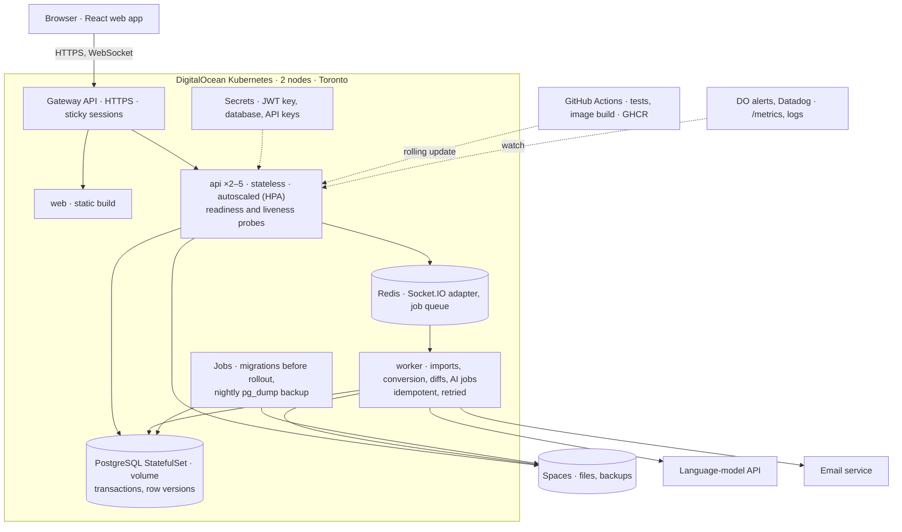

# Architecture

Working draft for the 7 November proposal, section 2 (objectives, architecture and key features). Each decision records the options weighed and the reason for the choice. Items marked **proposed** are confirmed or changed at the team meeting; to change anything here, edit the file on `main` or open an Issue with the alternative and its trade-off.

## Objective

A stateful, cloud-native content review platform. A user uploads a document, PDF or image, shares it with named collaborators or by a scoped link, and the collaborators comment and annotate on it, with updates appearing live for everyone viewing the same version. Every required course technology is used by a real part of the system.

## System diagram

## Decisions

### D11. Traffic entry: Gateway API, not ingress-nginx (proposed)

ingress-nginx was retired in March 2026 and gets no security fixes, so we do not use it. The Gateway API is its supported replacement: a Gateway terminates TLS (cert-manager, Let's Encrypt) and HTTPRoutes send `/api` and `/socket.io` to the API and everything else to `web`. Cost: new objects to learn. Fallback: a DigitalOcean load balancer with its own certificate, which is simpler but needs a second load balancer or a proxy for path routing. Details in [RESEARCH.md](RESEARCH.md).

### D12. Socket.IO across replicas (decided 24 October, #17)

Sticky sessions at the Gateway keep each client on one API pod, so Socket.IO keeps its HTTP long-polling fallback when a WebSocket connection fails; the Redis adapter carries broadcasts between pods. WebSocket-only transport is the fallback if the Gateway controller cannot provide session affinity. The Gateway's idle timeout is set above Socket.IO's 45 seconds.

### D0. Service model

Lecture 1 splits cloud services into IaaS (you manage the OS), PaaS (the provider manages the hosts, you ship containers or code) and FaaS (functions run on events). Assignment 1 was IaaS: a droplet, Nginx, PostgreSQL installed by hand. The project is not that. We use managed Kubernetes, where DigitalOcean runs the control plane and the worker nodes' OS and we run containers (PaaS-style on top of the provider's IaaS), object storage as a service for files, and the provider's metrics and alerts. A DigitalOcean Function is an option for one small event-driven job (a thumbnail when a file lands in Spaces) if we want the serverless advanced feature; it is not in the core path. The point for the proposal: we manage containers and data, not machines.

### D1. Orchestration: DigitalOcean Kubernetes (proposed)

The course accepts Docker Swarm (service replication and routing-mesh load balancing, lecture 6) or Kubernetes (Deployments, Services, PersistentVolumeClaims, minikube locally then a managed cluster).

| | Kubernetes (DOKS) | Docker Swarm |
|---|---|---|
| Replication and load balancing | Deployment replicas behind a Service; a Gateway terminates TLS and routes by path | service replicas behind the routing mesh; TLS needs a separate proxy service |
| Scaling | HorizontalPodAutoscaler scales replicas on CPU or memory; two worker nodes give node-level redundancy | manual `docker service scale`; no autoscaler |
| Rolling updates and recovery | rolling update with readiness probes, `rollout undo`, failed pods replaced by the controller | rolling update per service, `--rollback`, failed tasks replaced by the manager |
| Persistent storage | PersistentVolumeClaim bound to a DigitalOcean block-storage volume; the volume follows the pod if it is rescheduled within the zone | a named volume lives on one node; the service must be pinned to that node |
| Secrets and config | Secret and ConfigMap objects mounted as files or env | Docker secrets mounted as files (lecture 5) |
| Operations cost | manifests for every object, kubectl, a managed control plane; more to learn and more to misconfigure (a wrong storage class loses data) | one Compose file with a `deploy:` section; fewer concepts |
| Cost (third-party pricing pages, confirm on digitalocean.com) | about $46 to $60 a month: $12 per node, $12 load balancer, $10 volume, control plane free | two $6 droplets |

Proposed: **DOKS**. The deciding points are the autoscaler and the volume handling: auto-scaling and high availability is one of our planned advanced features, and on Swarm the database volume ties the service to one node by hand. The cost is the learning curve and more objects to get right, which is why the manifests are tested on minikube first and Swarm remains the fallback: the same Compose file with a `deploy:` section would carry the stack if the cluster is not stable by 15 November.

**Why not Fly.io.** The course allows DigitalOcean or Fly.io. Fly.io gives edge regions and machines without managing hosts (lecture 6, Assignment 3), but its Kubernetes service is a paid beta the course does not recommend, and one system across two providers is two sets of operations for no gain. Assignment 3 covers Fly.io; the project stays on one provider.

### D2. Persistence: PostgreSQL on a DigitalOcean Volume, files in Spaces

A managed database alone does not count as persistent storage in this course, so PostgreSQL runs in the cluster as a StatefulSet with a PersistentVolumeClaim backed by DigitalOcean block storage. Uploaded files do not go on that volume: with several API replicas, a file written to one pod's disk is invisible to the others. Spaces is S3-compatible object storage reachable from every replica; the API streams the upload to Spaces and keeps the metadata row (owner, version, size, checksum, object key) in PostgreSQL. The restart test for the presentation: delete the postgres pod, the PVC re-attaches, the data is still there.

Schema, first cut: `users`, `documents`, `document_versions` (one row per upload, object key in Spaces), `shares` (document, user or link token, role, expiry), `comments` (document version, anchor, author, body, parent for threads), `tags`, `document_tags`. Roles are Owner, Editor, Commenter and Viewer (28 October, proposal section 2), enforced by one middleware that loads the share row for the current user and document before any handler runs.

### D3. What "collaboration" means here

Content is the uploaded file (manual upload, or a bulk import from a bucket the team already has: D9). PDFs and images render in the browser; other types (docx, spreadsheets) are stored, versioned and downloadable but not rendered. Collaboration is review: threaded comments, annotation pins anchored to a page and position, @-mentions, and a new version uploaded when the content changes, with the version history and revert.

Live co-editing of document text, or a track-changes mode, is a different product. It needs a CRDT or operational-transform engine (Yjs is the usual library) and an editor, and track changes is harder still because every change becomes a reviewable object. A collaborator in another time zone is served by versions, comment threads and notifications. If the team wants live text editing later, it is one more feature on top of this architecture, not a change to it; it is not promised.

### D4. Real-time: Socket.IO with a Redis adapter

New comments, replies, annotation pins and mentions appear for everyone viewing the same document version without a refresh. With replicated API pods, an event received by pod A must reach a user connected to pod B; the Socket.IO Redis adapter does that through Redis pub/sub, which is why Redis is in the stack. See D12 for routing across replicas.

### D5. Advanced features: two promised, four planned

The proposal commits to two features that are deterministic to build and to demo:

1. **Security**: email and password sign-in with bcrypt-hashed passwords, JWT sessions, role checks per route, share links with a token and an expiry, HTTPS from cert-manager and Let's Encrypt at the Gateway on `contentcollab.app` (registered 17 October through the GitHub Student Developer Pack, name.com, first year free), credentials in Kubernetes Secrets (the Docker secrets pattern from lecture 5), never in the image or the repo.
2. **CI/CD**: GitHub Actions. On every pull request: lint, typecheck, Jest and Supertest against a PostgreSQL service container. On merge to `main`: build the image, push to the GitHub Container Registry, `kubectl set image` and wait for the rollout. The pipeline is what makes the deployment reproducible for the grader.

Planned beyond that, in order, and presented as completed only if they are:

3. **Real-time** (D4).
4. **Auto-scaling and high availability**: HorizontalPodAutoscaler on CPU, two worker nodes, readiness and liveness probes, a PodDisruptionBudget, a rolling update shown live.
5. **Backup and recovery**: a Kubernetes CronJob runs `pg_dump` nightly to Spaces; a restore is rehearsed once and documented.
6. **External services**: email on share and on @-mention through a transactional email API.

### D6. Monitoring

DigitalOcean droplet and cluster metrics with alert policies (CPU, memory, disk at 80%) are mandatory and free. The API exposes `/metrics` with `prom-client` (request count, latency histogram, error rate, upload bytes, connected sockets); Prometheus and Grafana run in the cluster from the community Helm chart if time allows. The presentation shows one alert firing and one dashboard.

### D7. Local development

One `compose.yaml` runs api, web, worker, postgres and redis locally with healthchecks and `depends_on`, as in Assignment 2. Kubernetes manifests live in `k8s/` and are tested on minikube before DOKS. `.env.example` lists every variable; `.env` is ignored.

### D8. Frontend (proposed: yes, small)

The course does not require a frontend and grades the cloud work, not the interface. We build one anyway because the demo is a user opening a document, leaving a comment and a second browser seeing it appear, and that is hard to show with curl. It stays small: sign-in, document list, upload, document view with comments and pins, share dialog. A React build served as static files by its own `web` container behind the same Gateway, so it scales and deploys like everything else and the API stays a pure JSON service. No server-side rendering, no design system work.

### D9. How content gets in

Two paths, one pipeline.

**Manual upload** is the core: the browser sends the file to the API, the API streams it straight to Spaces (never buffering the whole file in memory), then writes the version row. Size and type limits are enforced before a byte is stored.

**Bulk import** is the answer to "a team already has its documents somewhere": an Owner points ContentCollab at an existing S3-compatible bucket, or at a folder the API can reach, and a `worker` service copies the files in as versions under a chosen collection. The import runs as a background job on a Redis-backed queue (BullMQ), in its own container, so a thousand files cannot stall the API. Each file is identified by a checksum, so running the same import twice adds nothing. Connectors to Google Drive or SharePoint follow the same job shape and are not promised.

This split is what keeps the system standing: the request path does small, bounded work; everything slow or unbounded goes to the worker. The worker has the same database and Spaces access as the API and nothing else.

### D10. What keeps it from falling over

The practices in `docs/PRACTICES.md` that shape the design:

- Every list endpoint paginates with a maximum page size; every input is validated in middleware before a handler sees it; errors have one shape.
- Request bodies and uploads are capped; uploads stream; a rate limit per user applies to writes.
- The API handles `SIGTERM`: it stops accepting connections, finishes in-flight requests and closes the pool, so rolling updates and autoscaling drop nothing.
- Readiness is separate from liveness: a pod gets traffic only once Postgres and Redis answer.
- Every container has CPU and memory requests and limits, so a runaway process cannot starve the node.
- Secrets are mounted, never baked into images; the `web` container holds none.
- The load-bearing pieces are the schema, the API contract in `docs/API.md` and the role middleware. They change only with tests in place and the team told.

## Failure handling and reproducibility (28 October)

The API pods hold no state: every request is answered from PostgreSQL, Redis or Spaces, so any pod can be killed or added without losing data.

| Risk | How we handle it |
|---|---|
| Race conditions (two users save, resolve or restore at once) | Each document row carries a version number; a write that read an older number is rejected with 409 and the client reloads. Unique constraints and transactions keep partial writes out of the database. |
| Duplicate work after a retry | Uploads and worker jobs carry an idempotency key, so a retried request or a job run twice changes nothing. |
| Network partition or a dependency down | Every call has a timeout and retries with backoff. If Redis is unreachable, the API keeps serving and live updates fall back to polling; if PostgreSQL is unreachable, the readiness probe fails and the Gateway stops routing to that pod. On reconnect, clients fetch events newer than the last sequence number they saw. |
| Memory exhaustion | Uploads stream to Spaces and are never held in memory; every container has CPU and memory requests and limits, with Node's heap capped below its container limit. |
| Errors reaching users | One error middleware returns a single JSON shape with a request ID; logs are structured and carry the same ID into Socket.IO events and worker jobs. On shutdown the API finishes in-flight requests before exiting. |
| Silent failure | Alerts by email when the 5xx rate exceeds 2% for five minutes, p95 latency exceeds one second, a pod restarts three times in ten minutes, the job queue keeps growing, disk passes 80%, or the nightly backup fails. |
| A build that runs differently in the cluster | Base images pinned by digest, `npm ci` from the lockfile, multi-stage builds running as a non-root user, and the image tested in CI is the one deployed. Database migrations run as a Kubernetes Job before each rollout. |

## Scope and feasibility

In: upload, versions, revert, share by user or link, roles, comments, annotations, tags, search by tag or title, JSON or CSV export of metadata, live updates. Out: rich-text editing, track changes, formatting, mobile. The 10 October notes listed a Google Docs style editor; this is where the thinking changed, and proposal section 4 says so.

## Open questions for the team

- Confirm D1 (Kubernetes) and D3 (review, not editing).
- DigitalOcean billing: nobody has credit left from Assignment 1; one account hosts the cluster and the cost is split. The GitHub Student Developer Pack no longer includes DigitalOcean credit: the offer ended 31 July 2026 and redeemed credit expired 1 August 2026 ([Capital & Compute, checked 16 September 2026](https://capitalandcompute.net/blog/github-student-developer-pack-2026/)), so the budget in [RESEARCH.md](RESEARCH.md) assumes paid usage from the start.
- PDF annotation in the browser: pdf.js with our own overlay, or pins anchored to page number and coordinates only.
