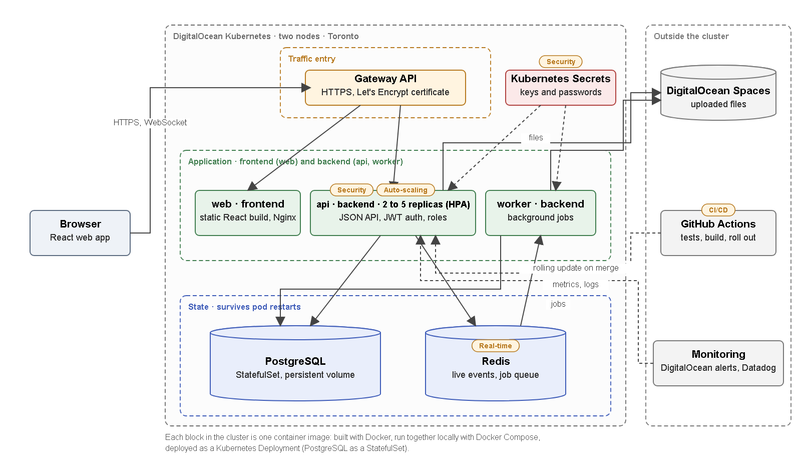

# ContentCollab: project proposal

ECE1779 Introduction to Cloud Computing, Fall 2026.

Team: Nabeegh Khan (1001388152), Milton Wang (1009114192), Jyotiraditya Kale (1013397370), Yiqing (Eyrika) Liu (1008052580).

## 1. Motivation

**Sharing a PDF is easy. Sharing the thinking behind it shouldn’t be hard.** Imagine a lab team reviewing the same research paper: one member highlights a passage on their own copy, another asks a question in a group chat, and a third emails an annotated version. The document is shared, but the conversation is fragmented. Our platform brings annotations and discussion into one shared space, keeping feedback connected to the passages it refers to.

We therefore aim to build a stateful, cloud-native content review platform. A user uploads a PDF, image or other document and shares it with named collaborators or by a scoped link. Collaborators comment and annotate, and updates appear live for everyone viewing the same version. Our target users are remote professionals, lab and industry teams, and clients and contractors reviewing legal terms or architectural designs; study groups and courses fit the same workflow. Because reviewers work from different places and at different times, the service must stay available, and live updates must survive pod restarts and new releases.

Live co-editing needs complex concurrency control, so we focus on review. Office suites (e.g. Google Workspace) convert a PDF into an editable document and lose its layout, while branch-based platforms (e.g. GitHub) review text line by line, not positions on a page. The closest tools are Acrobat's shared review, where several people comment on a PDF at the same time and see feedback as it happens [15], and Hypothesis, social annotation of web pages and PDFs built for higher education [16]. Both are services run by their vendors. ContentCollab runs the same review loop as a deployment our team controls and observes on managed cloud infrastructure, with versioned files, role-scoped sharing and comments pinned to a page position.

## 2. Objectives, architecture and key features

### 2.1 Objectives

ContentCollab lets people share files and discuss them in place, so files, versions and comments stay together, not scattered across email and chat.

Users upload a document and share it as Owner, Editor, Commenter or Viewer, as in Google Drive [11], or by a link with an expiry. Everyone viewing a version sees new comments and pins (notes on a page position) without refreshing.

The cloud objective is resilience: an API pod can crash, the database can move to another node, or a release can roll out, and no user loses a comment.

### 2.2 Architecture

*Figure 1. Components and their connections. Solid lines carry application traffic; dashed lines are configuration, deployment and monitoring.*

A small React web app calls a JSON API through one Gateway, which terminates HTTPS for `contentcollab.app`. Files live in DigitalOcean Spaces, object storage every replica reaches; users, documents, shares, versions and comments live in PostgreSQL on block storage [7].

### 2.3 Key design decisions

| Decision | Reason | Trade-off |
|---|---|---|
| Slow work runs in a worker on a Redis queue | A large file cannot exhaust API memory or block users | One more service |
| Socket.IO with sticky sessions and the Redis adapter | Without affinity the long-polling fallback breaks across replicas; the adapter relays events between pods [3] | Needs affinity at the Gateway; WebSocket-only is the fallback |
| Gateway API, not ingress-nginx | ingress-nginx was retired in March 2026 [1] | New objects to configure |
| One PostgreSQL instance on a volume; files in Spaces | A volume attaches to one node; a file on one pod's disk is invisible to the others [4], [5], [7] | No database failover |
| Two small nodes | About US$54 a month shared by four: two US$18 nodes, a US$12 load balancer and US$5 for Spaces [2], [13], [14] | Little headroom |

### 2.4 Failure handling

API pods hold no state, so any pod can be killed or added without losing data. Each service has its own container, health check and rollout, so a failure degrades one capability: without Redis, comments still save and clients poll; without the worker, uploads still succeed; without PostgreSQL, the readiness probe fails and the Service stops routing to that pod [8].

| Risk | How we handle it |
|---|---|
| Race conditions | Optimistic locking rejects a stale write with 409; transactions and unique constraints prevent partial or duplicate rows |
| Retries | Idempotency keys on uploads and jobs; timeouts and backoff on every call; reconnecting clients fetch events after their last sequence number |
| Memory | Uploads stream to Spaces; every container has requests and limits |
| Silent failure | Alerts on 5xx rate, latency, pod restarts, queue depth and disk |
| Drift | Pinned base images and lockfile installs; the image tested in CI is the one deployed, after a migration Job |

### 2.5 How the required technologies are used

| Requirement [10] | Our use |
|---|---|
| Docker and Docker Compose | One container per service; one Compose file runs the stack locally with health checks [6] |
| PostgreSQL | Relational data linked by foreign keys and changed inside transactions |
| Persistent storage | A persistent volume backed by a DigitalOcean Volume; the demo deletes the database pod; the data survives |
| Orchestration | DigitalOcean Kubernetes: Deployments, Services, a PostgreSQL StatefulSet and an API HorizontalPodAutoscaler, each kept at its desired state [8]; minikube first, Swarm as the fallback [9] |
| Deployment provider | DigitalOcean, the course's IaaS provider [7]; Fly.io's Kubernetes service is a paid beta the course does not recommend [12] |
| Monitoring | DigitalOcean alerts on CPU, memory and disk; request counts, errors and latency at `/metrics`; Datadog for dashboards and container logs |

### 2.6 Core features

- **Upload and preview.** PDFs and images render in the browser; other types are stored, versioned and downloadable.
- **Sharing and roles.** By email or by a link with an expiry; one middleware checks the role before every action.
- **Comments.** Threads, pins on a page position, @-mentions, live for everyone viewing the version.
- **Versions.** Every upload is a version; any version can be restored.

### 2.7 Advanced features

We commit to four from the handout's list:

1. **Security enhancements** (Eyrika, Nabeegh). bcrypt password hashes, JWT sessions, role checks on every route, expiring share links, HTTPS at the Gateway, credentials in Kubernetes Secrets [6].
2. **CI/CD pipeline** (Nabeegh, running). GitHub Actions checks every pull request; a merge to `main` builds the image, pushes it to the GitHub Container Registry and rolls it out one pod at a time [8].
3. **Real-time functionality** (Jyotiraditya). Socket.IO with the Redis adapter pushes comments and pins to everyone viewing a version.
4. **Auto-scaling and high availability** (Nabeegh). A HorizontalPodAutoscaler, already in the manifests, keeps two to five API replicas on the two nodes; a stepped load test (#69) and a rolling update must drop no requests.

Stretch goals, reported finished only if they are: **backup and recovery** (Milton), a nightly pg_dump to Spaces, and **integration with external services** (Eyrika): email on share and mention.

### 2.8 Scope and feasibility

Live co-editing is out of scope (section 4.1). We deployed before building features, and each feature ships with tests that run in CI. The cluster has run on DigitalOcean since 4 November; owners and schedule are in section 3.

## 3. Project plan and team responsibilities

Each member's scope is visible in their own GitHub commits, Issues and pull requests. Eyrika: the backend API, including authentication and roles, tags, and email notifications. Jyotiraditya: comments, live updates, and the API with Eyrika. Milton: the frontend, backups, and API documentation. Nabeegh: architecture, API skeleton, tests and worker, and the cloud stack (cluster, CI/CD, monitoring, autoscaling).

We first agree on the schema and API contract, then build features against them. The schema, authentication, documents and shares are the critical path and merge first, one pull request at a time; real-time and the frontend build on them. The skeleton stage ran until 1 November and closes with the schema (#37). Core features and the cloud are built in parallel until the 14 November checkpoint, real-time and additional features from 9 to 20 November. Demonstration-path features freeze on 21 November; load tests and two rehearsals follow.

Every pull request runs lint and type checks in CI, and Jest and Supertest tests once #71 merges. Code changes need one review; proposal and report sections are reviewed by all four, with one approval merging; minutes and other documentation go straight to `main`. We coordinate on WhatsApp and during Saturday meetings (3:30 p.m.); technical problems are resolved in Issues and pull requests.

Risks: a stage slipping, pod or volume loss, deployment problems, and the DigitalOcean cost. Features that do not work are left out of the demonstration; members who are ahead take open Issues. A planned pg_dump backup restores data after a volume loss. If the cluster or an external service fails during the presentation, Nabeegh switches the demonstration to the local Docker Compose stack on the presenting laptop, Milton keeps presenting the frontend, and Eyrika and Jyotiraditya continue on the local stack.

## 4. Initial team reasoning and AI-assisted exploration

### 4.1 Initial Team Reasoning

On 10 October we compared ideas including a GitHub clone, an inventory management system and a scientific data repository. We chose content sharing and collaboration because it applies across industries and exercises cloud storage, access control and real-time updates. We first envisioned a Google Docs-style editor on Kubernetes, Swarm as fallback. On 17 October we recognized that live co-editing needs a conflict-resolution engine such as a CRDT, a product of its own, so we narrowed the scope to collaborative document review: PDFs and images rendered for review, other files stored and versioned, and four roles. Our open questions were the hosting cost, whether Kubernetes could run by 15 November, and whether the Gateway controller supports session affinity.

### 4.2 Exploration and Evaluation

We evaluated Kubernetes against Docker Swarm and Fly.io and chose DigitalOcean Kubernetes (section 2.5). The Kubernetes blog's notice that ingress-nginx is retired with no further security fixes [1] moved us to the Gateway API. We added a React frontend, since live comments in two browsers cannot be shown with curl.

On 24 October we asked AI for the simplest way to run Socket.IO with a Redis adapter behind a load balancer with several API pods. It recommended WebSocket-only transport to avoid session affinity, with sticky sessions as the alternative. We did not accept this as given: without the HTTP long-polling fallback, clients on networks that block WebSockets cannot connect. We chose sticky sessions with the Redis adapter and kept WebSocket-only as the fallback. On 4 November we confirmed that NGINX Gateway Fabric 2.8 offers cookie session persistence without NGINX Plus, as an experimental Gateway API field [17]. The final proposal differs from our initial thinking in scope (review, not co-editing) and commits to four advanced features (section 2.7).

## References

[1] Kubernetes, "Ingress NGINX retirement: what you need to know," Kubernetes Blog, Nov. 2025. https://kubernetes.io/blog/2025/11/11/ingress-nginx-retirement/

[2] DigitalOcean, "Kubernetes pricing," checked 6 Nov. 2026. https://www.digitalocean.com/pricing/kubernetes

[3] Socket.IO, "Using multiple nodes," Socket.IO v4 documentation. https://socket.io/docs/v4/using-multiple-nodes

[4] ECE1779 Lecture 3, DigitalOcean Volumes and Snapshots, slides 12–18.

[5] ECE1779 Lecture 4, Docker Volumes, slides 90–94.

[6] ECE1779 Lecture 5, Docker Secrets and Healthchecks, slides 28–51.

[7] ECE1779 Lecture 2, IaaS resources (block and object storage) and why DigitalOcean, slides 23–27 and 42–45.

[8] ECE1779 Lecture 7, Deployment Strategies and Kubernetes core concepts, slides 16, 29–31, 59, 79 and 105.

[9] ECE1779 Lecture 6, managed deployment and Swarm rolling updates, slides 38 and 44–45.

[10] ECE1779 Lecture 1, Project requirements, slide 14.

[11] Google, "Share and manage access to files and folders in Google Drive," checked 6 Nov. 2026. https://support.google.com/drive/answer/7166529

[12] ECE1779 course project handout, "Deployment Provider" and "Note on Orchestration on Fly.io," Fall 2026. https://www.eecg.utoronto.ca/~cying/courses/ece1779-cloud/project/handout/

[13] DigitalOcean, "Droplet pricing," checked 6 Nov. 2026. https://www.digitalocean.com/pricing/droplets

[14] DigitalOcean, "Spaces object storage pricing," checked 6 Nov. 2026. https://www.digitalocean.com/pricing/spaces-object-storage

[15] Adobe, "Share PDF files for review," Adobe Acrobat, checked 6 Nov. 2026. https://www.adobe.com/acrobat/features/share-and-review-pdfs.html

[16] Hypothesis, "The #1 Social Annotation Tool for Higher Education," checked 6 Nov. 2026. https://web.hypothes.is/

[17] NGINX, "NGINX Gateway Fabric 2.8: IP allow and deny lists, passive health checks, and cookie-based session persistence," checked 6 Nov. 2026. https://blog.nginx.org/blog/nginx-gateway-fabric-2-8-ip-allow-and-deny-lists-passive-health-checks-and-cookie-based-session-persistence
