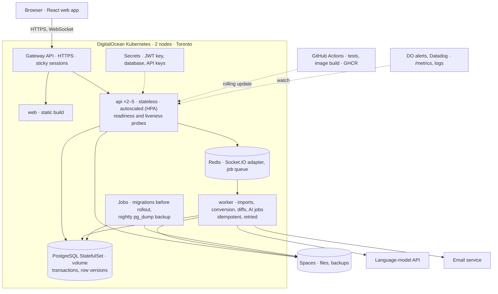

# ContentCollab: project proposal

ECE1779 Introduction to Cloud Computing, Fall 2026.

Team: Nabeegh Khan (1001388152), Milton Wang (1009114192), Jyotiraditya Kale (1013397370), Yiqing Liu (1008052580).

## 1. Motivation

Owner: Yiqing Liu. Problem, intended users, why it is worth addressing, limitations of existing approaches.

## 2. Objectives, architecture and key features

### 2.1 Objectives

ContentCollab is a workspace where people share files and discuss them in place: documents, slide decks, drawings, reports, images or code. Files, versions, comments and decisions stay together, so feedback does not scatter across email, chat and file copies.

Anyone can sign up with any email address: a student group, an open-source team across time zones, or a company. A user creates a workspace and invites people by email as Owner, Editor, Commenter or Viewer, the roles Google Drive and Figma use. An organization can optionally verify its email domain so new staff join automatically. People without an account can be sent a link that expires.

Everyone viewing a version sees new comments and pins (notes attached to a spot on the page) without refreshing. Each upload becomes a version, changes from the previous one are highlighted, and any version can be restored.

The cloud objective is resilience: an API pod can crash, the database can move to another node, or a release can roll out, and no user loses a comment.

### 2.2 Architecture

A React web app calls a JSON API through the same Gateway. We build the web app because live comments across two browsers, version comparison and roles can only be demonstrated through an interface. Its status page also shows API replica count, queue depth and request latency during the autoscaling demonstration.

Files are stored in DigitalOcean Spaces, which every API replica can reach; users, workspaces, versions and comments are stored in PostgreSQL. Traffic enters through the Kubernetes Gateway API, which terminates HTTPS for `contentcollab.app`.

### 2.3 Key design decisions

| Decision | Reason | Trade-off and mitigation |
|---|---|---|
| Slow work (imports, conversion, comparison, AI) runs in a worker on a Redis queue | A large file cannot exhaust the API's memory or block other users | One more service; same base image and health checks as the API |
| Socket.IO with sticky sessions and the Redis adapter | Without affinity, the long-polling fallback breaks across replicas; the adapter relays events between pods [3] | Needs affinity at the Gateway; WebSocket-only is the fallback |
| Gateway API, not ingress-nginx | ingress-nginx was retired in March 2026 [1] | New objects to configure |
| One PostgreSQL instance on a volume; files in Spaces | A volume attaches to one node; a file on one pod's disk is invisible to the others [4], [5] | No database failover; backups and a rehearsed restore |
| Two small nodes | About US$46 a month shared by four [2] | Little headroom; load tests run before the demo |

### 2.4 Failure handling and reproducibility

API pods hold no state, so any pod can be killed or added without losing data.

| Risk | How we handle it |
|---|---|
| Race conditions | Optimistic locking: a write based on an older row version is rejected with 409. Transactions and unique constraints prevent partial or duplicate rows. |
| Retries | Uploads and jobs carry an idempotency key, so repeating one changes nothing. |
| Partitions and outages | Timeouts and retries with backoff on every call. Without Redis, live updates fall back to polling; without PostgreSQL, the readiness probe fails and traffic moves away. Reconnecting clients fetch events after their last sequence number. |
| Memory | Uploads stream to Spaces; every container has requests and limits, with Node's heap capped below its limit. |
| Errors | One error shape with a request ID, carried through logs, socket events and jobs; in-flight requests finish before a pod stops. |
| Silent failure | Email alerts on 5xx rate above 2% for five minutes, p95 latency above one second, repeated pod restarts, a growing queue, disk above 80% or a failed backup. |
| Drift between environments | Pinned base images, `npm ci` from the lockfile, non-root multi-stage builds; the image tested in CI is the one deployed, after a migration Job. |

### 2.5 How the required technologies are used

| Requirement | Our use |
|---|---|
| Docker and Docker Compose | One container per service; one Compose file runs the stack locally with health checks (API, PostgreSQL and Redis since 25 October; web and worker as they are built) [6]. |
| PostgreSQL | Users, workspaces, roles, versions, comments and review decisions, linked by foreign keys and changed inside transactions. |
| Persistent storage | A persistent volume backed by a DigitalOcean Volume; the demonstration deletes the database pod and shows the data survives. |
| Orchestration | DigitalOcean Kubernetes: Deployments and Services, a StatefulSet for PostgreSQL, a HorizontalPodAutoscaler for the API. Manifests are tested on minikube first; Swarm is the fallback if the cluster is unstable on 14 November. |
| Deployment provider | DigitalOcean. Fly.io offers Kubernetes only as a paid beta. |
| Monitoring | DigitalOcean alerts on CPU, memory and disk; request counts, errors and latency at `/metrics`; Datadog (GitHub Student Developer Pack) for dashboards and container logs. |

### 2.6 Core features

- **Upload and preview.** PDFs and images render in the browser; Office files are converted to PDF by the worker; text and code render with line numbers.
- **Workspaces and roles.** Invitations by email; Owner, Editor, Commenter and Viewer permissions are checked by one middleware before every action.
- **Comments.** Threaded comments, pins on a page position or a line of text, and @-mentions.
- **Versions.** Restore any version; a comparison view highlights changes page by page for PDFs and line by line for text.
- **Review decisions.** When a version needs sign-off, each reviewer marks it Approved or Changes requested.
- **Bulk import.** Background import from an S3-compatible bucket, skipping files already imported.

### 2.7 Advanced features

We commit to two advanced features we can build and demonstrate reliably:

1. **Security and access control.** Passwords stored as bcrypt hashes, JWT sessions, role checks on every route, expiring share links, HTTPS at the Gateway, and credentials in Kubernetes Secrets rather than in images or the repository [6].
2. **CI/CD.** GitHub Actions has checked linting, formatting and types on every pull request since 28 October. Unit tests and API integration tests against a PostgreSQL service container join the pipeline as each feature is written; a merge to `main` will build the images, push them to the GitHub Container Registry and roll them out.

Planned in priority order, and reported as finished only if they are:

- **Real-time updates**, as designed in 2.3.
- **Autoscaling and high availability.** More API replicas under load, readiness probes, and a rolling update with no dropped requests, shown on the status page.
- **Backup and recovery.** A nightly `pg_dump` to Spaces and one rehearsed restore.
- **External services.** Email on invitations and @-mentions, and two AI features run by the worker through a language-model API: a summary of a document, a long comment thread or the changes between two versions, and suggested tags on upload. Model replies are validated against a schema before they are saved.

### 2.8 Scope and feasibility

Live co-editing of text is out of scope: it needs a conflict-resolution engine (operational transformation or a CRDT) and an editor, a separate product. CAD formats need dedicated viewers, so drawings are reviewed as PDF exports.

We deploy before we build features, so deployment problems surface while there is time to fix them. Each feature ships with unit and integration tests, so a change that breaks another member's part fails in CI before review, and the deployed system is piloted by the team every week from 14 November rather than first exercised at the demo. The cluster runs by 14 November and new features stop on 21 November, which leaves the days before the 25 November presentation for load tests and two rehearsals. Each part has a named owner (section 3).

## 3. Project plan and team responsibilities

Owner: Milton Wang. From `PLAN.md`: stages, division of work, integration strategy, dependencies and coordination, risks.

## 4. Initial team reasoning and AI-assisted exploration

Owner: Jyotiraditya Kale. Initial understanding (10 October notes), technical hypotheses, open questions, how the thinking changed, one AI interaction with its evaluation, how the final proposal differs from the initial thinking.

## References

[1] Kubernetes, "Ingress NGINX retirement: what you need to know," Kubernetes Blog, Nov. 2025. https://kubernetes.io/blog/2025/11/11/ingress-nginx-retirement/

[2] DigitalOcean, "Kubernetes pricing." https://www.digitalocean.com/pricing/kubernetes

[3] Socket.IO, "Using multiple nodes," Socket.IO v4 documentation. https://socket.io/docs/v4/using-multiple-nodes

[4] ECE1779 lecture slides, Lecture 3: DigitalOcean Volumes and Snapshots, slides 12–18, Fall 2026.

[5] ECE1779 lecture slides, Lecture 4: Docker Volumes, slides 90–94, Fall 2026.

[6] ECE1779 lecture slides, Lecture 5: Docker Secrets and Healthchecks, slides 28–51, Fall 2026.
