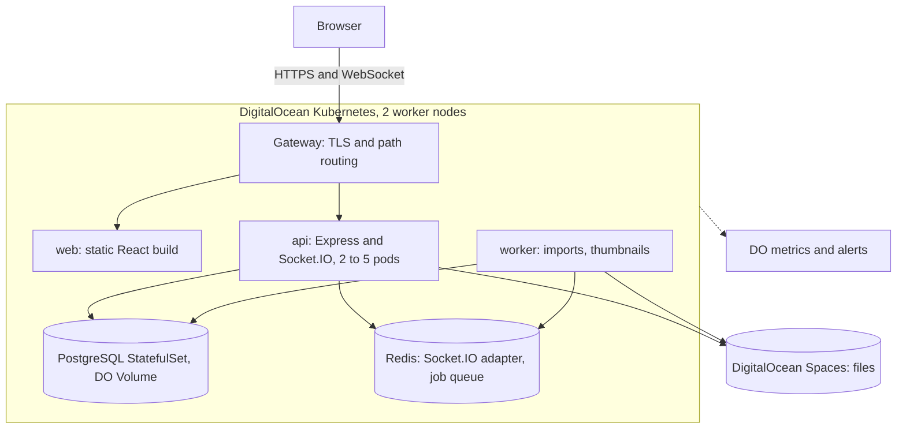

# ContentCollab: project proposal

ECE1779 Introduction to Cloud Computing, Fall 2026. Due Saturday 7 November 2026, 11:59pm. One Markdown file, at most 2,000 words. Drafted in the shared Google Doc; each section's owner moves the settled text here.

Team: Nabeegh Khan (1001388152), Milton Wang (1009114192), Jyotiraditya Kale (1013397370), Eyrika Liu (1008052580).

## 1. Motivation

Owner: Eyrika. Problem, intended users, why it is worth addressing, limitations of existing approaches.

## 2. Objectives, architecture and key features

Owner: Nabeegh. Draft 1, 23 October, for the 24 October meeting. About 900 words of the 2,000; each choice is argued in full in [ARCHITECTURE.md](ARCHITECTURE.md).

### Objective

ContentCollab lets a small team review documents together. A user uploads a PDF, image or document, shares it with named collaborators or through a link that expires, and everyone viewing the same version sees comments, replies and annotation pins appear without refreshing. A new upload becomes a new version, and any version can be restored.

The cloud objective is that the system keeps working while parts of it fail or change: an API pod can die mid-request, the database pod can be rescheduled, a new release can roll out, and no user loses a comment. Every required course technology does a real job in that.

### Architecture

The API stays a JSON service and does only small, bounded work per request. Anything slow, such as a bulk import or a thumbnail, goes to the worker through a Redis queue, so one large job cannot stall everyone else's requests.

### How each required technology is used

| Requirement | Our use | Why this and not the alternative |
|---|---|---|
| Docker and Compose | One image per service; `compose.yaml` runs api, web, worker, postgres and redis locally with healthchecks, as in Assignment 2 | The same images run locally, in CI and in the cluster |
| PostgreSQL | Users, documents, versions, shares with roles, comments and tags | Shares, roles and threaded comments are relational and need transactions |
| Persistent storage | PostgreSQL as a StatefulSet on a PersistentVolumeClaim backed by a DigitalOcean Volume; uploaded files in Spaces | A file on one pod's disk is invisible to the other replicas; Spaces is reachable from all of them |
| Orchestration | DigitalOcean Kubernetes: Deployments, Services, a StatefulSet, a HorizontalPodAutoscaler | We chose Kubernetes over Swarm for the autoscaler and because a Swarm volume pins the database to one node by hand. The cost is more objects to learn, so manifests are tested on minikube first and Swarm stays the fallback if the cluster is not stable by 15 November |
| Provider | DigitalOcean only | Fly.io's Kubernetes is a paid beta; two providers would mean two sets of operations |
| Monitoring | DigitalOcean metrics with alerts on CPU, memory and disk; the API exposes `/metrics` | The demo shows an alert firing and the request-latency graph |

Traffic enters through the Kubernetes Gateway API rather than ingress-nginx, which was retired in March 2026 and no longer gets security fixes. The Gateway terminates TLS with cert-manager and routes `/api` and `/socket.io` to the API, everything else to `web`.

### Key features

Core: upload with type and size limits, streamed straight to Spaces; versions and restore; sharing by user or expiring link with three roles (Owner, Collaborator, Viewer), enforced by one middleware before any handler runs; threaded comments, annotation pins on a page and position, @-mentions; tags and search by title or tag.

### Advanced features

We commit to two, chosen because we can build and demo them reliably:

1. **Security and access control**: bcrypt-hashed passwords, JWT sessions, role checks on every route, share links with an expiry, HTTPS at the Gateway on our own domain, and credentials in Kubernetes Secrets, never in an image or the repository.
2. **CI/CD**: GitHub Actions runs lint, typecheck and tests against a PostgreSQL service container on every pull request. A merge to `main` builds the images, pushes them to the GitHub Container Registry and rolls the cluster forward.

Planned, in order, and presented as done only if they are: real-time updates through Socket.IO with the Redis adapter so a comment posted to one API pod reaches viewers connected to another; autoscaling and high availability (the autoscaler on CPU, two nodes, readiness probes, a rolling update shown live); nightly `pg_dump` backups to Spaces with one rehearsed restore; email on share and mention.

### Scope and feasibility

In scope: everything under core features plus the two committed advanced features. Out of scope: live co-editing of document text and track changes. Both need an operational-transform or CRDT engine and an editor, which is a different product; review with versions and comment threads serves a team across time zones without it.

The plan is feasible for four people in six weeks because the risky parts come first. The Compose stack and the API contract land before feature work; the cluster is up by 15 November with Swarm as the fallback; feature work stops on 22 November so the last days go to testing and the demo rehearsal. Each slice has an owner (section 3), and the schema, the API contract and the role middleware change only with tests in place.

## 3. Project plan and team responsibilities

Owner: Milton. From `PLAN.md`: stages, division of work, integration strategy, dependencies and coordination, risks.

## 4. Initial team reasoning and AI-assisted exploration

Owner: Jyotiraditya. Initial understanding (10 October notes), technical hypotheses, open questions, how the thinking changed, one AI interaction with its evaluation, how the final proposal differs from the initial thinking.
